01.00-polyIC-qPCR-analysis
================
Sam White
2026-02-02

- [1 Load Data](#1-load-data)
- [2 Functions](#2-functions)
  - [2.1 Calculate delta Cq](#21-calculate-delta-cq)
- [3 Data Cleaning](#3-data-cleaning)
  - [3.1 Remove NTC samples](#31-remove-ntc-samples)
  - [3.2 Check for high standard
    deviations](#32-check-for-high-standard-deviations)
  - [3.3 Remove outlier technical
    replicates](#33-remove-outlier-technical-replicates)
    - [3.3.1 Samples excluded due to quality
      control](#331-samples-excluded-due-to-quality-control)
  - [3.4 Group and Summarize Data](#34-group-and-summarize-data)
  - [3.5 Parse Sample Names and Add Treatment
    Columns](#35-parse-sample-names-and-add-treatment-columns)
    - [3.5.1 View treatment groups](#351-view-treatment-groups)
- [4 Raw Cq Variation Assessment for Normalizing Gene
  Selection](#4-raw-cq-variation-assessment-for-normalizing-gene-selection)
  - [4.1 Data completeness by gene](#41-data-completeness-by-gene)
  - [4.2 Raw Cq summary statistics (all
    genes)](#42-raw-cq-summary-statistics-all-genes)
  - [4.3 Box plots and statistical comparisons: raw Cq by treatment
    group (all
    genes)](#43-box-plots-and-statistical-comparisons-raw-cq-by-treatment-group-all-genes)
  - [4.4 Normalizing gene candidate
    ranking](#44-normalizing-gene-candidate-ranking)
  - [4.5 Conclusion](#45-conclusion)
- [5 Calculate Delta Cq](#5-calculate-delta-cq)
  - [5.1 Missing samples analysis](#51-missing-samples-analysis)
  - [5.2 Normalizing Gene Impact
    Analysis](#52-normalizing-gene-impact-analysis)
- [6 Statistical Comparisons](#6-statistical-comparisons)
  - [6.1 T-tests for treatment
    comparisons](#61-t-tests-for-treatment-comparisons)
    - [6.1.1 Comparison 1: Basic Control vs Stressors (No
      PolyIC)](#611-comparison-1-basic-control-vs-stressors-no-polyic)
    - [6.1.2 Comparison 2: Basic Control vs PolyIC
      Control](#612-comparison-2-basic-control-vs-polyic-control)
    - [6.1.3 Comparison 3: PolyIC Control vs PolyIC
      Stressors](#613-comparison-3-polyic-control-vs-polyic-stressors)
  - [6.2 Create ANOVA Models](#62-create-anova-models)
    - [6.2.1 All treatments comparison](#621-all-treatments-comparison)
  - [6.3 ANOVA Results and
    Diagnostics](#63-anova-results-and-diagnostics)
    - [6.3.1 Data distribution check](#631-data-distribution-check)
    - [6.3.2 ATP Synthase](#632-atp-synthase)
    - [6.3.3 Citrate Synthase](#633-citrate-synthase)
    - [6.3.4 DNMT1](#634-dnmt1)
    - [6.3.5 HSP70](#635-hsp70)
    - [6.3.6 GAPDH](#636-gapdh)
    - [6.3.7 cGAS](#637-cgas)
    - [6.3.8 VIPERIN](#638-viperin)
    - [6.3.9 Summary Plots](#639-summary-plots)
- [7 Delta Delta Cq and Fold Change
  Analysis](#7-delta-delta-cq-and-fold-change-analysis)
  - [7.1 Calculate delta delta Cq for each
    comparison](#71-calculate-delta-delta-cq-for-each-comparison)
    - [7.1.1 Comparison 1: Stressors vs Control (No
      PolyIC)](#711-comparison-1-stressors-vs-control-no-polyic)
    - [7.1.2 Comparison 2: PolyIC Control vs Basic
      Control](#712-comparison-2-polyic-control-vs-basic-control)
    - [7.1.3 Comparison 3: PolyIC Stressors vs PolyIC
      Control](#713-comparison-3-polyic-stressors-vs-polyic-control)
  - [7.2 Fold Change Bar Plots](#72-fold-change-bar-plots)
    - [7.2.1 No PolyIC: Stressors vs
      Control](#721-no-polyic-stressors-vs-control)
    - [7.2.2 PolyIC Control vs Basic
      Control](#722-polyic-control-vs-basic-control)
    - [7.2.3 PolyIC: Stressors vs
      Control](#723-polyic-stressors-vs-control)
- [8 Temperature-Only Analysis: PolyIC vs No_PolyIC (Mechanical
  Excluded)](#8-temperature-only-analysis-polyic-vs-no_polyic-mechanical-excluded)
  - [8.1 Data Subset and Sample Sizes](#81-data-subset-and-sample-sizes)
  - [8.2 Per-gene Two-way ANOVAs (PolyIC × Stress
    Type)](#82-per-gene-two-way-anovas-polyic--stress-type)
    - [8.2.1 ATP Synthase](#821-atp-synthase)
    - [8.2.2 Citrate Synthase](#822-citrate-synthase)
    - [8.2.3 DNMT1](#823-dnmt1)
    - [8.2.4 HSP70](#824-hsp70)
    - [8.2.5 GAPDH](#825-gapdh)
    - [8.2.6 VIPERIN](#826-viperin)
    - [8.2.7 cGAS](#827-cgas)
  - [8.3 Robustness of Two-way ANOVA
    Results](#83-robustness-of-two-way-anova-results)
    - [8.3.1 Assumption Checks and Test
      Results](#831-assumption-checks-and-test-results)
    - [8.3.2 P-value Comparison Across
      Methods](#832-p-value-comparison-across-methods)
    - [8.3.3 Interpretation](#833-interpretation)
  - [8.4 Fold Change Figures: PolyIC vs No_PolyIC at Control and High
    Temperature](#84-fold-change-figures-polyic-vs-no_polyic-at-control-and-high-temperature)
    - [8.4.1 Delta-Delta Cq: Individual
      Replicates](#841-delta-delta-cq-individual-replicates)
    - [8.4.2 Fold Change: Individual Replicates (log2
      scale)](#842-fold-change-individual-replicates-log2-scale)
    - [8.4.3 Fold Change Summary Table](#843-fold-change-summary-table)
  - [8.5 Effect Sizes (Cohen’s d)](#85-effect-sizes-cohens-d)

``` r
# Output directory for files this document explicitly writes (e.g. fc_genes.png via
# ggsave). Knitted output (.md and its figures) uses rmarkdown's default location:
# next to this Rmd, with figures in 01.00-polyIC-qPCR-analysis_files/.
output_dir <- "output/qPCR/01.00-polyIC-qPCR-analysis"
dir.create(file.path(output_dir, "figures"), recursive = TRUE, showWarnings = FALSE)

knitr::opts_chunk$set(
  echo = TRUE,         # Display code chunks
  eval = TRUE,        # Evaluate code chunks
  warning = FALSE,     # Hide warnings
  message = FALSE,     # Hide messages
  comment = ""         # Prevents appending '##' to beginning of lines in code output
)

library(tidyverse)
```

    ## ── Attaching core tidyverse packages ──────────────────────── tidyverse 2.0.0 ──
    ## ✔ dplyr     1.2.1     ✔ readr     2.2.0
    ## ✔ forcats   1.0.1     ✔ stringr   1.6.0
    ## ✔ ggplot2   4.0.3     ✔ tibble    3.3.1
    ## ✔ lubridate 1.9.5     ✔ tidyr     1.3.2
    ## ✔ purrr     1.2.2     
    ## ── Conflicts ────────────────────────────────────────── tidyverse_conflicts() ──
    ## ✖ dplyr::filter() masks stats::filter()
    ## ✖ dplyr::lag()    masks stats::lag()
    ## ℹ Use the conflicted package (<http://conflicted.r-lib.org/>) to force all conflicts to become errors

``` r
library(ggplot2)
library(car)
```

    ## Loading required package: carData
    ## 
    ## Attaching package: 'car'
    ## 
    ## The following object is masked from 'package:dplyr':
    ## 
    ##     recode
    ## 
    ## The following object is masked from 'package:purrr':
    ## 
    ##     some

``` r
library(emmeans)
```

    ## Welcome to emmeans.
    ## Caution: You lose important information if you filter this package's results.
    ## See '? untidy'

``` r
library(multcomp)
```

    ## Loading required package: mvtnorm
    ## Loading required package: survival
    ## Loading required package: TH.data
    ## Loading required package: MASS
    ## 
    ## Attaching package: 'MASS'
    ## 
    ## The following object is masked from 'package:dplyr':
    ## 
    ##     select
    ## 
    ## 
    ## Attaching package: 'TH.data'
    ## 
    ## The following object is masked from 'package:MASS':
    ## 
    ##     geyser

# 1 Load Data

``` r
# Load qPCR data

# Define file URLs and target names in a structured format
file_list <- list(
  # CITRATE SYNTHASE
  list(url = "https://raw.githubusercontent.com/RobertsLab/polyIC-larvae/refs/heads/main/data/qPCR/Cq/sam_2026-01-27_15-32-08_Connect-citrate_synthase-01--Quantification-Cq_Results.csv", 
       target = "Citrate.Synthase", gene = "citrate_synthase"),
  list(url = "https://raw.githubusercontent.com/RobertsLab/polyIC-larvae/refs/heads/main/data/qPCR/Cq/sam_2026-01-27_15-30-47_CFX96-citrate_synthase-02-Quantification-Cq_Results.csv", 
       target = "Citrate.Synthase", gene = "citrate_synthase"),
  list(url = "https://raw.githubusercontent.com/RobertsLab/polyIC-larvae/refs/heads/main/data/qPCR/Cq/sam_2026-01-27_16-31-12_Connect-citrate_synthase-03-Quantification-Cq_Results.csv", 
       target = "Citrate.Synthase", gene = "citrate_synthase"),
  list(url = "https://raw.githubusercontent.com/RobertsLab/polyIC-larvae/refs/heads/main/data/qPCR/Cq/admin_2025-08-12%2011-18-15_Connect_citrate_VV-SJW-Quantification-Cq_Results.csv", 
       target = "Citrate.Synthase", gene = "citrate_synthase"),
  
  # DNMT1
  list(url = "https://raw.githubusercontent.com/RobertsLab/polyIC-larvae/refs/heads/main/data/qPCR/Cq/sam_2026-01-27_13-34-02_Connect-DNMT1-01-Quantification-Cq_Results.csv", 
       target = "DNMT1", gene = "DNMT1"),
  list(url = "https://raw.githubusercontent.com/RobertsLab/polyIC-larvae/refs/heads/main/data/qPCR/Cq/sam_2026-01-27_13-29-34_CFX96-DNMT1-02%20Quantification-Cq_Results.csv", 
       target = "DNMT1", gene = "DNMT1"),
  list(url = "https://raw.githubusercontent.com/RobertsLab/polyIC-larvae/refs/heads/main/data/qPCR/Cq/sam_2026-01-27_14-33-31_Connect-DNMT1-03-Quantification-Cq_Results.csv", 
       target = "DNMT1", gene = "DNMT1"),
  list(url = "https://raw.githubusercontent.com/RobertsLab/polyIC-larvae/refs/heads/main/data/qPCR/Cq/sam_2026-10-08_09-19-38_Connect-DNMT1-Quantification-Cq_Results.csv", 
       target = "DNMT1", gene = "DNMT1"),
  
  # cGAS
  list(url = "https://raw.githubusercontent.com/RobertsLab/polyIC-larvae/refs/heads/main/data/qPCR/Cq/sam_2026-01-27_11-25-14_Connect-cGAS-01-Quantification-Cq_Results.csv", 
       target = "cGAS", gene = "cGAS"),
  list(url = "https://raw.githubusercontent.com/RobertsLab/polyIC-larvae/refs/heads/main/data/qPCR/Cq/sam_2026-01-27_11-49-08_CFX96-cGAS-02-Quantification-Cq_Results.csv", 
       target = "cGAS", gene = "cGAS"),
  list(url = "https://raw.githubusercontent.com/RobertsLab/polyIC-larvae/refs/heads/main/data/qPCR/Cq/sam_2026-01-27_12-35-04_Connect-cGAS-03-QuantificationCq_Results.csv", 
       target = "cGAS", gene = "cGAS"),
  list(url = "https://raw.githubusercontent.com/RobertsLab/polyIC-larvae/refs/heads/main/data/qPCR/Cq/sam_2026-10-08_09-37-12_CFX96-cGAS-Quantification-Cq_Results.csv", 
       target = "cGAS", gene = "cGAS"),
  
  # ATP SYNTHASE
  list(url = "https://raw.githubusercontent.com/RobertsLab/polyIC-larvae/refs/heads/main/data/qPCR/Cq/sam_2026-01-28_09-56-00_Connect-ATP_synthase-01-QuantificationCq_Results.csv", 
       target = "ATP.Synthase", gene = "ATP_synthase"),
  list(url = "https://raw.githubusercontent.com/RobertsLab/polyIC-larvae/refs/heads/main/data/qPCR/Cq/sam_2026-01-28_10-13-15_CFX96-ATP_synthase-02-Quantification-Cq_Results.csv", 
       target = "ATP.Synthase", gene = "ATP_synthase"),
  list(url = "https://raw.githubusercontent.com/RobertsLab/polyIC-larvae/refs/heads/main/data/qPCR/Cq/sam_2026-01-28_10-55-49_Connect-ATP_synthase-03-Quantification-Cq_Results.csv", 
       target = "ATP.Synthase", gene = "ATP_synthase"),
  list(url = "https://raw.githubusercontent.com/RobertsLab/polyIC-larvae/refs/heads/main/data/qPCR/Cq/admin_2025-08-14%2011-11-18_Connect_ATPase_vv-SJW-Quantification-Cq_Results.csv", 
       target = "ATP.Synthase", gene = "ATP_synthase"),
  
  # GAPDH
  list(url = "https://raw.githubusercontent.com/RobertsLab/polyIC-larvae/refs/heads/main/data/qPCR/Cq/sam_2026-01-28_12-06-16_Connect-GAPDH-01-Quantification-Cq_Results.csv", 
       target = "GAPDH", gene = "GAPDH"),
  list(url = "https://raw.githubusercontent.com/RobertsLab/polyIC-larvae/refs/heads/main/data/qPCR/Cq/sam_2026-01-28_12-07-20_CFX96-GAPDH-02-Quantification-Cq_Results.csv", 
       target = "GAPDH", gene = "GAPDH"),
  list(url = "https://raw.githubusercontent.com/RobertsLab/polyIC-larvae/refs/heads/main/data/qPCR/Cq/sam_2026-01-28_13-05-59_Connect-GAPDH-03-Quantification-Cq_Results.csv", 
       target = "GAPDH", gene = "GAPDH"),
  list(url = "https://raw.githubusercontent.com/RobertsLab/polyIC-larvae/refs/heads/main/data/qPCR/Cq/sam_2026-10-08_10-20-43_Connect-GAPDH-Quantification-Cq_Results.csv", 
       target = "GAPDH", gene = "GAPDH"),
  
  # HSP70
  list(url = "https://raw.githubusercontent.com/RobertsLab/polyIC-larvae/refs/heads/main/data/qPCR/Cq/sam_2026-01-28_14-03-35_Connect-HSP70-01-Quantification-Cq_Results.csv", 
       target = "HSP70", gene = "HSP70"),
  list(url = "https://raw.githubusercontent.com/RobertsLab/polyIC-larvae/refs/heads/main/data/qPCR/Cq/sam_2026-01-28_14-25-31_CFX96-HSP70-02-Quantification-Cq_Results.csv", 
       target = "HSP70", gene = "HSP70"),
  list(url = "https://raw.githubusercontent.com/RobertsLab/polyIC-larvae/refs/heads/main/data/qPCR/Cq/sam_2026-01-28_15-00-57_Connect-HSP70-03-Quantification-Cq_Results.csv", 
       target = "HSP70", gene = "HSP70"),
  list(url = "https://raw.githubusercontent.com/RobertsLab/polyIC-larvae/refs/heads/main/data/qPCR/Cq/admin_2025-08-12%2014-19-37_Connect_HSP70_vv-SJW-Quantification-Cq_Results.csv", 
       target = "HSP70", gene = "HSP70"),
  
  # HSP90
  list(url = "https://raw.githubusercontent.com/RobertsLab/polyIC-larvae/refs/heads/main/data/qPCR/Cq/sam_2026-01-28-16-06-43_Connect-HSP90-01-QuantificationCq_Results.csv", 
       target = "HSP90", gene = "HSP90"),
  list(url = "https://raw.githubusercontent.com/RobertsLab/polyIC-larvae/refs/heads/main/data/qPCR/Cq/sam_2026-01-28_16-07-47_CFX96-HSP90-02-Quantification-Cq_Results.csv", 
       target = "HSP90", gene = "HSP90"),
  list(url = "https://raw.githubusercontent.com/RobertsLab/polyIC-larvae/refs/heads/main/data/qPCR/Cq/sam_2026-01-28_17-07-09_Connect-HSP90-03-Quantification-Cq_Results.csv", 
       target = "HSP90", gene = "HSP90"),
  list(url = "https://raw.githubusercontent.com/RobertsLab/polyIC-larvae/refs/heads/main/data/qPCR/Cq/sam_2026-10-08_09-37-12_CFX96-HSP90-Quantification-Cq_Results.csv", 
       target = "HSP90", gene = "HSP90"),
  
  # VIPERIN
  list(url = "https://raw.githubusercontent.com/RobertsLab/polyIC-larvae/refs/heads/main/data/qPCR/Cq/sam_2026-01-29_07-21-16_Connect-VIPERIN-01-QuantificationCq_Results.csv", 
       target = "VIPERIN", gene = "VIPERIN"),
  list(url = "https://raw.githubusercontent.com/RobertsLab/polyIC-larvae/refs/heads/main/data/qPCR/Cq/sam_2026-01-29_07-39-06_CFX96-VIPERIN-02-Quantification-Cq_Results.csv", 
       target = "VIPERIN", gene = "VIPERIN"),
  list(url = "https://raw.githubusercontent.com/RobertsLab/polyIC-larvae/refs/heads/main/data/qPCR/Cq/sam_2026-01-29_08-24-59_Connect-VIPERIN-03-QuantificationCq_Results.csv", 
       target = "VIPERIN", gene = "VIPERIN"),
  list(url = "https://raw.githubusercontent.com/RobertsLab/polyIC-larvae/refs/heads/main/data/qPCR/Cq/sam_2026-10-08_09-19-38_Connect-VIPERIN-Quantification-Cq_Results.csv", 
       target = "VIPERIN", gene = "VIPERIN")
)

# Load all files and combine automatically
qpcr_data <- map_df(file_list, function(file_info) {
  read.csv(file_info$url) %>%
    mutate(Target = file_info$target)
})
```

# 2 Functions

## 2.1 Calculate delta Cq

Normalized to the normalizing gene identified programmatically in the
“Raw Cq Variation Assessment for Normalizing Gene Selection” section
below (`normalizing_gene`) – no gene name is hand-typed here.
`normalizing_gene` is required (no default), so calling this function
before that section has run (and set the variable) fails loudly rather
than silently falling back to a stale gene name.

Unlike GAPDH (which had a complete set of samples with no
missing/QC-dropped data), a programmatically-selected normalizing gene
is not guaranteed to have been measured for every sample – some
normalizer candidates have missing or QC-dropped values for a subset of
samples (see the completeness table above). For any sample where the
normalizing gene has no valid `Cq.Mean`, there is nothing to subtract,
so `delta_Cq` is set to `NA` for every target in that sample rather than
erroring; those rows are then dropped explicitly in the
`calculate-delta-cq` chunk below, with a count of how many sample-gene
combinations were lost this way.

``` r
calculate_delta_Cq <- function(df, normalizing_gene) {
  df <- df %>%
    group_by(Sample) %>%
    mutate(delta_Cq = {
      norm_Cq <- Cq.Mean[Target == normalizing_gene]
      if (length(norm_Cq) == 1) Cq.Mean - norm_Cq else NA_real_
    }) %>%
    ungroup()
  
  return(df)
}
```

# 3 Data Cleaning

## 3.1 Remove NTC samples

``` r
# Remove rows with Sample name "NTC" or empty/NA Sample names
qpcr_data <- qpcr_data %>%
  filter(Sample != "NTC" & !is.na(Sample) & Sample != "")

str(qpcr_data)
```

    'data.frame':   2552 obs. of  16 variables:
     $ X                     : logi  NA NA NA NA NA NA ...
     $ Well                  : chr  "A01" "A02" "A03" "A04" ...
     $ Fluor                 : chr  "SYBR" "SYBR" "SYBR" "SYBR" ...
     $ Target                : chr  "Citrate.Synthase" "Citrate.Synthase" "Citrate.Synthase" "Citrate.Synthase" ...
     $ Content               : chr  "Unkn-01" "Unkn-01" "Unkn-01" "Unkn-02" ...
     $ Sample                : chr  "A1C" "A1C" "A1C" "A2C" ...
     $ Biological.Set.Name   : logi  NA NA NA NA NA NA ...
     $ Cq                    : num  24.1 24 23.8 25.1 24.7 ...
     $ Cq.Mean               : num  23.9 23.9 23.9 24.9 24.9 ...
     $ Cq.Std..Dev           : num  0.147 0.147 0.147 0.208 0.208 ...
     $ Starting.Quantity..SQ.: num  NaN NaN NaN NaN NaN NaN NaN NaN NaN NaN ...
     $ Log.Starting.Quantity : num  NaN NaN NaN NaN NaN NaN NaN NaN NaN NaN ...
     $ SQ.Mean               : num  NaN NaN NaN NaN NaN NaN NaN NaN NaN NaN ...
     $ SQ.Std..Dev           : num  NaN NaN NaN NaN NaN NaN NaN NaN NaN NaN ...
     $ Set.Point             : int  60 60 60 60 60 60 60 60 60 60 ...
     $ Well.Note             : logi  NA NA NA NA NA NA ...

## 3.2 Check for high standard deviations

``` r
# Filter out rows where Cq.Std..Dev is NA
qpcr_data <- qpcr_data[!is.na(qpcr_data$Cq.Std..Dev), ]

# Filter rows where Cq.Std..Dev is greater than 0.5
high_cq_std_dev <- qpcr_data[qpcr_data$Cq.Std..Dev > 0.5, ]

# Print the filtered rows with specified columns, without row names
print(high_cq_std_dev[, c("Target", "Sample", "Cq", "Cq.Std..Dev")], row.names = FALSE)
```

               Target Sample       Cq Cq.Std..Dev
     Citrate.Synthase   D4PC 23.58953   1.2262012
     Citrate.Synthase   D4PC 25.22609   1.2262012
     Citrate.Synthase   D4PC 25.98956   1.2262012
     Citrate.Synthase   C1PT 24.22698   0.6305806
     Citrate.Synthase   C1PT 24.09781   0.6305806
     Citrate.Synthase   C1PT 25.24885   0.6305806
     Citrate.Synthase   C5PT 24.30653   0.6151831
     Citrate.Synthase   C5PT 24.05928   0.6151831
     Citrate.Synthase   C5PT 25.22670   0.6151831
                DNMT1    A5M 30.84670   1.9690822
                DNMT1    A5M 27.36680   1.9690822
                DNMT1    A5M 30.70349   1.9690822
                DNMT1   D4PC 31.61104   0.6475757
                DNMT1   D4PC 31.51718   0.6475757
                DNMT1   D4PC 30.44542   0.6475757
                DNMT1   D5PC 31.81420   0.8774717
                DNMT1   D5PC 30.09977   0.8774717
                DNMT1   D5PC 31.28165   0.8774717
                DNMT1   D4PM 31.84097   0.6990197
                DNMT1   D4PM 31.56654   0.6990197
                DNMT1   D4PM 32.89094   0.6990197
                DNMT1   A3PT 31.37176   0.6647356
                DNMT1   A3PT 31.00085   0.6647356
                DNMT1   A3PT 32.29195   0.6647356
                DNMT1   C3PT 30.93391   1.9559044
                DNMT1   C3PT 34.32213   1.9559044
                DNMT1   C3PT 30.93490   1.9559044
                DNMT1   D4PT 28.51543   0.8274428
                DNMT1   D4PT 29.40357   0.8274428
                DNMT1   D4PT 30.16879   0.8274428
                DNMT1   B4PC 29.36018   2.4257208
                DNMT1   B4PC 29.50856   2.4257208
                DNMT1   B4PC 33.63388   2.4257208
                 cGAS    A1C 31.09889   0.5958513
                 cGAS    A1C 30.51096   0.5958513
                 cGAS    A1C 29.90723   0.5958513
                 cGAS    A3C 30.71172   0.6725415
                 cGAS    A3C 30.23246   0.6725415
                 cGAS    A3C 29.38366   0.6725415
                 cGAS    A4C 32.47341   0.5704754
                 cGAS    A4C 31.67087   0.5704754
                 cGAS    A4C 31.36981   0.5704754
                 cGAS    B1C 28.69140   1.5243846
                 cGAS    B1C 31.55769   1.5243846
                 cGAS    B1C 29.22481   1.5243846
                 cGAS    C1C 29.16134   0.7172895
                 cGAS    C1C 29.31145   0.7172895
                 cGAS    C1C 30.47195   0.7172895
                 cGAS    C3M 29.88386   1.8065816
                 cGAS    C3M 29.81184   1.8065816
                 cGAS    C3M 32.97631   1.8065816
                 cGAS    A5T 33.66309   2.4759798
                 cGAS    A5T 29.55374   2.4759798
                 cGAS    A5T 29.21543   2.4759798
                 cGAS   D4PC 29.52347   0.7216823
                 cGAS   D4PC 29.38534   0.7216823
                 cGAS   D4PC 30.69866   0.7216823
                 cGAS   B2PT 30.33579   2.9187950
                 cGAS   B2PT 35.74373   2.9187950
                 cGAS   B2PT 31.13614   2.9187950
                 cGAS   C2PT 29.41279   0.8378923
                 cGAS   C2PT 29.04691   0.8378923
                 cGAS   C2PT 30.64611   0.8378923
                 cGAS   D1PT 31.53902   1.1351264
                 cGAS   D1PT 33.08089   1.1351264
                 cGAS   D1PT 33.75305   1.1351264
         ATP.Synthase    B1M 21.94408   0.6345520
         ATP.Synthase    B1M 22.95451   0.6345520
         ATP.Synthase    B1M 23.11430   0.6345520
         ATP.Synthase   C3PC 24.15370   0.5694444
         ATP.Synthase   C3PC 23.19252   0.5694444
         ATP.Synthase   C3PC 23.14405   0.5694444
         ATP.Synthase   D3PT 24.70960   0.5708900
         ATP.Synthase   D3PT 24.60682   0.5708900
         ATP.Synthase   D3PT 25.64301   0.5708900
         ATP.Synthase   A1PC 29.49846   3.7832839
         ATP.Synthase   A1PC 30.53143   3.7832839
         ATP.Synthase   A1PC 23.52346   3.7832839
         ATP.Synthase   A2PC 29.79862   4.1202801
         ATP.Synthase   A2PC 30.34860   4.1202801
         ATP.Synthase   A2PC 22.95298   4.1202801
         ATP.Synthase   A4PC 31.51927   0.8092799
         ATP.Synthase   A4PC 32.72186   0.8092799
         ATP.Synthase   A4PC 33.05872   0.8092799
         ATP.Synthase   A2PC 29.22068   1.2680354
         ATP.Synthase   A2PC 31.04155   1.2680354
         ATP.Synthase   A2PC 31.65986   1.2680354
         ATP.Synthase   A1PM 25.88041   0.5968540
         ATP.Synthase   A1PM 25.38009   0.5968540
         ATP.Synthase   A1PM 26.56884   0.5968540
         ATP.Synthase   B1PC 28.20285   3.0574664
         ATP.Synthase   B1PC 33.21694   3.0574664
         ATP.Synthase   B1PC 33.74113   3.0574664
         ATP.Synthase   B2PC 31.61585   2.4554921
         ATP.Synthase   B2PC 26.77269   2.4554921
         ATP.Synthase   B2PC 28.48989   2.4554921
         ATP.Synthase   B5PC 33.25991   0.9734783
         ATP.Synthase   B5PC 33.02801   0.9734783
         ATP.Synthase   B5PC 34.81807   0.9734783
         ATP.Synthase   A2PM 31.87285   4.1105820
         ATP.Synthase   A2PM 25.74462   4.1105820
         ATP.Synthase   A2PM 24.06276   4.1105820
         ATP.Synthase   A3PM 37.05442   6.7379697
         ATP.Synthase   A3PM 23.69949   6.7379697
         ATP.Synthase   A3PM 31.93743   6.7379697
         ATP.Synthase   A4PM 30.86969   1.3433926
         ATP.Synthase   A4PM 31.10307   1.3433926
         ATP.Synthase   A4PM 33.30441   1.3433926
         ATP.Synthase   A5PM 23.07786   1.7068305
         ATP.Synthase   A5PM 23.92584   1.7068305
         ATP.Synthase   A5PM 26.36550   1.7068305
         ATP.Synthase   B1PM 31.02730   5.0891703
         ATP.Synthase   B1PM 23.83012   5.0891703
         ATP.Synthase   B2PM 30.27510   4.3654487
         ATP.Synthase   B2PM 24.10142   4.3654487
         ATP.Synthase   B3PM 38.17801   8.9249343
         ATP.Synthase   B3PM 22.96081   8.9249343
         ATP.Synthase   B3PM 22.48913   8.9249343
                GAPDH    A3T 22.96407   0.6473489
                GAPDH    A3T 23.45998   0.6473489
                GAPDH    A3T 24.24775   0.6473489
                HSP70    B5M 33.74524   0.8087996
                HSP70    B5M 32.37369   0.8087996
                HSP70    B5M 32.31676   0.8087996
                HSP70   B4PC 30.71240   0.6802331
                HSP70   B4PC 29.83791   0.6802331
                HSP70   B4PC 29.37261   0.6802331
                HSP70   A1PM 29.45236   3.1088225
                HSP70   A1PM 29.73179   3.1088225
                HSP70   A1PM 24.21288   3.1088225
                HSP70   A4PM 33.09655   0.6821469
                HSP70   A4PM 31.81483   0.6821469
                HSP70   A4PM 32.86049   0.6821469
                HSP70   B1PM 27.93827   0.5637303
                HSP70   B1PM 28.32120   0.5637303
                HSP70   B1PM 29.04810   0.5637303
                HSP90    B2C 24.79178   2.3098674
                HSP90    B2C 28.85831   2.3098674
                HSP90    B2C 24.92664   2.3098674

## 3.3 Remove outlier technical replicates

``` r
# Group by Sample and Target, then filter out the outlier replicate
qpcr_filtered <- qpcr_data %>%
  group_by(Sample, Target) %>%
  filter(n() == 1 | abs(Cq - median(Cq, na.rm = TRUE)) <= 0.5) %>%
  ungroup()

str(qpcr_filtered)
```

    tibble [2,427 × 16] (S3: tbl_df/tbl/data.frame)
     $ X                     : logi [1:2427] NA NA NA NA NA NA ...
     $ Well                  : chr [1:2427] "A01" "A02" "A03" "A04" ...
     $ Fluor                 : chr [1:2427] "SYBR" "SYBR" "SYBR" "SYBR" ...
     $ Target                : chr [1:2427] "Citrate.Synthase" "Citrate.Synthase" "Citrate.Synthase" "Citrate.Synthase" ...
     $ Content               : chr [1:2427] "Unkn-01" "Unkn-01" "Unkn-01" "Unkn-02" ...
     $ Sample                : chr [1:2427] "A1C" "A1C" "A1C" "A2C" ...
     $ Biological.Set.Name   : logi [1:2427] NA NA NA NA NA NA ...
     $ Cq                    : num [1:2427] 24.1 24 23.8 25.1 24.7 ...
     $ Cq.Mean               : num [1:2427] 23.9 23.9 23.9 24.9 24.9 ...
     $ Cq.Std..Dev           : num [1:2427] 0.147 0.147 0.147 0.208 0.208 ...
     $ Starting.Quantity..SQ.: num [1:2427] NaN NaN NaN NaN NaN NaN NaN NaN NaN NaN ...
     $ Log.Starting.Quantity : num [1:2427] NaN NaN NaN NaN NaN NaN NaN NaN NaN NaN ...
     $ SQ.Mean               : num [1:2427] NaN NaN NaN NaN NaN NaN NaN NaN NaN NaN ...
     $ SQ.Std..Dev           : num [1:2427] NaN NaN NaN NaN NaN NaN NaN NaN NaN NaN ...
     $ Set.Point             : int [1:2427] 60 60 60 60 60 60 60 60 60 60 ...
     $ Well.Note             : logi [1:2427] NA NA NA NA NA NA ...

### 3.3.1 Samples excluded due to quality control

``` r
# Identify samples that were filtered out
all_samples <- qpcr_data %>%
  dplyr::select(Sample, Target) %>%
  distinct()

retained_samples <- qpcr_filtered %>%
  dplyr::select(Sample, Target) %>%
  distinct()

excluded_samples <- all_samples %>%
  anti_join(retained_samples, by = c("Sample", "Target"))

if(nrow(excluded_samples) > 0) {
  cat("Samples excluded from analysis due to high standard deviation (> 0.5):\n\n")
  excluded_samples %>%
    arrange(Target, Sample) %>%
    knitr::kable()
} else {
  cat("No samples were excluded from the analysis.\n")
}
```

    Samples excluded from analysis due to high standard deviation (> 0.5):

| Sample | Target           |
|:-------|:-----------------|
| B1PM   | ATP.Synthase     |
| B2PM   | ATP.Synthase     |
| A2PM   | Citrate.Synthase |
| D4PM   | DNMT1            |

## 3.4 Group and Summarize Data

``` r
# Group by Sample and Target, then summarize to get unique rows for each sample
grouped_df <- qpcr_filtered %>%
  group_by(Sample, Target) %>%
  summarise(
    Cq.Mean = mean(Cq, na.rm = TRUE),
    Cq.Std..Dev = sd(Cq, na.rm = TRUE),
    .groups = 'drop'
  )

str(grouped_df)
```

    tibble [841 × 4] (S3: tbl_df/tbl/data.frame)
     $ Sample     : chr [1:841] "A1C" "A1C" "A1C" "A1C" ...
     $ Target     : chr [1:841] "ATP.Synthase" "Citrate.Synthase" "DNMT1" "GAPDH" ...
     $ Cq.Mean    : num [1:841] 23.6 23.9 29.7 23.6 30.4 ...
     $ Cq.Std..Dev: num [1:841] 0.0674 0.1467 0.1991 0.3435 0.2572 ...

## 3.5 Parse Sample Names and Add Treatment Columns

Sample naming convention: Letter + Number + P (optional) + Treatment

- Letter: Biological replicate
- Number: Replicate number
- P: PolyIC treatment (absent if no PolyIC)
- C/T/M: Control/Temperature/Mechanical stress

``` r
# Parse sample names to extract treatment information
grouped_df <- grouped_df %>%
  mutate(
    # Extract biological replicate (first letter)
    bio_replicate = str_extract(Sample, "^[A-Z]"),
    
    # Extract replicate number
    replicate_num = str_extract(Sample, "\\d+"),
    
    # Check if PolyIC treatment (contains P)
    polyIC = ifelse(str_detect(Sample, "P"), "PolyIC", "No_PolyIC"),
    
    # Extract stress type (last letter: C, T, or M)
    stress_type = case_when(
      str_detect(Sample, "C$") ~ "Control",
      str_detect(Sample, "T$") ~ "Temperature",
      str_detect(Sample, "M$") ~ "Mechanical",
      TRUE ~ NA_character_
    ),
    
    # Create combined treatment group
    treatment_group = paste(polyIC, stress_type, sep = "_")
  )

str(grouped_df)
```

    tibble [841 × 9] (S3: tbl_df/tbl/data.frame)
     $ Sample         : chr [1:841] "A1C" "A1C" "A1C" "A1C" ...
     $ Target         : chr [1:841] "ATP.Synthase" "Citrate.Synthase" "DNMT1" "GAPDH" ...
     $ Cq.Mean        : num [1:841] 23.6 23.9 29.7 23.6 30.4 ...
     $ Cq.Std..Dev    : num [1:841] 0.0674 0.1467 0.1991 0.3435 0.2572 ...
     $ bio_replicate  : chr [1:841] "A" "A" "A" "A" ...
     $ replicate_num  : chr [1:841] "1" "1" "1" "1" ...
     $ polyIC         : chr [1:841] "No_PolyIC" "No_PolyIC" "No_PolyIC" "No_PolyIC" ...
     $ stress_type    : chr [1:841] "Control" "Control" "Control" "Control" ...
     $ treatment_group: chr [1:841] "No_PolyIC_Control" "No_PolyIC_Control" "No_PolyIC_Control" "No_PolyIC_Control" ...

### 3.5.1 View treatment groups

``` r
# Check the unique treatment groups
unique(grouped_df$treatment_group)
```

    [1] "No_PolyIC_Control"     "No_PolyIC_Mechanical"  "PolyIC_Control"       
    [4] "PolyIC_Mechanical"     "PolyIC_Temperature"    "No_PolyIC_Temperature"

``` r
# Count samples per treatment group
grouped_df %>%
  group_by(treatment_group, Target) %>%
  summarise(n_samples = n(), .groups = 'drop') %>%
  pivot_wider(names_from = Target, values_from = n_samples) %>%
  knitr::kable()
```

| treatment_group | ATP.Synthase | Citrate.Synthase | DNMT1 | GAPDH | HSP70 | HSP90 | VIPERIN | cGAS |
|:---|---:|---:|---:|---:|---:|---:|---:|---:|
| No_PolyIC_Control | 20 | 20 | 20 | 20 | 20 | 20 | 20 | 20 |
| No_PolyIC_Mechanical | 20 | 20 | 20 | 20 | 20 | 20 | 20 | 20 |
| No_PolyIC_Temperature | 20 | 20 | 20 | 20 | 20 | 20 | 20 | 20 |
| PolyIC_Control | 17 | 18 | 18 | 18 | 18 | 18 | 18 | 18 |
| PolyIC_Mechanical | 12 | 13 | 3 | 4 | 14 | 4 | 4 | 4 |
| PolyIC_Temperature | 20 | 20 | 20 | 20 | 20 | 20 | 20 | 20 |

# 4 Raw Cq Variation Assessment for Normalizing Gene Selection

This section evaluates **raw Cq values** (i.e., prior to any delta-Cq
normalization) for each gene, using the post-QC, per-sample mean Cq
already calculated in `grouped_df` (`Cq.Mean` = mean of technical
replicates per Sample x Target, after NTC removal, high Std. Dev.
filtering, and outlier technical-replicate removal above). The goal is
to identify which gene varies least across samples/treatment groups,
since a low and consistent raw Cq across all conditions is the defining
property of a good normalizing (“housekeeping”) gene. Genes whose
expression itself responds to treatment are poor normalizers, even if
technically “stable” in a QC sense.

Box plots and statistical group comparisons below include **every
gene**, including those missing some sample-gene combinations and/or
with samples dropped for QC (Std. Dev. or outlier-replicate filtering).
Treatment-group sample sizes are therefore unequal for genes with
missing data – the completeness table immediately below reports exactly
how many samples are missing/dropped per gene, so that result should be
read alongside the box plots and ANOVA results for those genes.

## 4.1 Data completeness by gene

``` r
# Define the "complete" sample universe as every Sample name that was actually run
# for AT LEAST ONE gene in this dataset. (A handful of samples -- e.g. some PolyIC +
# Mechanical combinations -- were never assayed for any gene, so they are not a fair
# basis for flagging other genes as "incomplete".)
rawcq_sample_universe <- grouped_df %>%
  dplyr::select(Sample) %>%
  distinct() %>%
  pull(Sample) %>%
  sort()

rawcq_all_genes <- sort(unique(grouped_df$Target))

cat("Sample universe size (samples run for >= 1 gene):", length(rawcq_sample_universe), "\n")
cat("Genes evaluated:", paste(rawcq_all_genes, collapse = ", "), "\n\n")

# Expected sample x gene combinations, given the sample universe above
rawcq_expected_combinations <- expand.grid(
  Sample = rawcq_sample_universe,
  Target = rawcq_all_genes,
  stringsAsFactors = FALSE
)

rawcq_actual_combinations <- grouped_df %>%
  dplyr::select(Sample, Target) %>%
  distinct()

rawcq_missing_combinations <- rawcq_expected_combinations %>%
  anti_join(rawcq_actual_combinations, by = c("Sample", "Target"))

rawcq_missing_by_gene <- rawcq_missing_combinations %>%
  group_by(Target) %>%
  summarise(n_missing = n(), .groups = "drop")

# Samples dropped for QC reasons (high Std. Dev. / outlier replicates), from the
# `excluded_samples` object computed above in the "Samples excluded due to quality
# control" chunk
rawcq_qc_dropped_by_gene <- excluded_samples %>%
  group_by(Target) %>%
  summarise(n_qc_dropped = n(), .groups = "drop")

gene_completeness <- data.frame(Target = rawcq_all_genes, stringsAsFactors = FALSE) %>%
  left_join(rawcq_missing_by_gene, by = "Target") %>%
  left_join(rawcq_qc_dropped_by_gene, by = "Target") %>%
  mutate(
    n_missing = ifelse(is.na(n_missing), 0, n_missing),
    n_qc_dropped = ifelse(is.na(n_qc_dropped), 0, n_qc_dropped),
    n_expected = length(rawcq_sample_universe),
    n_present = n_expected - n_missing,
    complete = (n_missing == 0) & (n_qc_dropped == 0)
  ) %>%
  dplyr::select(Target, n_expected, n_present, n_missing, n_qc_dropped, complete) %>%
  arrange(Target)

knitr::kable(gene_completeness,
             caption = "Data completeness by gene, relative to the full sample universe (post-QC)")

complete_genes <- gene_completeness %>%
  filter(complete) %>%
  pull(Target)

cat("\nGenes with a complete set of samples (none missing, none dropped for QC):\n  ",
    paste(complete_genes, collapse = ", "), "\n")
cat("\nAll genes are carried forward into the box plots and statistical tests below;",
    "treatment-group sample sizes are unequal for the incomplete genes listed above.\n")
```

    Sample universe size (samples run for >= 1 gene): 112 
    Genes evaluated: ATP.Synthase, cGAS, Citrate.Synthase, DNMT1, GAPDH, HSP70, HSP90, VIPERIN 

| Target           | n_expected | n_present | n_missing | n_qc_dropped | complete |
|:-----------------|-----------:|----------:|----------:|-------------:|:---------|
| ATP.Synthase     |        112 |       109 |         3 |            2 | FALSE    |
| Citrate.Synthase |        112 |       111 |         1 |            1 | FALSE    |
| DNMT1            |        112 |       101 |        11 |            1 | FALSE    |
| GAPDH            |        112 |       102 |        10 |            0 | FALSE    |
| HSP70            |        112 |       112 |         0 |            0 | TRUE     |
| HSP90            |        112 |       102 |        10 |            0 | FALSE    |
| VIPERIN          |        112 |       102 |        10 |            0 | FALSE    |
| cGAS             |        112 |       102 |        10 |            0 | FALSE    |

Data completeness by gene, relative to the full sample universe
(post-QC)

    Genes with a complete set of samples (none missing, none dropped for QC):
       HSP70 

    All genes are carried forward into the box plots and statistical tests below; treatment-group sample sizes are unequal for the incomplete genes listed above.

## 4.2 Raw Cq summary statistics (all genes)

``` r
raw_cq_summary <- grouped_df %>%
  group_by(Target) %>%
  summarise(
    n_samples = n(),
    mean_Cq = mean(Cq.Mean, na.rm = TRUE),
    sd_Cq = sd(Cq.Mean, na.rm = TRUE),
    median_Cq = median(Cq.Mean, na.rm = TRUE),
    min_Cq = min(Cq.Mean, na.rm = TRUE),
    max_Cq = max(Cq.Mean, na.rm = TRUE),
    range_Cq = max_Cq - min_Cq,
    cv_percent = (sd_Cq / mean_Cq) * 100,
    .groups = "drop"
  ) %>%
  left_join(gene_completeness %>% dplyr::select(Target, n_missing, n_qc_dropped, complete),
            by = "Target") %>%
  mutate(data_status = ifelse(complete,
                               "Complete (all samples, no QC drops)",
                               "Incomplete (missing/dropped samples present)")) %>%
  arrange(cv_percent) %>%
  mutate(rank_CV = row_number()) %>%
  dplyr::select(rank_CV, Target, n_samples, mean_Cq, sd_Cq, median_Cq, min_Cq, max_Cq,
                range_Cq, cv_percent, n_missing, n_qc_dropped, data_status)

knitr::kable(raw_cq_summary, digits = 3,
             caption = paste("Raw Cq summary statistics by gene, ranked by coefficient of",
                              "variation (CV%) -- lower CV indicates more stable raw Cq",
                              "across all samples/groups and greater suitability as a",
                              "normalizing gene. Genes flagged 'Incomplete' are missing",
                              "samples or had samples dropped for QC, so their CV may not be",
                              "directly comparable to the complete-data genes."))
```

| rank_CV | Target | n_samples | mean_Cq | sd_Cq | median_Cq | min_Cq | max_Cq | range_Cq | cv_percent | n_missing | n_qc_dropped | data_status |
|---:|:---|---:|---:|---:|---:|---:|---:|---:|---:|---:|---:|:---|
| 1 | GAPDH | 102 | 23.794 | 0.546 | 23.825 | 22.179 | 25.053 | 2.874 | 2.297 | 10 | 0 | Incomplete (missing/dropped samples present) |
| 2 | HSP90 | 102 | 24.043 | 0.578 | 24.079 | 22.510 | 25.604 | 3.094 | 2.404 | 10 | 0 | Incomplete (missing/dropped samples present) |
| 3 | cGAS | 102 | 30.046 | 0.952 | 29.976 | 27.964 | 33.081 | 5.117 | 3.170 | 10 | 0 | Incomplete (missing/dropped samples present) |
| 4 | VIPERIN | 102 | 28.827 | 1.008 | 28.620 | 27.128 | 32.071 | 4.943 | 3.497 | 10 | 0 | Incomplete (missing/dropped samples present) |
| 5 | DNMT1 | 101 | 30.125 | 1.367 | 30.204 | 27.439 | 37.882 | 10.444 | 4.538 | 11 | 1 | Incomplete (missing/dropped samples present) |
| 6 | ATP.Synthase | 109 | 24.897 | 2.570 | 24.113 | 22.725 | 34.070 | 11.345 | 10.324 | 3 | 2 | Incomplete (missing/dropped samples present) |
| 7 | Citrate.Synthase | 111 | 25.560 | 2.657 | 24.485 | 23.298 | 33.068 | 9.770 | 10.394 | 1 | 1 | Incomplete (missing/dropped samples present) |
| 8 | HSP70 | 112 | 27.400 | 3.123 | 28.116 | 18.904 | 33.380 | 14.476 | 11.398 | 0 | 0 | Complete (all samples, no QC drops) |

Raw Cq summary statistics by gene, ranked by coefficient of variation
(CV%) – lower CV indicates more stable raw Cq across all samples/groups
and greater suitability as a normalizing gene. Genes flagged
‘Incomplete’ are missing samples or had samples dropped for QC, so their
CV may not be directly comparable to the complete-data genes.

## 4.3 Box plots and statistical comparisons: raw Cq by treatment group (all genes)

``` r
treatment_order <- c("No_PolyIC_Control", "No_PolyIC_Temperature", "No_PolyIC_Mechanical",
                      "PolyIC_Control", "PolyIC_Temperature", "PolyIC_Mechanical")

rawcq_all_df <- grouped_df %>%
  mutate(treatment_group = factor(treatment_group, levels = treatment_order))

# One-way ANOVA per gene (Cq.Mean ~ treatment_group) with Tukey HSD post-hoc and
# a Compact Letter Display (CLD) for plot annotation. `emmeans:::cld.emmGrid` is
# called directly (rather than the `multcomp::cld()` generic) because the S3 method
# dispatch for emmGrid objects is sensitive to package load order in some sessions.
# Treatment-group sample sizes are unbalanced for genes with missing data (see the
# completeness table above); `aov`/`TukeyHSD`/`emmeans` all handle unbalanced designs,
# but statistical power is reduced for groups with few observations.
rawcq_anova_models <- list()
rawcq_tukey <- list()
rawcq_cld <- data.frame()

for (gene in rawcq_all_genes) {
  gene_df <- rawcq_all_df %>% filter(Target == gene)
  mod <- aov(Cq.Mean ~ treatment_group, data = gene_df)
  rawcq_anova_models[[gene]] <- mod
  rawcq_tukey[[gene]] <- TukeyHSD(mod)

  emm <- emmeans(mod, ~ treatment_group)
  cld_df <- as.data.frame(emmeans:::cld.emmGrid(emm, Letters = letters, alpha = 0.05))
  cld_df$Target <- gene
  cld_df$label <- trimws(cld_df$.group)
  rawcq_cld <- rbind(rawcq_cld, cld_df[, c("Target", "treatment_group", "label")])
}

rawcq_cld <- rawcq_cld %>%
  mutate(treatment_group = factor(treatment_group, levels = treatment_order))

# Position CLD letters above the max value for each gene x treatment_group panel
rawcq_y_range_per_gene <- rawcq_all_df %>%
  group_by(Target) %>%
  summarise(y_range = max(Cq.Mean, na.rm = TRUE) - min(Cq.Mean, na.rm = TRUE), .groups = "drop")

rawcq_y_max_per_group <- rawcq_all_df %>%
  group_by(Target, treatment_group) %>%
  summarise(max_y = max(Cq.Mean, na.rm = TRUE), .groups = "drop")

rawcq_cld_plot <- rawcq_cld %>%
  left_join(rawcq_y_max_per_group, by = c("Target", "treatment_group")) %>%
  left_join(rawcq_y_range_per_gene, by = "Target") %>%
  mutate(y_pos = max_y + y_range * 0.08)

# Colorblind-safe palette (Okabe-Ito categorical set). Control and Temperature
# are threaded by hue family (sky-blue/blue, orange/vermillion: No_PolyIC = the
# lighter member of the pair, PolyIC = the more saturated member); Mechanical
# uses two distinct Okabe-Ito hues rather than a lightness pair, since a
# lightened/darkened single-hue pair collapsed under simulated tritanopia.
# Verified via colorspace::deutan()/protan()/tritan() simulation + CIE Lab
# distance: minimum pairwise Delta-E across all three CVD types is 16.2 (well
# above the ~10 just-noticeable-difference threshold).
treatment_palette <- c(
  "No_PolyIC_Control" = "#56B4E9", "No_PolyIC_Temperature" = "#E69F00",
  "No_PolyIC_Mechanical" = "#009E73", "PolyIC_Control" = "#0072B2",
  "PolyIC_Temperature" = "#D55E00", "PolyIC_Mechanical" = "#CC79A7"
)

p_rawcq_all <- rawcq_all_df %>%
  ggplot(aes(x = treatment_group, y = Cq.Mean, fill = treatment_group)) +
  geom_boxplot(outlier.shape = NA, alpha = 0.85) +
  geom_jitter(width = 0.15, alpha = 0.4, size = 0.8) +
  facet_wrap(~Target, scales = "free_y", ncol = 2) +
  scale_fill_manual(values = treatment_palette) +
  scale_x_discrete(labels = function(x) str_wrap(gsub("_", " ", x), width = 9)) +
  scale_y_continuous(expand = expansion(mult = c(0.05, 0.15))) +
  coord_cartesian(clip = "off") +
  theme_bw(base_size = 11) +
  labs(
    title = "Raw Cq by Treatment Group (All Genes)",
    subtitle = paste(strwrap(
      paste("Letters show Tukey HSD groupings (p \u2264 0.05); groups sharing a letter",
            "are not significantly different."),
      width = 95), collapse = "\n"),
    caption = paste(strwrap(
      paste("Group sizes are unequal for genes with missing samples or QC-dropped",
            "replicates (see completeness table above)."),
      width = 110), collapse = "\n"),
    x = "Treatment Group", y = "Raw Cq (mean of technical replicates)", fill = "Treatment Group"
  ) +
  theme(axis.text.x = element_text(angle = 0, hjust = 0.5, vjust = 1, size = 7.5, lineheight = 0.85),
        plot.caption = element_text(hjust = 0, size = 8, color = "gray40"),
        legend.position = "bottom") +
  geom_text(data = rawcq_cld_plot, aes(x = treatment_group, y = y_pos, label = label),
            inherit.aes = FALSE, size = 3.3, fontface = "bold", color = "black")

print(p_rawcq_all)
```

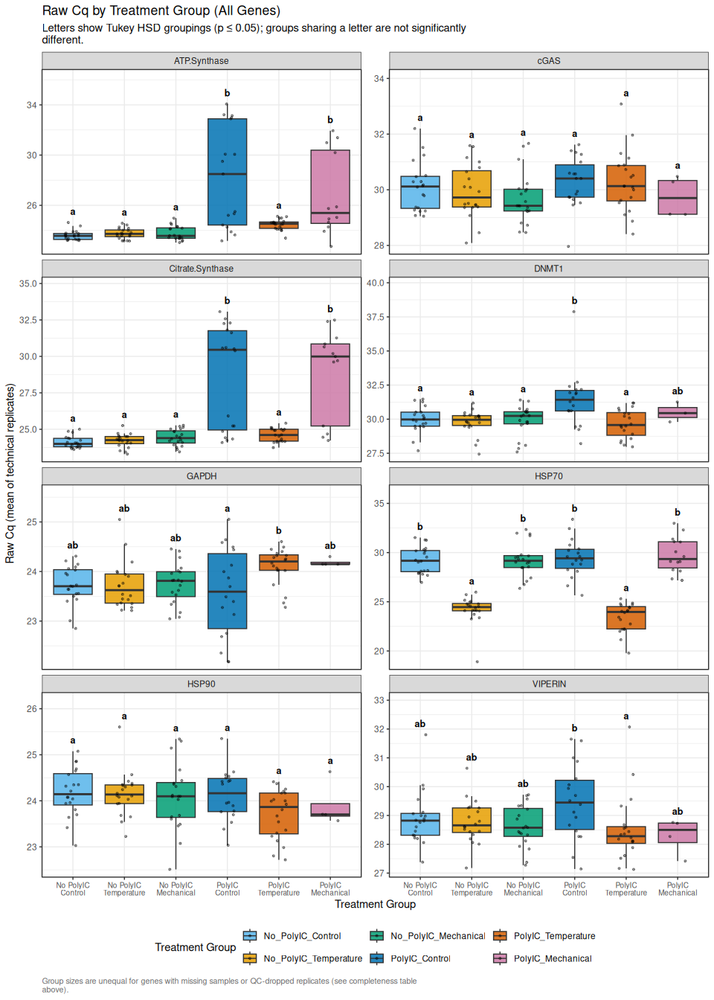<!-- -->

``` r
rawcq_anova_summary <- purrr::map_dfr(rawcq_all_genes, function(gene) {
  sm <- summary(rawcq_anova_models[[gene]])[[1]]
  data.frame(
    Target = gene,
    df_treatment = sm["treatment_group", "Df"],
    F_value = sm["treatment_group", "F value"],
    p_value = sm["treatment_group", "Pr(>F)"]
  )
}) %>%
  mutate(significant = p_value <= 0.05) %>%
  arrange(p_value)

knitr::kable(rawcq_anova_summary, digits = c(0, 0, 0, 3, 6, 0),
             caption = paste("One-way ANOVA (Cq.Mean ~ treatment_group) per gene.",
                              "A significant result (p <= 0.05) indicates raw Cq differs",
                              "across treatment groups -- i.e., the gene is NOT stable",
                              "across conditions and is a poor normalizing-gene candidate."))
```

| Target           | df_treatment | F_value | p_value | significant |
|:-----------------|-------------:|--------:|--------:|:------------|
| HSP70            |            5 |      63 |   0.000 | TRUE        |
| Citrate.Synthase |            5 |      26 |   0.000 | TRUE        |
| ATP.Synthase     |            5 |      17 |   0.000 | TRUE        |
| DNMT1            |            5 |       5 |   0.001 | TRUE        |
| GAPDH            |            5 |       3 |   0.030 | TRUE        |
| VIPERIN          |            5 |       2 |   0.043 | TRUE        |
| HSP90            |            5 |       2 |   0.089 | FALSE       |
| cGAS             |            5 |       1 |   0.321 | FALSE       |

One-way ANOVA (Cq.Mean ~ treatment_group) per gene. A significant result
(p \<= 0.05) indicates raw Cq differs across treatment groups – i.e.,
the gene is NOT stable across conditions and is a poor normalizing-gene
candidate.

## 4.4 Normalizing gene candidate ranking

``` r
cat("=== Candidate normalizing genes, ranked by raw Cq coefficient of variation (CV%) ===\n\n")
cat("All genes (lower CV = more stable raw Cq across all samples/treatments):\n\n")
print(raw_cq_summary %>% dplyr::select(rank_CV, Target, cv_percent, sd_Cq, range_Cq, data_status),
      row.names = FALSE)

cat("\n\nOne-way ANOVA significance (raw Cq ~ treatment_group), all genes:\n\n")
print(rawcq_anova_summary %>% dplyr::select(Target, F_value, p_value, significant),
      row.names = FALSE)

cat("\nNote: the CV ranking above and the ANOVA results above are two SEPARATE criteria,",
    "shown here side by side but not yet combined. A low overall CV is necessary but not",
    "sufficient for a good normalizer -- a gene can have a low CV (little raw variation",
    "overall) while still shifting systematically with treatment group (a significant",
    "ANOVA), which would make it unsuitable for normalization despite its low CV. This is",
    "exactly what happens below: the gene with the single lowest CV in this list is",
    "EXCLUDED in the Conclusion because its ANOVA is significant. The Conclusion section",
    "combines both criteria into one ranking -- see that table for the actual decision.",
    "Genes flagged 'Incomplete' have unequal group sizes due to missing/QC-dropped",
    "samples, which should be weighed when interpreting both criteria.\n")
```

    === Candidate normalizing genes, ranked by raw Cq coefficient of variation (CV%) ===

    All genes (lower CV = more stable raw Cq across all samples/treatments):

    # A tibble: 8 × 6
      rank_CV Target           cv_percent sd_Cq range_Cq data_status                
        <int> <chr>                 <dbl> <dbl>    <dbl> <chr>                      
    1       1 GAPDH                  2.30 0.546     2.87 Incomplete (missing/droppe…
    2       2 HSP90                  2.40 0.578     3.09 Incomplete (missing/droppe…
    3       3 cGAS                   3.17 0.952     5.12 Incomplete (missing/droppe…
    4       4 VIPERIN                3.50 1.01      4.94 Incomplete (missing/droppe…
    5       5 DNMT1                  4.54 1.37     10.4  Incomplete (missing/droppe…
    6       6 ATP.Synthase          10.3  2.57     11.3  Incomplete (missing/droppe…
    7       7 Citrate.Synthase      10.4  2.66      9.77 Incomplete (missing/droppe…
    8       8 HSP70                 11.4  3.12     14.5  Complete (all samples, no …


    One-way ANOVA significance (raw Cq ~ treatment_group), all genes:

               Target   F_value      p_value significant
                HSP70 62.983283 3.563159e-30        TRUE
     Citrate.Synthase 25.874059 6.126530e-17        TRUE
         ATP.Synthase 16.801940 4.107874e-12        TRUE
                DNMT1  4.812825 5.765237e-04        TRUE
                GAPDH  2.595916 3.016180e-02        TRUE
              VIPERIN  2.400263 4.261391e-02        TRUE
                HSP90  1.976985 8.892554e-02       FALSE
                 cGAS  1.188572 3.205570e-01       FALSE

    Note: the CV ranking above and the ANOVA results above are two SEPARATE criteria, shown here side by side but not yet combined. A low overall CV is necessary but not sufficient for a good normalizer -- a gene can have a low CV (little raw variation overall) while still shifting systematically with treatment group (a significant ANOVA), which would make it unsuitable for normalization despite its low CV. This is exactly what happens below: the gene with the single lowest CV in this list is EXCLUDED in the Conclusion because its ANOVA is significant. The Conclusion section combines both criteria into one ranking -- see that table for the actual decision. Genes flagged 'Incomplete' have unequal group sizes due to missing/QC-dropped samples, which should be weighed when interpreting both criteria.

## 4.5 Conclusion

``` r
# Combine both selection criteria into a single ranking. A candidate normalizing
# gene must first be STABLE across treatment groups (ANOVA p > 0.05 -- its Cq does
# not shift with condition); only among stable genes does a lower CV% make it a
# better choice. Sorting by `significant` before `cv_percent` means all stable
# ("Candidate") genes are ranked first by CV%, followed by all excluded genes --
# so the #1 row in this table is always the recommendation, and a gene with a
# lower raw CV% but a significant treatment effect (e.g. GAPDH) is correctly
# pushed below the stable candidates rather than appearing to outrank them.
candidate_table <- raw_cq_summary %>%
  dplyr::select(Target, cv_percent, data_status) %>%
  left_join(rawcq_anova_summary %>% dplyr::select(Target, p_value, significant), by = "Target") %>%
  mutate(
    verdict = ifelse(significant,
                      "Excluded \u2014 Cq shifts with treatment",
                      "Candidate \u2014 Cq stable across treatments")
  ) %>%
  arrange(significant, cv_percent) %>%
  mutate(rank = row_number(), recommended = "", .before = Target)

best_row <- which(!candidate_table$significant)[1]
if (!is.na(best_row)) candidate_table$recommended[best_row] <- "\u2b50"

display_table <- candidate_table %>%
  dplyr::select(rank, recommended, Target, cv_percent, data_status, p_value, verdict) %>%
  rename(
    Rank = rank, ` ` = recommended, Gene = Target, `Raw Cq CV (%)` = cv_percent,
    `Data completeness` = data_status, `ANOVA p (Cq ~ treatment)` = p_value,
    `Verdict` = verdict
  )

knitr::kable(display_table, digits = c(0, 0, 0, 2, 0, 4, 0),
             caption = paste("Candidate normalizing genes, ranked by suitability: stable genes",
                              "(no significant treatment effect) first, ordered by raw Cq CV% low",
                              "to high; excluded genes (significant treatment effect) follow, also",
                              "ordered by CV%. Rank 1 is the recommended normalizer."))

if (!is.na(best_row)) {
  best_gene <- candidate_table$Target[best_row]
  cat("\nRecommended normalizing gene:", best_gene, "\n")
  cat("  - Lowest raw Cq CV% (", round(candidate_table$cv_percent[best_row], 2),
      "%) among genes with no significant treatment-group effect (ANOVA p =",
      round(candidate_table$p_value[best_row], 3), ")\n")
} else {
  stop("No gene showed a non-significant treatment effect across treatment groups -- ",
       "re-evaluate QC/assumptions before selecting a normalizer. Cannot proceed with ",
       "delta-Cq normalization below without a stable reference gene.")
}

# `normalizing_gene` is THE single source of truth for every downstream section of this
# document (delta-Cq calculation, "genes of interest" filtering, ANOVA models, and the
# per-gene diagnostic subsections). It is derived programmatically from the ranking above
# -- never hand-typed -- so re-running this analysis on updated data will automatically
# propagate a different normalizer choice through the rest of the script.
normalizing_gene <- best_gene
cat("\n`normalizing_gene` set to:", normalizing_gene,
    "-- used programmatically throughout the rest of this document.\n")
```

| Rank |  | Gene | Raw Cq CV (%) | Data completeness | ANOVA p (Cq ~ treatment) | Verdict |
|---:|----|:---|---:|:---|---:|:---|
| 1 | ⭐ | HSP90 | 2.40 | Incomplete (missing/dropped samples present) | 0.0889 | Candidate — Cq stable across treatments |
| 2 |  | cGAS | 3.17 | Incomplete (missing/dropped samples present) | 0.3206 | Candidate — Cq stable across treatments |
| 3 |  | GAPDH | 2.30 | Incomplete (missing/dropped samples present) | 0.0302 | Excluded — Cq shifts with treatment |
| 4 |  | VIPERIN | 3.50 | Incomplete (missing/dropped samples present) | 0.0426 | Excluded — Cq shifts with treatment |
| 5 |  | DNMT1 | 4.54 | Incomplete (missing/dropped samples present) | 0.0006 | Excluded — Cq shifts with treatment |
| 6 |  | ATP.Synthase | 10.32 | Incomplete (missing/dropped samples present) | 0.0000 | Excluded — Cq shifts with treatment |
| 7 |  | Citrate.Synthase | 10.39 | Incomplete (missing/dropped samples present) | 0.0000 | Excluded — Cq shifts with treatment |
| 8 |  | HSP70 | 11.40 | Complete (all samples, no QC drops) | 0.0000 | Excluded — Cq shifts with treatment |

Candidate normalizing genes, ranked by suitability: stable genes (no
significant treatment effect) first, ordered by raw Cq CV% low to high;
excluded genes (significant treatment effect) follow, also ordered by
CV%. Rank 1 is the recommended normalizer.

    Recommended normalizing gene: HSP90 
      - Lowest raw Cq CV% ( 2.4 %) among genes with no significant treatment-group effect (ANOVA p = 0.089 )

    `normalizing_gene` set to: HSP90 -- used programmatically throughout the rest of this document.

# 5 Calculate Delta Cq

``` r
# Calculate delta Cq by subtracting the programmatically-identified normalizing gene's
# Cq.Mean from each corresponding Sample Cq.Mean (see `normalizing_gene` above)
delta_Cq_df <- calculate_delta_Cq(grouped_df, normalizing_gene)

# Samples where the normalizing gene has no valid Cq.Mean (missing or QC-dropped) cannot
# be normalized -- calculate_delta_Cq() marks these rows NA_real_ rather than erroring.
# Drop them here and report how many sample-gene combinations were lost, since the
# normalizing gene is no longer guaranteed to have complete coverage the way GAPDH did.
n_before <- nrow(delta_Cq_df)
delta_Cq_df <- delta_Cq_df %>%
  filter(!is.na(delta_Cq))
n_dropped <- n_before - nrow(delta_Cq_df)

# Filter out the normalizing gene itself, since no need to compare it to itself
delta_Cq_df <- delta_Cq_df %>%
  filter(Target != normalizing_gene)

cat("Normalizing gene used:", normalizing_gene, "\n")
```

    Normalizing gene used: HSP90 

``` r
cat("Rows dropped for missing", normalizing_gene, "measurement:", n_dropped, "\n\n")
```

    Rows dropped for missing HSP90 measurement: 27 

``` r
str(delta_Cq_df)
```

    tibble [712 × 10] (S3: tbl_df/tbl/data.frame)
     $ Sample         : chr [1:712] "A1C" "A1C" "A1C" "A1C" ...
     $ Target         : chr [1:712] "ATP.Synthase" "Citrate.Synthase" "DNMT1" "GAPDH" ...
     $ Cq.Mean        : num [1:712] 23.6 23.9 29.7 23.6 30.4 ...
     $ Cq.Std..Dev    : num [1:712] 0.0674 0.1467 0.1991 0.3435 0.2572 ...
     $ bio_replicate  : chr [1:712] "A" "A" "A" "A" ...
     $ replicate_num  : chr [1:712] "1" "1" "1" "1" ...
     $ polyIC         : chr [1:712] "No_PolyIC" "No_PolyIC" "No_PolyIC" "No_PolyIC" ...
     $ stress_type    : chr [1:712] "Control" "Control" "Control" "Control" ...
     $ treatment_group: chr [1:712] "No_PolyIC_Control" "No_PolyIC_Control" "No_PolyIC_Control" "No_PolyIC_Control" ...
     $ delta_Cq       : num [1:712] -0.764 -0.408 5.347 -0.793 6.075 ...

## 5.1 Missing samples analysis

``` r
# Get all unique sample names from the data that made it to delta_Cq_df
available_samples <- delta_Cq_df %>%
  dplyr::select(Sample, Target, treatment_group, polyIC, stress_type) %>%
  distinct()

# Expected samples based on the naming pattern
# From the view-groups output, we know the expected samples
expected_no_polyIC <- c(paste0(rep(LETTERS[1:4], each=5), rep(1:5, 4), "C"),
                        paste0(rep(LETTERS[1:4], each=5), rep(1:5, 4), "T"),
                        paste0(rep(LETTERS[1:4], each=5), rep(1:5, 4), "M"))

expected_polyIC <- c(paste0(rep(LETTERS[1:4], each=5), rep(1:5, 4), "PC"),
                     paste0(rep(LETTERS[1:4], each=5), rep(1:5, 4), "PT"),
                     paste0(rep(LETTERS[1:4], each=5), rep(1:5, 4), "PM"))

all_expected_samples <- c(expected_no_polyIC, expected_polyIC)

# Get all genes
all_genes <- unique(delta_Cq_df$Target)

# Create expected sample-gene combinations
expected_combinations <- expand.grid(
  Sample = all_expected_samples,
  Target = all_genes,
  stringsAsFactors = FALSE
)

# Find missing combinations
actual_combinations <- delta_Cq_df %>%
  dplyr::select(Sample, Target) %>%
  distinct()

missing_combinations <- expected_combinations %>%
  anti_join(actual_combinations, by = c("Sample", "Target"))

# Summarize by treatment group and gene
# Parse treatment info for missing samples
missing_combinations_parsed <- missing_combinations %>%
  mutate(
    polyIC = ifelse(grepl("P", substr(Sample, nchar(Sample)-1, nchar(Sample))), "PolyIC", "No_PolyIC"),
    stress_type = case_when(
      grepl("C$", Sample) | grepl("PC$", Sample) ~ "Control",
      grepl("T$", Sample) | grepl("PT$", Sample) ~ "Temperature",
      grepl("M$", Sample) | grepl("PM$", Sample) ~ "Mechanical",
      TRUE ~ "Unknown"
    ),
    treatment_group = paste(polyIC, stress_type, sep = "_")
  )

# Summary table
cat("\n=== MISSING SAMPLES SUMMARY BY TREATMENT GROUP ===\n\n")
missing_summary <- missing_combinations_parsed %>%
  group_by(treatment_group, Target) %>%
  summarise(n_missing = n(), .groups = "drop") %>%
  tidyr::pivot_wider(names_from = Target, values_from = n_missing, values_fill = 0) %>%
  arrange(treatment_group)

print(missing_summary)

# Detailed list of missing samples
cat("\n\n=== DETAILED LIST OF MISSING SAMPLES ===\n\n")
cat("Total missing sample-gene combinations:", nrow(missing_combinations), "\n\n")

missing_by_gene <- missing_combinations_parsed %>%
  arrange(Target, treatment_group, Sample)

for(gene in sort(unique(missing_by_gene$Target))) {
  gene_missing <- missing_by_gene %>% filter(Target == gene)
  if(nrow(gene_missing) > 0) {
    cat("\n**", gene, "** (", nrow(gene_missing), " missing samples):\n", sep = "")
    for(trt in unique(gene_missing$treatment_group)) {
      samples <- gene_missing %>% filter(treatment_group == trt) %>% pull(Sample)
      if(length(samples) > 0) {
        cat("  ", trt, ": ", paste(samples, collapse = ", "), "\n", sep = "")
      }
    }
  }
}

# Comprehensive list of all problematic samples
cat("\n\n=== ALL SAMPLES EXCLUDED OR MISSING FROM ANALYSIS ===\n\n")

# Get samples that failed QC by gene
cat("**Samples that Failed QC (high standard deviation > 0.5) by Gene:**\n\n")
if(nrow(excluded_samples) > 0) {
  failed_qc_by_gene <- excluded_samples %>%
    arrange(Target, Sample)
  
  for(gene in unique(failed_qc_by_gene$Target)) {
    gene_failed <- failed_qc_by_gene %>% filter(Target == gene) %>% pull(Sample)
    cat("  ", gene, " (", length(gene_failed), " samples): ", paste(sort(gene_failed), collapse = ", "), "\n", sep = "")
  }
  
  failed_qc_samples <- unique(excluded_samples$Sample)
  cat("\n  Total unique samples that failed QC: ", length(failed_qc_samples), "\n", sep = "")
  cat("  All failed QC samples: ", paste(sort(failed_qc_samples), collapse = ", "), "\n", sep = "")
} else {
  failed_qc_samples <- character(0)
  cat("  No samples failed QC.\n")
}

# Get unique samples that are missing
missing_sample_names <- unique(missing_combinations$Sample)

cat("\n**Missing from data (never run/loaded):** ", length(missing_sample_names), " unique samples\n", sep = "")
if(length(missing_sample_names) > 0) {
  cat("  ", paste(sort(missing_sample_names), collapse = ", "), "\n")
}

# Combine and get all unique
all_problematic_samples <- unique(c(failed_qc_samples, missing_sample_names))

cat("\n**Summary:**\n")
cat("  Total unique samples with issues: ", length(all_problematic_samples), "\n", sep = "")
cat("  All unique sample names (failed QC + missing): ", paste(sort(all_problematic_samples), collapse = ", "), "\n", sep = "")
```

    === MISSING SAMPLES SUMMARY BY TREATMENT GROUP ===

    # A tibble: 2 × 8
      treatment_group  ATP.Synthase Citrate.Synthase DNMT1 GAPDH HSP70 VIPERIN  cGAS
      <chr>                   <int>            <int> <int> <int> <int>   <int> <int>
    1 PolyIC_Control              3                2     2     2     2       2     2
    2 PolyIC_Mechanic…           16               16    17    16    16      16    16


    === DETAILED LIST OF MISSING SAMPLES ===

    Total missing sample-gene combinations: 128 


    **ATP.Synthase** (19 missing samples):
      PolyIC_Control: A5PC, C4PC, C5PC
      PolyIC_Mechanical: A1PM, A2PM, A3PM, A4PM, A5PM, B1PM, B2PM, B3PM, B4PM, B5PM, C1PM, C2PM, C3PM, C4PM, C5PM, D5PM

    **cGAS** (18 missing samples):
      PolyIC_Control: C4PC, C5PC
      PolyIC_Mechanical: A1PM, A2PM, A3PM, A4PM, A5PM, B1PM, B2PM, B3PM, B4PM, B5PM, C1PM, C2PM, C3PM, C4PM, C5PM, D5PM

    **Citrate.Synthase** (18 missing samples):
      PolyIC_Control: C4PC, C5PC
      PolyIC_Mechanical: A1PM, A2PM, A3PM, A4PM, A5PM, B1PM, B2PM, B3PM, B4PM, B5PM, C1PM, C2PM, C3PM, C4PM, C5PM, D5PM

    **DNMT1** (19 missing samples):
      PolyIC_Control: C4PC, C5PC
      PolyIC_Mechanical: A1PM, A2PM, A3PM, A4PM, A5PM, B1PM, B2PM, B3PM, B4PM, B5PM, C1PM, C2PM, C3PM, C4PM, C5PM, D4PM, D5PM

    **GAPDH** (18 missing samples):
      PolyIC_Control: C4PC, C5PC
      PolyIC_Mechanical: A1PM, A2PM, A3PM, A4PM, A5PM, B1PM, B2PM, B3PM, B4PM, B5PM, C1PM, C2PM, C3PM, C4PM, C5PM, D5PM

    **HSP70** (18 missing samples):
      PolyIC_Control: C4PC, C5PC
      PolyIC_Mechanical: A1PM, A2PM, A3PM, A4PM, A5PM, B1PM, B2PM, B3PM, B4PM, B5PM, C1PM, C2PM, C3PM, C4PM, C5PM, D5PM

    **VIPERIN** (18 missing samples):
      PolyIC_Control: C4PC, C5PC
      PolyIC_Mechanical: A1PM, A2PM, A3PM, A4PM, A5PM, B1PM, B2PM, B3PM, B4PM, B5PM, C1PM, C2PM, C3PM, C4PM, C5PM, D5PM


    === ALL SAMPLES EXCLUDED OR MISSING FROM ANALYSIS ===

    **Samples that Failed QC (high standard deviation > 0.5) by Gene:**

      ATP.Synthase (2 samples): B1PM, B2PM
      Citrate.Synthase (1 samples): A2PM
      DNMT1 (1 samples): D4PM

      Total unique samples that failed QC: 4
      All failed QC samples: A2PM, B1PM, B2PM, D4PM

    **Missing from data (never run/loaded):** 20 unique samples
       A1PM, A2PM, A3PM, A4PM, A5PC, A5PM, B1PM, B2PM, B3PM, B4PM, B5PM, C1PM, C2PM, C3PM, C4PC, C4PM, C5PC, C5PM, D4PM, D5PM 

    **Summary:**
      Total unique samples with issues: 20
      All unique sample names (failed QC + missing): A1PM, A2PM, A3PM, A4PM, A5PC, A5PM, B1PM, B2PM, B3PM, B4PM, B5PM, C1PM, C2PM, C3PM, C4PC, C4PM, C5PC, C5PM, D4PM, D5PM

## 5.2 Normalizing Gene Impact Analysis

``` r
cat("\n=== ", toupper(normalizing_gene), " QC FAILURES AND THEIR CASCADE EFFECTS ===\n\n", sep = "")

# Get samples where the normalizing gene passed QC
normalizer_passed <- grouped_df %>%
  filter(Target == normalizing_gene) %>%
  dplyr::select(Sample) %>%
  distinct() %>%
  pull(Sample)

# Get samples where genes of interest (everything except the normalizer) passed QC
genes_of_interest <- grouped_df %>%
  filter(Target != normalizing_gene) %>%
  dplyr::select(Sample, Target) %>%
  distinct()

# Find samples that have gene data but missing the normalizing gene
samples_with_gene_but_no_normalizer <- genes_of_interest %>%
  filter(!Sample %in% normalizer_passed) %>%
  arrange(Sample, Target)

if(nrow(samples_with_gene_but_no_normalizer) > 0) {
  cat("**Samples with good gene measurements but failed/missing", normalizing_gene, ":**\n")
  cat("(These samples CANNOT be normalized and are excluded from analysis)\n\n")
  
  # Count by sample
  sample_counts <- samples_with_gene_but_no_normalizer %>%
    group_by(Sample) %>%
    summarise(n_genes_lost = n(), .groups = "drop") %>%
    arrange(desc(n_genes_lost), Sample)
  
  cat("Total samples affected:", nrow(sample_counts), "\n")
  cat("Total gene measurements lost:", nrow(samples_with_gene_but_no_normalizer), "\n\n")
  
  # Detailed breakdown
  for(i in 1:nrow(sample_counts)) {
    samp <- sample_counts$Sample[i]
    genes_lost <- samples_with_gene_but_no_normalizer %>%
      filter(Sample == samp) %>%
      pull(Target)
    cat("  ", samp, " (", sample_counts$n_genes_lost[i], " genes lost): ", 
        paste(genes_lost, collapse = ", "), "\n", sep = "")
  }
} else {
  cat("**Good news!** All samples with gene measurements also have valid", normalizing_gene, ".\n")
}

# Check if the normalizing gene itself failed QC for any samples
normalizer_failed_qc <- excluded_samples %>%
  filter(Target == normalizing_gene) %>%
  pull(Sample) %>%
  unique()

if(length(normalizer_failed_qc) > 0) {
  cat("\n\n**", normalizing_gene, " samples that failed QC (Std Dev > 0.5):** ", length(normalizer_failed_qc), " samples\n", sep = "")
  cat("  ", paste(sort(normalizer_failed_qc), collapse = ", "), "\n", sep = "")
  cat("\nNote: These", normalizing_gene, "failures prevent normalization for ALL genes in these samples,\n")
  cat("even if those genes had good quality measurements.\n")
} else {
  cat("\n\n**No", normalizing_gene, "samples failed QC.**\n")
}

# Identify which "missing" samples in the final analysis are due to normalizing-gene issues
cat("\n\n**Analysis of 'Missing' Samples:**\n\n")

# Get samples that made it to grouped_df (passed initial QC)
all_passed_qc <- grouped_df %>%
  dplyr::select(Sample, Target) %>%
  distinct()

# For each "missing" sample in delta_Cq_df, check if the gene passed QC but the
# normalizing gene didn't
missing_due_to_normalizer <- missing_combinations %>%
  inner_join(all_passed_qc, by = c("Sample", "Target")) %>%
  filter(!Sample %in% normalizer_passed)

if(nrow(missing_due_to_normalizer) > 0) {
  cat("Gene measurements lost due to ", normalizing_gene, " failure/missing: ", nrow(missing_due_to_normalizer), " sample-gene combinations\n\n", sep = "")
  
  missing_normalizer_summary <- missing_due_to_normalizer %>%
    group_by(Target) %>%
    summarise(n = n(), .groups = "drop") %>%
    arrange(desc(n))
  
  cat("Breakdown by gene:\n")
  for(i in 1:nrow(missing_normalizer_summary)) {
    cat("  ", missing_normalizer_summary$Target[i], ": ", missing_normalizer_summary$n[i], " samples\n", sep = "")
  }
} else {
  cat("None of the 'missing' samples are due to", normalizing_gene, "QC failures.\n")
  cat("(They were never run/loaded for those genes)\n")
}
```

    === HSP90 QC FAILURES AND THEIR CASCADE EFFECTS ===

    **Samples with good gene measurements but failed/missing HSP90 :**
    (These samples CANNOT be normalized and are excluded from analysis)

    Total samples affected: 10 
    Total gene measurements lost: 27 

      A1PM (3 genes lost): ATP.Synthase, Citrate.Synthase, HSP70
      A3PM (3 genes lost): ATP.Synthase, Citrate.Synthase, HSP70
      A4PM (3 genes lost): ATP.Synthase, Citrate.Synthase, HSP70
      A5PM (3 genes lost): ATP.Synthase, Citrate.Synthase, HSP70
      B3PM (3 genes lost): ATP.Synthase, Citrate.Synthase, HSP70
      B4PM (3 genes lost): ATP.Synthase, Citrate.Synthase, HSP70
      B5PM (3 genes lost): ATP.Synthase, Citrate.Synthase, HSP70
      A2PM (2 genes lost): ATP.Synthase, HSP70
      B1PM (2 genes lost): Citrate.Synthase, HSP70
      B2PM (2 genes lost): Citrate.Synthase, HSP70


    **No HSP90 samples failed QC.**


    **Analysis of 'Missing' Samples:**

    Gene measurements lost due to HSP90 failure/missing: 27 sample-gene combinations

    Breakdown by gene:
      HSP70: 10 samples
      Citrate.Synthase: 9 samples
      ATP.Synthase: 8 samples

# 6 Statistical Comparisons

## 6.1 T-tests for treatment comparisons

### 6.1.1 Comparison 1: Basic Control vs Stressors (No PolyIC)

``` r
# Filter data for samples without PolyIC treatment
no_polyIC_data <- delta_Cq_df %>%
  filter(polyIC == "No_PolyIC")

# Perform t-tests for each target comparing Control vs each stressor
comparison1_results <- no_polyIC_data %>%
  filter(stress_type %in% c("Control", "Temperature", "Mechanical")) %>%
  group_by(Target) %>%
  summarise(
    # Control vs Temperature
    temp_pvalue = if(sum(stress_type == "Control") > 0 & sum(stress_type == "Temperature") > 0) {
      t.test(delta_Cq[stress_type == "Control"], 
             delta_Cq[stress_type == "Temperature"])$p.value
    } else NA_real_,
    
    # Control vs Mechanical
    mech_pvalue = if(sum(stress_type == "Control") > 0 & sum(stress_type == "Mechanical") > 0) {
      t.test(delta_Cq[stress_type == "Control"], 
             delta_Cq[stress_type == "Mechanical"])$p.value
    } else NA_real_,
    
    .groups = 'drop'
  )

print(comparison1_results)
```

    # A tibble: 7 × 3
      Target           temp_pvalue mech_pvalue
      <chr>                  <dbl>       <dbl>
    1 ATP.Synthase        2.96e- 1      0.109 
    2 Citrate.Synthase    4.19e- 1      0.0189
    3 DNMT1               5.69e- 1      0.952 
    4 GAPDH               8.39e- 1      0.447 
    5 HSP70               2.73e-13      0.809 
    6 VIPERIN             7.09e- 1      0.494 
    7 cGAS                6.79e- 1      0.264 

#### 6.1.1.1 Significant genes (p ≤ 0.05)

``` r
# Identify genes with significant p-values for Temperature comparison
sig_temp <- comparison1_results %>%
  ungroup() %>%
  filter(temp_pvalue <= 0.05 & !is.na(temp_pvalue)) %>%
  dplyr::select(Target, pvalue = temp_pvalue) %>%
  mutate(comparison = "Control vs Temperature")

# Identify genes with significant p-values for Mechanical comparison
sig_mech <- comparison1_results %>%
  ungroup() %>%
  filter(mech_pvalue <= 0.05 & !is.na(mech_pvalue)) %>%
  dplyr::select(Target, pvalue = mech_pvalue) %>%
  mutate(comparison = "Control vs Mechanical")

# Combine and display
sig_genes_comp1 <- bind_rows(
  sig_temp,
  sig_mech
)

if(nrow(sig_genes_comp1) > 0) {
  print("Genes with p ≤ 0.05:")
  sig_genes_comp1 %>%
    mutate(pvalue = format(pvalue, scientific = TRUE, digits = 3)) %>%
    knitr::kable()
} else {
  print("No genes had p-values ≤ 0.05")
}
```

    [1] "Genes with p ≤ 0.05:"

| Target           | pvalue   | comparison             |
|:-----------------|:---------|:-----------------------|
| HSP70            | 2.73e-13 | Control vs Temperature |
| Citrate.Synthase | 1.89e-02 | Control vs Mechanical  |

#### 6.1.1.2 Delta Cq boxplot

``` r
# Prepare significance annotations from t-test results
if(exists("sig_genes_comp1") && nrow(sig_genes_comp1) > 0) {
  # Extract significant genes for Temperature
  sig_temp_genes <- sig_genes_comp1 %>%
    filter(comparison == "Control vs Temperature") %>%
    pull(Target)
  
  # Extract significant genes for Mechanical
  sig_mech_genes <- sig_genes_comp1 %>%
    filter(comparison == "Control vs Mechanical") %>%
    pull(Target)
  
  # Create annotation data
  sig_annotations_comp1 <- data.frame(
    Target = character(),
    stress_type = character(),
    label = character(),
    stringsAsFactors = FALSE
  )
  
  # Add Temperature annotations
  if(length(sig_temp_genes) > 0) {
    sig_annotations_comp1 <- rbind(sig_annotations_comp1,
      data.frame(Target = sig_temp_genes,
                 stress_type = "Temperature",
                 label = "*"))
  }
  
  # Add Mechanical annotations
  if(length(sig_mech_genes) > 0) {
    sig_annotations_comp1 <- rbind(sig_annotations_comp1,
      data.frame(Target = sig_mech_genes,
                 stress_type = "Mechanical",
                 label = "*"))
  }
  
  # Get y positions for annotations
  if(nrow(sig_annotations_comp1) > 0) {
    y_pos_comp1 <- no_polyIC_data %>%
      group_by(Target, stress_type) %>%
      summarise(max_y = max(delta_Cq, na.rm = TRUE), .groups = "drop")
    
    # Calculate data range for each gene to use a proportional offset -- a flat
    # offset doesn't scale across genes whose delta_Cq ranges differ substantially
    # under facet_wrap's free_y scales
    y_range_comp1 <- no_polyIC_data %>%
      group_by(Target) %>%
      summarise(y_range = max(delta_Cq, na.rm = TRUE) - min(delta_Cq, na.rm = TRUE), .groups = "drop")
    
    sig_annotations_comp1 <- sig_annotations_comp1 %>%
      left_join(y_pos_comp1, by = c("Target", "stress_type")) %>%
      left_join(y_range_comp1, by = "Target") %>%
      mutate(y_pos = max_y + y_range * 0.08)  # 8% of data range above max
  }
} else {
  sig_annotations_comp1 <- data.frame()
}

# Create plot
p <- no_polyIC_data %>%
  ggplot(aes(x = stress_type, y = delta_Cq, fill = stress_type)) +
  geom_boxplot(outlier.shape = NA) +
  geom_jitter(width = 0.15, alpha = 0.4, size = 0.8) +
  facet_wrap(~Target, scales = "free_y") +
  scale_fill_manual(values = c("Control" = "darkgray", "Temperature" = "salmon", "Mechanical" = "steelblue")) +
  scale_y_continuous(expand = expansion(mult = c(0.05, 0.25))) +  # Extra space at top for annotations
  theme_bw() +
  labs(
    title = "Delta Cq: Control vs Stressors (No PolyIC Treatment)",
    x = "Stress Type",
    y = "Delta Cq",
    fill = "Stress Type"
  ) +
  theme(axis.text.x = element_text(angle = 45, hjust = 1))

# Add annotations if any exist
if(nrow(sig_annotations_comp1) > 0) {
  p <- p + 
    geom_text(data = sig_annotations_comp1, 
              aes(x = stress_type, y = y_pos, label = label),
              inherit.aes = FALSE, size = 4, vjust = 0, color = "darkorange") +
    labs(subtitle = "Asterisks (*) indicate significant differences from Control (t-test p ≤ 0.05)",
         caption = paste("Significant comparisons:", paste(unique(sig_genes_comp1$Target), collapse = ", ")))
} else {
  p <- p + labs(subtitle = "No significant differences detected in t-tests (all p > 0.05)")
}

print(p)
```

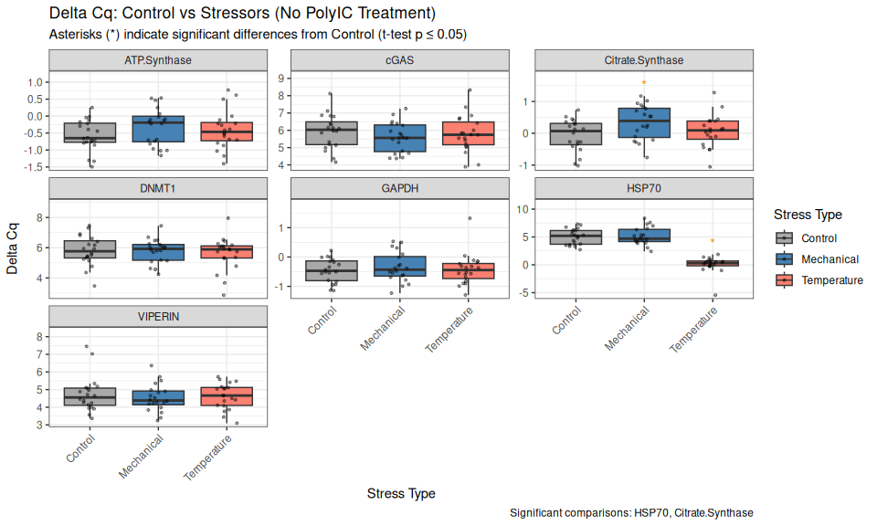<!-- -->

### 6.1.2 Comparison 2: Basic Control vs PolyIC Control

``` r
# Filter data for control samples only (with and without PolyIC)
control_data <- delta_Cq_df %>%
  filter(stress_type == "Control")

# Perform t-tests for each target comparing No_PolyIC vs PolyIC controls
comparison2_results <- control_data %>%
  group_by(Target) %>%
  summarise(
    n_no_polyIC = sum(polyIC == "No_PolyIC"),
    n_polyIC = sum(polyIC == "PolyIC"),
    
    pvalue = if(sum(polyIC == "No_PolyIC") > 0 & sum(polyIC == "PolyIC") > 0) {
      t.test(delta_Cq[polyIC == "No_PolyIC"], 
             delta_Cq[polyIC == "PolyIC"])$p.value
    } else NA_real_,
    
    mean_no_polyIC = mean(delta_Cq[polyIC == "No_PolyIC"], na.rm = TRUE),
    sd_no_polyIC = sd(delta_Cq[polyIC == "No_PolyIC"], na.rm = TRUE),
    mean_polyIC = mean(delta_Cq[polyIC == "PolyIC"], na.rm = TRUE),
    sd_polyIC = sd(delta_Cq[polyIC == "PolyIC"], na.rm = TRUE),
    mean_diff = mean_polyIC - mean_no_polyIC,
    
    .groups = 'drop'
  )

print(comparison2_results)
```

    # A tibble: 7 × 9
      Target    n_no_polyIC n_polyIC  pvalue mean_no_polyIC sd_no_polyIC mean_polyIC
      <chr>           <int>    <int>   <dbl>          <dbl>        <dbl>       <dbl>
    1 ATP.Synt…          20       17 2.70e-4        -0.575         0.465       4.18 
    2 Citrate.…          20       18 6.64e-5        -0.0669        0.507       4.43 
    3 DNMT1              20       18 9.23e-3         5.81          0.990       7.27 
    4 GAPDH              20       18 6.97e-1        -0.457         0.405      -0.549
    5 HSP70              20       18 6.35e-1         5.05          1.42        5.31 
    6 VIPERIN            20       18 1.63e-1         4.73          1.02        5.34 
    7 cGAS               20       18 5.30e-1         5.93          0.986       6.16 
    # ℹ 2 more variables: sd_polyIC <dbl>, mean_diff <dbl>

#### 6.1.2.1 Significant genes (p ≤ 0.05)

``` r
# Identify genes with significant p-values
sig_genes_comp2 <- comparison2_results %>%
  filter(pvalue <= 0.05 & !is.na(pvalue)) %>%
  dplyr::select(Target, pvalue)

if(nrow(sig_genes_comp2) > 0) {
  print("Genes with p ≤ 0.05:")
  sig_genes_comp2 %>%
    mutate(pvalue = format(pvalue, scientific = TRUE, digits = 3)) %>%
    knitr::kable()
} else {
  print("No genes had p-values ≤ 0.05")
}
```

    [1] "Genes with p ≤ 0.05:"

| Target           | pvalue   |
|:-----------------|:---------|
| ATP.Synthase     | 2.70e-04 |
| Citrate.Synthase | 6.64e-05 |
| DNMT1            | 9.23e-03 |

#### 6.1.2.2 Delta Cq boxplot

``` r
# Prepare significance annotations from t-test results
if(exists("sig_genes_comp2") && nrow(sig_genes_comp2) > 0) {
  sig_annotations_comp2 <- data.frame(
    Target = sig_genes_comp2$Target,
    polyIC = "PolyIC",
    label = "*",
    stringsAsFactors = FALSE
  )
  
  # Get y positions for annotations
  y_pos_comp2 <- control_data %>%
    group_by(Target, polyIC) %>%
    summarise(max_y = max(delta_Cq, na.rm = TRUE), .groups = "drop")
  
  # Calculate data range for each gene to use a proportional offset -- a flat
  # offset doesn't scale across genes whose delta_Cq ranges differ substantially
  # under facet_wrap's free_y scales
  y_range_comp2 <- control_data %>%
    group_by(Target) %>%
    summarise(y_range = max(delta_Cq, na.rm = TRUE) - min(delta_Cq, na.rm = TRUE), .groups = "drop")
  
  sig_annotations_comp2 <- sig_annotations_comp2 %>%
    left_join(y_pos_comp2, by = c("Target", "polyIC")) %>%
    left_join(y_range_comp2, by = "Target") %>%
    mutate(y_pos = max_y + y_range * 0.08)  # 8% of data range above max
} else {
  sig_annotations_comp2 <- data.frame()
}

# Create plot
p <- control_data %>%
  ggplot(aes(x = polyIC, y = delta_Cq, fill = polyIC)) +
  geom_boxplot(outlier.shape = NA) +
  geom_jitter(width = 0.15, alpha = 0.4, size = 0.8) +
  facet_wrap(~Target, scales = "free_y") +
  scale_fill_manual(values = c("No_PolyIC" = "darkgray", "PolyIC" = "salmon")) +
  scale_y_continuous(expand = expansion(mult = c(0.05, 0.25))) +  # Extra space at top for annotations
  theme_bw() +
  labs(
    title = "Delta Cq: Basic Control vs PolyIC Control",
    x = "PolyIC Treatment",
    y = "Delta Cq",
    fill = "Treatment"
  ) +
  theme(axis.text.x = element_text(angle = 45, hjust = 1))

# Add annotations if any exist
if(nrow(sig_annotations_comp2) > 0) {
  p <- p + 
    geom_text(data = sig_annotations_comp2, 
              aes(x = polyIC, y = y_pos, label = label),
              inherit.aes = FALSE, size = 4, vjust = 0, color = "darkorange") +
    labs(subtitle = "Asterisks (*) indicate significant differences (t-test p ≤ 0.05)",
         caption = paste("Genes with significant PolyIC effect:", paste(sig_genes_comp2$Target, collapse = ", ")))
} else {
  p <- p + labs(subtitle = "No significant differences detected in t-tests (all p > 0.05)")
}

print(p)
```

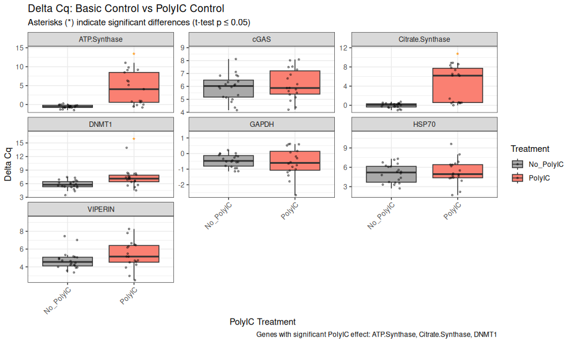<!-- -->

### 6.1.3 Comparison 3: PolyIC Control vs PolyIC Stressors

``` r
# Filter data for PolyIC samples only
polyIC_data <- delta_Cq_df %>%
  filter(polyIC == "PolyIC")

# Perform t-tests for each target comparing PolyIC Control vs each stressor
comparison3_results <- polyIC_data %>%
  filter(stress_type %in% c("Control", "Temperature", "Mechanical")) %>%
  group_by(Target) %>%
  summarise(
    # PolyIC Control vs Temperature
    temp_pvalue = if(sum(stress_type == "Control") > 0 & sum(stress_type == "Temperature") > 0) {
      t.test(delta_Cq[stress_type == "Control"], 
             delta_Cq[stress_type == "Temperature"])$p.value
    } else NA_real_,
    
    # PolyIC Control vs Mechanical
    mech_pvalue = if(sum(stress_type == "Control") > 0 & sum(stress_type == "Mechanical") > 0) {
      t.test(delta_Cq[stress_type == "Control"], 
             delta_Cq[stress_type == "Mechanical"])$p.value
    } else NA_real_,
    
    .groups = 'drop'
  )

print(comparison3_results)
```

    # A tibble: 7 × 3
      Target           temp_pvalue mech_pvalue
      <chr>                  <dbl>       <dbl>
    1 ATP.Synthase        4.32e- 3    0.00665 
    2 Citrate.Synthase    7.60e- 4    0.000979
    3 DNMT1               2.21e- 2    0.174   
    4 GAPDH               5.26e- 4    0.0180  
    5 HSP70               2.18e-11    0.0290  
    6 VIPERIN             2.48e- 1    0.0508  
    7 cGAS                2.66e- 1    0.438   

#### 6.1.3.1 Significant genes (p ≤ 0.05)

``` r
# Identify genes with significant p-values for Temperature comparison
sig_temp_polyIC <- comparison3_results %>%
  filter(temp_pvalue <= 0.05 & !is.na(temp_pvalue)) %>%
  dplyr::select(Target, pvalue = temp_pvalue) %>%
  mutate(comparison = "PolyIC Control vs Temperature")

# Identify genes with significant p-values for Mechanical comparison
sig_mech_polyIC <- comparison3_results %>%
  filter(mech_pvalue <= 0.05 & !is.na(mech_pvalue)) %>%
  dplyr::select(Target, pvalue = mech_pvalue) %>%
  mutate(comparison = "PolyIC Control vs Mechanical")

# Combine and display
sig_genes_comp3 <- bind_rows(
  sig_temp_polyIC,
  sig_mech_polyIC
)

if(nrow(sig_genes_comp3) > 0) {
  print("Genes with p ≤ 0.05:")
  sig_genes_comp3 %>%
    mutate(pvalue = format(pvalue, scientific = TRUE, digits = 3)) %>%
    knitr::kable()
} else {
  print("No genes had p-values ≤ 0.05")
}
```

    [1] "Genes with p ≤ 0.05:"

| Target           | pvalue   | comparison                    |
|:-----------------|:---------|:------------------------------|
| ATP.Synthase     | 4.32e-03 | PolyIC Control vs Temperature |
| Citrate.Synthase | 7.60e-04 | PolyIC Control vs Temperature |
| DNMT1            | 2.21e-02 | PolyIC Control vs Temperature |
| GAPDH            | 5.26e-04 | PolyIC Control vs Temperature |
| HSP70            | 2.18e-11 | PolyIC Control vs Temperature |
| ATP.Synthase     | 6.65e-03 | PolyIC Control vs Mechanical  |
| Citrate.Synthase | 9.79e-04 | PolyIC Control vs Mechanical  |
| GAPDH            | 1.80e-02 | PolyIC Control vs Mechanical  |
| HSP70            | 2.90e-02 | PolyIC Control vs Mechanical  |

#### 6.1.3.2 Delta Cq boxplot

``` r
# Prepare significance annotations from t-test results
if(exists("sig_genes_comp3") && nrow(sig_genes_comp3) > 0) {
  # Extract significant genes for Temperature
  sig_temp_genes <- sig_genes_comp3 %>%
    filter(comparison == "PolyIC Control vs Temperature") %>%
    pull(Target)
  
  # Extract significant genes for Mechanical
  sig_mech_genes <- sig_genes_comp3 %>%
    filter(comparison == "PolyIC Control vs Mechanical") %>%
    pull(Target)
  
  # Create annotation data
  sig_annotations_comp3 <- data.frame(
    Target = character(),
    stress_type = character(),
    label = character(),
    stringsAsFactors = FALSE
  )
  
  # Add Temperature annotations
  if(length(sig_temp_genes) > 0) {
    sig_annotations_comp3 <- rbind(sig_annotations_comp3,
      data.frame(Target = sig_temp_genes,
                 stress_type = "Temperature",
                 label = "*"))
  }
  
  # Add Mechanical annotations
  if(length(sig_mech_genes) > 0) {
    sig_annotations_comp3 <- rbind(sig_annotations_comp3,
      data.frame(Target = sig_mech_genes,
                 stress_type = "Mechanical",
                 label = "*"))
  }
  
  # Get y positions for annotations
  if(nrow(sig_annotations_comp3) > 0) {
    y_pos_comp3 <- polyIC_data %>%
      group_by(Target, stress_type) %>%
      summarise(max_y = max(delta_Cq, na.rm = TRUE), .groups = "drop")
    
    # Calculate data range for each gene to use a proportional offset -- a flat
    # offset doesn't scale across genes whose delta_Cq ranges differ substantially
    # under facet_wrap's free_y scales
    y_range_comp3 <- polyIC_data %>%
      group_by(Target) %>%
      summarise(y_range = max(delta_Cq, na.rm = TRUE) - min(delta_Cq, na.rm = TRUE), .groups = "drop")
    
    sig_annotations_comp3 <- sig_annotations_comp3 %>%
      left_join(y_pos_comp3, by = c("Target", "stress_type")) %>%
      left_join(y_range_comp3, by = "Target") %>%
      mutate(y_pos = max_y + y_range * 0.08)  # 8% of data range above max
  }
} else {
  sig_annotations_comp3 <- data.frame()
}

# Create plot
p <- polyIC_data %>%
  ggplot(aes(x = stress_type, y = delta_Cq, fill = stress_type)) +
  geom_boxplot(outlier.shape = NA) +
  geom_jitter(width = 0.15, alpha = 0.4, size = 0.8) +
  facet_wrap(~Target, scales = "free_y") +
  scale_fill_manual(values = c("Control" = "darkgray", "Temperature" = "salmon", "Mechanical" = "steelblue")) +
  scale_y_continuous(expand = expansion(mult = c(0.05, 0.25))) +  # Extra space at top for annotations
  theme_bw() +
  labs(
    title = "Delta Cq: PolyIC Control vs PolyIC Stressors",
    x = "Stress Type",
    y = "Delta Cq",
    fill = "Stress Type"
  ) +
  theme(axis.text.x = element_text(angle = 45, hjust = 1))

# Add annotations if any exist
if(nrow(sig_annotations_comp3) > 0) {
  p <- p + 
    geom_text(data = sig_annotations_comp3, 
              aes(x = stress_type, y = y_pos, label = label),
              inherit.aes = FALSE, size = 4, vjust = 0, color = "darkorange") +
    labs(subtitle = "Asterisks (*) indicate significant differences from PolyIC Control (t-test p ≤ 0.05)",
         caption = paste("Significant comparisons:", paste(unique(sig_genes_comp3$Target), collapse = ", ")))
} else {
  p <- p + labs(subtitle = "No significant differences detected in t-tests (all p > 0.05)")
}

print(p)
```

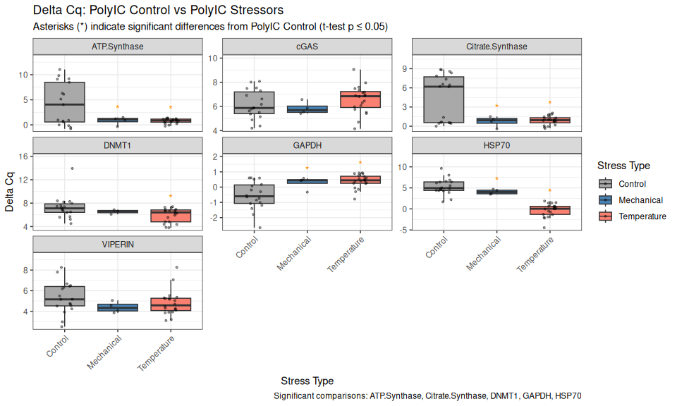<!-- -->

## 6.2 Create ANOVA Models

Two-way ANOVA (PolyIC × Stress Type) for each gene to comprehensively
test treatment effects and interactions.

``` r
# Run ANOVA models for all genes and store emmeans objects for plotting
# Detailed assumption checks and interpretations are in the "ANOVA Results and Diagnostics" section below

# ATP Synthase
model_atp <- delta_Cq_df %>%
  filter(Target == "ATP.Synthase") %>%
  aov(delta_Cq ~ polyIC * stress_type, data = .)
if(any(summary(model_atp)[[1]][["Pr(>F)"]][1:3] < 0.05, na.rm = TRUE)) {
  emm_atp <- emmeans(model_atp, ~ polyIC * stress_type)
}

# Citrate Synthase
model_citrate <- delta_Cq_df %>%
  filter(Target == "Citrate.Synthase") %>%
  aov(delta_Cq ~ polyIC * stress_type, data = .)
if(any(summary(model_citrate)[[1]][["Pr(>F)"]][1:3] < 0.05, na.rm = TRUE)) {
  emm_citrate <- emmeans(model_citrate, ~ polyIC * stress_type)
}

# DNMT1
model_dnmt1 <- delta_Cq_df %>%
  filter(Target == "DNMT1") %>%
  aov(delta_Cq ~ polyIC * stress_type, data = .)
if(any(summary(model_dnmt1)[[1]][["Pr(>F)"]][1:3] < 0.05, na.rm = TRUE)) {
  emm_dnmt1 <- emmeans(model_dnmt1, ~ polyIC * stress_type)
}

# HSP70
model_hsp70 <- delta_Cq_df %>%
  filter(Target == "HSP70") %>%
  aov(delta_Cq ~ polyIC * stress_type, data = .)
if(any(summary(model_hsp70)[[1]][["Pr(>F)"]][1:3] < 0.05, na.rm = TRUE)) {
  emm_hsp70 <- emmeans(model_hsp70, ~ polyIC * stress_type)
}

# GAPDH (gene of interest here -- HSP90 is the normalizer and is excluded from
# delta_Cq_df, so it is no longer one of the modeled genes)
model_gapdh <- delta_Cq_df %>%
  filter(Target == "GAPDH") %>%
  aov(delta_Cq ~ polyIC * stress_type, data = .)
if(any(summary(model_gapdh)[[1]][["Pr(>F)"]][1:3] < 0.05, na.rm = TRUE)) {
  emm_gapdh <- emmeans(model_gapdh, ~ polyIC * stress_type)
}

# cGAS
model_cgas <- delta_Cq_df %>%
  filter(Target == "cGAS") %>%
  aov(delta_Cq ~ polyIC * stress_type, data = .)
if(any(summary(model_cgas)[[1]][["Pr(>F)"]][1:3] < 0.05, na.rm = TRUE)) {
  emm_cgas <- emmeans(model_cgas, ~ polyIC * stress_type)
}

# VIPERIN
model_viperin <- delta_Cq_df %>%
  filter(Target == "VIPERIN") %>%
  aov(delta_Cq ~ polyIC * stress_type, data = .)
if(any(summary(model_viperin)[[1]][["Pr(>F)"]][1:3] < 0.05, na.rm = TRUE)) {
  emm_viperin <- emmeans(model_viperin, ~ polyIC * stress_type)
}

cat("ANOVA models created for all genes. Emmeans objects stored for post-hoc testing and plotting.\n")
cat("See 'ANOVA Results and Diagnostics' section below for detailed results, assumption checks, and interpretations.\n")

# Report which genes had at least one significant term (polyIC, stress_type, or their
# interaction) -- these are the genes for which an emmeans object was created above.
# This list is derived programmatically from the models just run (never hand-typed), since
# it necessarily changes when the normalizing gene changes.
all_genes_of_interest <- c("ATP.Synthase", "Citrate.Synthase", "DNMT1", "GAPDH",
                            "HSP70", "cGAS", "VIPERIN")
emm_var_names <- c(ATP.Synthase = "emm_atp", Citrate.Synthase = "emm_citrate",
                   DNMT1 = "emm_dnmt1", GAPDH = "emm_gapdh", HSP70 = "emm_hsp70",
                   cGAS = "emm_cgas", VIPERIN = "emm_viperin")
significant_genes <- all_genes_of_interest[sapply(emm_var_names[all_genes_of_interest], exists)]
cat("\nGenes with >=1 significant ANOVA term (p < 0.05):", paste(significant_genes, collapse = ", "), "\n")
```

    ANOVA models created for all genes. Emmeans objects stored for post-hoc testing and plotting.
    See 'ANOVA Results and Diagnostics' section below for detailed results, assumption checks, and interpretations.

    Genes with >=1 significant ANOVA term (p < 0.05): ATP.Synthase, Citrate.Synthase, DNMT1, GAPDH, HSP70, cGAS 

### 6.2.1 All treatments comparison

``` r
# Use emmeans objects created in the "Create ANOVA Models" section above.
# Loop generically over `significant_genes` (the genes with >=1 significant ANOVA term,
# derived programmatically there) rather than a hand-picked gene list, since that list
# changes whenever the normalizing gene changes.
all_treat_annotations <- data.frame()

for (gene in significant_genes) {
  emm_var <- emm_var_names[[gene]]
  if (exists(emm_var)) {
    cld_temp <- cld(get(emm_var), Letters = letters, alpha = 0.05)
    cld_df <- as.data.frame(cld_temp)
    cld_df$Target <- gene
    cld_df$label <- trimws(cld_df$.group)
    cld_df$treatment_group <- paste(cld_df$polyIC, cld_df$stress_type, sep = "_")
    all_treat_annotations <- rbind(all_treat_annotations,
                                   cld_df[, c("Target", "treatment_group", "label")])
  }
}

# Calculate y positions if annotations exist
if(nrow(all_treat_annotations) > 0) {
  y_pos_all <- delta_Cq_df %>%
    group_by(Target, treatment_group) %>%
    summarise(max_y = max(delta_Cq, na.rm = TRUE), .groups = "drop")
  
  # Calculate data range for each gene to use proportional offset
  y_range_all <- delta_Cq_df %>%
    group_by(Target) %>%
    summarise(y_range = max(delta_Cq, na.rm = TRUE) - min(delta_Cq, na.rm = TRUE), .groups = "drop")
  
  all_treat_annotations <- all_treat_annotations %>%
    left_join(y_pos_all, by = c("Target", "treatment_group")) %>%
    left_join(y_range_all, by = "Target") %>%
    mutate(y_pos = max_y + y_range * 0.08)  # 8% of data range above max
}

# Create plot
p <- delta_Cq_df %>%
  ggplot(aes(x = treatment_group, y = delta_Cq, fill = polyIC)) +
  geom_boxplot(outlier.shape = NA) +
  geom_jitter(width = 0.15, alpha = 0.4, size = 0.8) +
  facet_wrap(~Target, scales = "free_y", ncol = 2) +
  scale_fill_manual(values = c("No_PolyIC" = "darkgray", "PolyIC" = "salmon")) +
  scale_y_continuous(expand = expansion(mult = c(0.05, 0.15))) +  # Extra space at top for annotations
  theme_bw() +
  labs(
    title = "Delta Cq Across All Treatment Groups",
    x = "Treatment Group",
    y = "Delta Cq",
    fill = "PolyIC"
  ) +
  theme(axis.text.x = element_text(angle = 45, hjust = 1))

# Add annotations if they exist
if(nrow(all_treat_annotations) > 0) {
  p <- p +
    geom_text(data = all_treat_annotations,
              aes(x = treatment_group, y = y_pos, label = label),
              inherit.aes = FALSE, size = 4, vjust = 0, 
              color = "darkorange", fontface = "bold") +
    labs(subtitle = "Letters show statistical groupings (p ≤ 0.05). Groups sharing a letter are NOT significantly different from each other",
         caption = "Compact Letter Display shown for genes with significant ANOVA effects. See ANOVA Models section for detailed statistics.")
}

print(p)
```

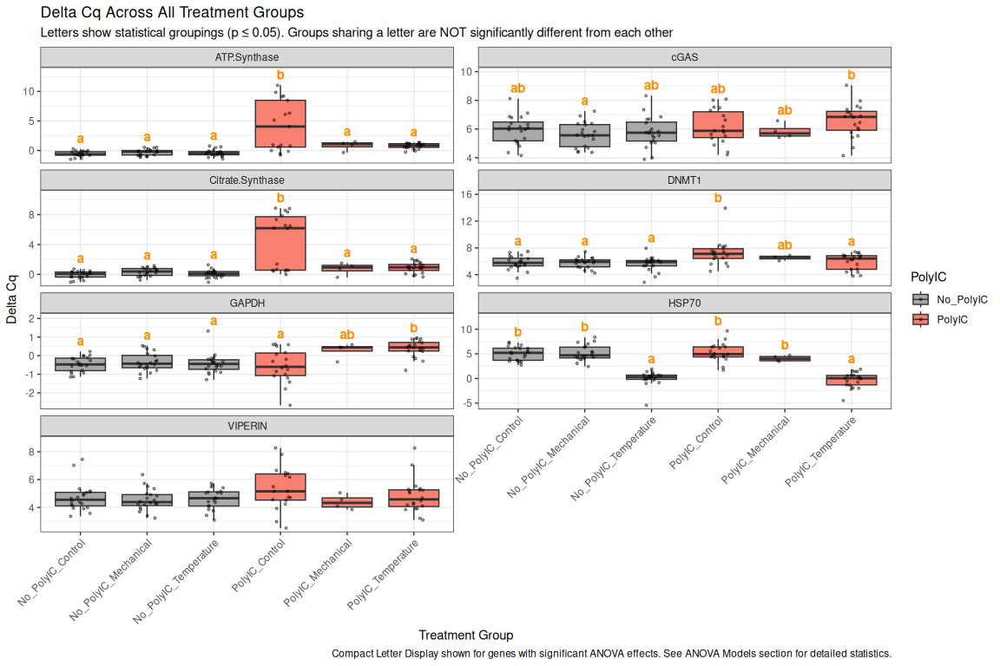<!-- -->

## 6.3 ANOVA Results and Diagnostics

Run ANOVA models to test for effects of PolyIC treatment and stress type
on delta Cq values for each target gene.

**Note:** ANOVA models were created in the Create ANOVA Models section
above. This section provides detailed assumption checks and
interpretations for each gene.

### 6.3.1 Data distribution check

ANOVA assumes that data (or residuals) are approximately normally
distributed. This histogram provides a quick visual check of the overall
delta Cq distribution across all samples and targets.

**What to look for:**

- **Bell-shaped curve**: Indicates roughly normal distribution,
  supporting ANOVA use

- **Skewness**: Strong left or right skew may violate normality
  assumptions

- **Outliers**: Extreme values far from the main distribution

- **Multimodal**: Multiple peaks may indicate distinct subpopulations

While this shows the overall distribution, we’ll check normality of
residuals for each gene-specific model using QQ plots below.

``` r
hist(delta_Cq_df$delta_Cq, main = "Distribution of Delta Cq Values", xlab = "Delta Cq")
```

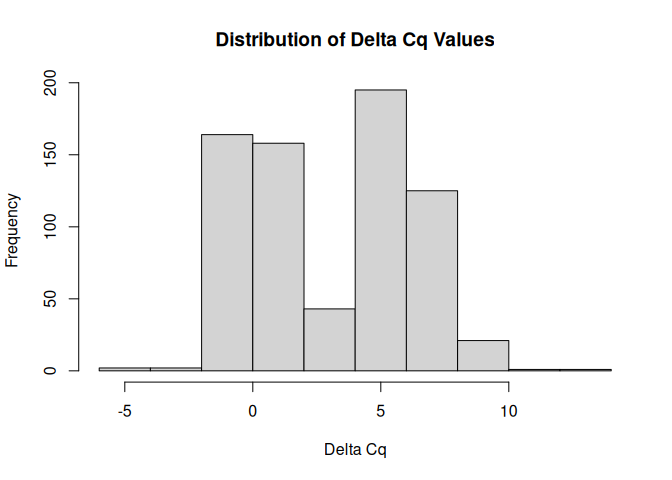<!-- -->

### 6.3.2 ATP Synthase

ATP synthase is an enzyme complex that functions to synthesize adenosine
triphosphate (ATP) from adenosine diphosphate (ADP) and inorganic
phosphate (Pi), essentially generating the cell’s primary energy
currency by harnessing the energy from a proton gradient across a
membrane.

``` r
model_atp <- delta_Cq_df %>%
  filter(Target == "ATP.Synthase") %>%
  aov(delta_Cq ~ polyIC * stress_type, data = .)

summary(model_atp)
```

                       Df Sum Sq Mean Sq F value   Pr(>F)    
    polyIC              1 166.88  166.88  51.655 1.49e-10 ***
    stress_type         2  45.47   22.74   7.037  0.00141 ** 
    polyIC:stress_type  2  70.08   35.04  10.845 5.72e-05 ***
    Residuals          95 306.92    3.23                     
    ---
    Signif. codes:  0 '***' 0.001 '**' 0.01 '*' 0.05 '.' 0.1 ' ' 1

#### 6.3.2.1 Assumption Checks for ATP Synthase

**QQ Plot (Quantile-Quantile Plot)**: Tests normality assumption of
residuals.

- **What to look for**: Points should fall along the diagonal reference
  line
- **Good fit**: Points closely follow the line, indicating normally
  distributed residuals
- **Violations**: Systematic deviations (S-curves, heavy tails) suggest
  non-normality
- **Minor deviations** at the ends are usually acceptable

``` r
qqPlot(model_atp$residuals)
```

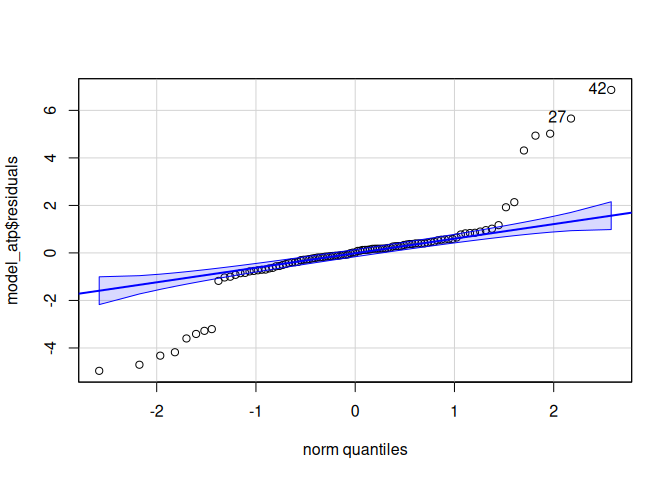<!-- -->

    [1] 42 27

**Levene’s Test**: Tests homogeneity of variance (equal variances across
groups).

- **Null hypothesis**: Variances are equal across all treatment groups
- **p-value \> 0.05**: Variances are homogeneous (assumption met) ✓
- **p-value ≤ 0.05**: Variances differ significantly (assumption
  violated)

``` r
leveneTest(model_atp$residuals ~ polyIC * stress_type, 
           data = delta_Cq_df %>% filter(Target == "ATP.Synthase"))

# If significant effects found, run post-hoc tests
if(any(summary(model_atp)[[1]][["Pr(>F)"]][1:3] < 0.05, na.rm = TRUE)) {
  emm_atp <- emmeans(model_atp, ~ polyIC * stress_type)
  pairs_atp <- pairs(emm_atp)
  print(pairs_atp)
  
  # Identify significant contrasts
  pairs_df <- as.data.frame(pairs_atp)
  sig_contrasts <- pairs_df[pairs_df$p.value <= 0.05, ]
  
  cat("\n**ATP Synthase - Pairwise Contrast Summary:**\n\n")
  if(nrow(sig_contrasts) > 0) {
    cat("Significant contrasts (p ≤ 0.05):\n")
    for(i in 1:nrow(sig_contrasts)) {
      cat("-", sig_contrasts$contrast[i], "(p =", round(sig_contrasts$p.value[i], 4), ")\n")
    }
  } else {
    cat("No significant pairwise contrasts found (all p > 0.05).\n")
  }
} else {
  cat("No significant effects found; post-hoc tests not performed.\n")
}
```

    Levene's Test for Homogeneity of Variance (center = median)
          Df F value    Pr(>F)    
    group  5  52.129 < 2.2e-16 ***
          95                      
    ---
    Signif. codes:  0 '***' 0.001 '**' 0.01 '*' 0.05 '.' 0.1 ' ' 1
     contrast                                     estimate    SE df t.ratio p.value
     No_PolyIC Control - PolyIC Control            -4.7515 0.593 95  -8.014 <0.0001
     No_PolyIC Control - No_PolyIC Mechanical      -0.2625 0.568 95  -0.462  0.9973
     No_PolyIC Control - PolyIC Mechanical         -1.3960 0.984 95  -1.418  0.7161
     No_PolyIC Control - No_PolyIC Temperature     -0.1742 0.568 95  -0.306  0.9996
     No_PolyIC Control - PolyIC Temperature        -1.3464 0.568 95  -2.369  0.1779
     PolyIC Control - No_PolyIC Mechanical          4.4891 0.593 95   7.571 <0.0001
     PolyIC Control - PolyIC Mechanical             3.3555 0.999 95   3.359  0.0139
     PolyIC Control - No_PolyIC Temperature         4.5773 0.593 95   7.720 <0.0001
     PolyIC Control - PolyIC Temperature            3.4051 0.593 95   5.743 <0.0001
     No_PolyIC Mechanical - PolyIC Mechanical      -1.1336 0.984 95  -1.151  0.8583
     No_PolyIC Mechanical - No_PolyIC Temperature   0.0883 0.568 95   0.155  1.0000
     No_PolyIC Mechanical - PolyIC Temperature     -1.0839 0.568 95  -1.907  0.4043
     PolyIC Mechanical - No_PolyIC Temperature      1.2218 0.984 95   1.241  0.8155
     PolyIC Mechanical - PolyIC Temperature         0.0496 0.984 95   0.050  1.0000
     No_PolyIC Temperature - PolyIC Temperature    -1.1722 0.568 95  -2.062  0.3159

    P value adjustment: tukey method for comparing a family of 6 estimates 

    **ATP Synthase - Pairwise Contrast Summary:**

    Significant contrasts (p ≤ 0.05):
    - No_PolyIC Control - PolyIC Control (p = 0 )
    - PolyIC Control - No_PolyIC Mechanical (p = 0 )
    - PolyIC Control - PolyIC Mechanical (p = 0.0139 )
    - PolyIC Control - No_PolyIC Temperature (p = 0 )
    - PolyIC Control - PolyIC Temperature (p = 0 )

#### 6.3.2.2 ATP Synthase ANOVA Interpretation

``` r
anova_results <- summary(model_atp)[[1]]
# Fix: Trim whitespace from rownames
rownames(anova_results) <- trimws(rownames(anova_results))

levene_results <- leveneTest(model_atp$residuals ~ polyIC * stress_type, 
                              data = delta_Cq_df %>% filter(Target == "ATP.Synthase"))

cat("**ATP Synthase ANOVA Results:**\n\n")
cat("This ANOVA evaluates whether PolyIC treatment and/or stress type affect ATP Synthase expression (delta Cq).\n\n")

cat("**Treatment Effects (ANOVA):**\n\n")

# Check main effects and interaction
if(anova_results["polyIC", "Pr(>F)"] < 0.05) {
  cat("- **PolyIC effect**: SIGNIFICANT (p =", round(anova_results["polyIC", "Pr(>F)"], 4), ")\n")
} else {
  cat("- **PolyIC effect**: Not significant (p =", round(anova_results["polyIC", "Pr(>F)"], 4), ")\n")
}

if(anova_results["stress_type", "Pr(>F)"] < 0.05) {
  cat("- **Stress type effect**: SIGNIFICANT (p =", round(anova_results["stress_type", "Pr(>F)"], 4), ")\n")
} else {
  cat("- **Stress type effect**: Not significant (p =", round(anova_results["stress_type", "Pr(>F)"], 4), ")\n")
}

if(anova_results["polyIC:stress_type", "Pr(>F)"] < 0.05) {
  cat("- **PolyIC × Stress interaction**: SIGNIFICANT (p =", round(anova_results["polyIC:stress_type", "Pr(>F)"], 4), ")\n")
  cat("  → The effect of stress depends on PolyIC treatment status.\n")
} else {
  cat("- **PolyIC × Stress interaction**: Not significant (p =", round(anova_results["polyIC:stress_type", "Pr(>F)"], 4), ")\n")
}

cat("\n**Assumption Checks:**\n\n")

# Check Levene's test
levene_p <- levene_results$`Pr(>F)`[1]
if(levene_p > 0.05) {
  cat("- **Levene's Test** (homogeneity of variance): PASSED (p =", round(levene_p, 4), ") ✓\n")
  cat("  → Variances are equal across groups; ANOVA is appropriate.\n")
} else {
  cat("- **Levene's Test** (homogeneity of variance): FAILED (p =", round(levene_p, 4), ") ⚠️\n")
  cat("  → Variances differ across groups; ANOVA results should be interpreted with caution.\n")
}
```

    **ATP Synthase ANOVA Results:**

    This ANOVA evaluates whether PolyIC treatment and/or stress type affect ATP Synthase expression (delta Cq).

    **Treatment Effects (ANOVA):**

    - **PolyIC effect**: SIGNIFICANT (p = 0 )
    - **Stress type effect**: SIGNIFICANT (p = 0.0014 )
    - **PolyIC × Stress interaction**: SIGNIFICANT (p = 1e-04 )
      → The effect of stress depends on PolyIC treatment status.

    **Assumption Checks:**

    - **Levene's Test** (homogeneity of variance): FAILED (p = 0 ) ⚠️
      → Variances differ across groups; ANOVA results should be interpreted with caution.

### 6.3.3 Citrate Synthase

Citrate synthase is important for energy production in the TCA cycle and
is linked to the electron transport chain. It is also used as an enzyme
marker for intact mitochondria.

``` r
model_citrate <- delta_Cq_df %>%
  filter(Target == "Citrate.Synthase") %>%
  aov(delta_Cq ~ polyIC * stress_type, data = .)

summary(model_citrate)
```

                       Df Sum Sq Mean Sq F value   Pr(>F)    
    polyIC              1 129.40  129.40   49.15 3.30e-10 ***
    stress_type         2  52.69   26.34   10.01 0.000113 ***
    polyIC:stress_type  2  79.16   39.58   15.03 2.09e-06 ***
    Residuals          96 252.74    2.63                     
    ---
    Signif. codes:  0 '***' 0.001 '**' 0.01 '*' 0.05 '.' 0.1 ' ' 1

#### 6.3.3.1 Assumption Checks for Citrate Synthase

**QQ Plot (Quantile-Quantile Plot)**: Tests normality assumption of
residuals.

- **What to look for**: Points should fall along the diagonal reference
  line
- **Good fit**: Points closely follow the line, indicating normally
  distributed residuals
- **Violations**: Systematic deviations (S-curves, heavy tails) suggest
  non-normality
- **Minor deviations** at the ends are usually acceptable

``` r
qqPlot(model_citrate$residuals)
```

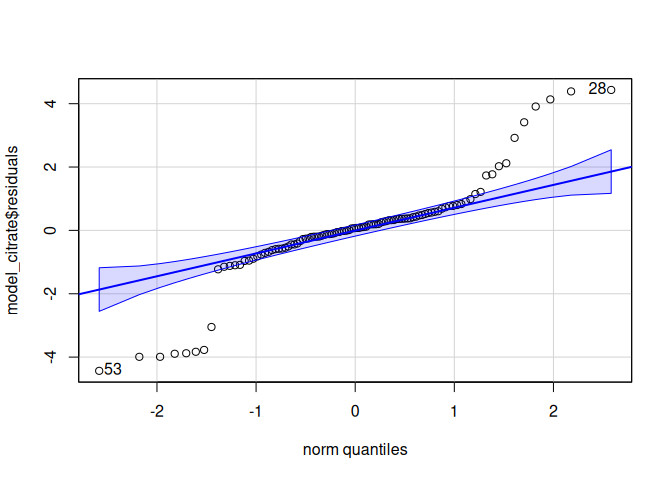<!-- -->

    [1] 53 28

**Levene’s Test**: Tests homogeneity of variance (equal variances across
groups).

- **Null hypothesis**: Variances are equal across all treatment groups
- **p-value \> 0.05**: Variances are homogeneous (assumption met) ✓
- **p-value ≤ 0.05**: Variances differ significantly (assumption
  violated)

``` r
leveneTest(model_citrate$residuals ~ polyIC * stress_type, 
           data = delta_Cq_df %>% filter(Target == "Citrate.Synthase"))

# If significant effects found, run post-hoc tests
if(any(summary(model_citrate)[[1]][["Pr(>F)"]][1:3] < 0.05, na.rm = TRUE)) {
  emm_citrate <- emmeans(model_citrate, ~ polyIC * stress_type)
  pairs_citrate <- pairs(emm_citrate)
  print(pairs_citrate)
  
  # Identify significant contrasts
  pairs_df <- as.data.frame(pairs_citrate)
  sig_contrasts <- pairs_df[pairs_df$p.value <= 0.05, ]
  
  cat("\n**Citrate Synthase - Pairwise Contrast Summary:**\n\n")
  if(nrow(sig_contrasts) > 0) {
    cat("Significant contrasts (p ≤ 0.05):\n")
    for(i in 1:nrow(sig_contrasts)) {
      cat("-", sig_contrasts$contrast[i], "(p =", round(sig_contrasts$p.value[i], 4), ")\n")
    }
  } else {
    cat("No significant pairwise contrasts found (all p > 0.05).\n")
  }
} else {
  cat("No significant effects found; post-hoc tests not performed.\n")
}
```

    Levene's Test for Homogeneity of Variance (center = median)
          Df F value    Pr(>F)    
    group  5  21.518 2.187e-14 ***
          96                      
    ---
    Signif. codes:  0 '***' 0.001 '**' 0.01 '*' 0.05 '.' 0.1 ' ' 1
     contrast                                     estimate    SE df t.ratio p.value
     No_PolyIC Control - PolyIC Control             -4.500 0.527 96  -8.536 <0.0001
     No_PolyIC Control - No_PolyIC Mechanical       -0.406 0.513 96  -0.792  0.9683
     No_PolyIC Control - PolyIC Mechanical          -0.812 0.889 96  -0.914  0.9421
     No_PolyIC Control - No_PolyIC Temperature      -0.132 0.513 96  -0.257  0.9998
     No_PolyIC Control - PolyIC Temperature         -0.970 0.513 96  -1.891  0.4138
     PolyIC Control - No_PolyIC Mechanical           4.094 0.527 96   7.765 <0.0001
     PolyIC Control - PolyIC Mechanical              3.688 0.897 96   4.112  0.0011
     PolyIC Control - No_PolyIC Temperature          4.368 0.527 96   8.286 <0.0001
     PolyIC Control - PolyIC Temperature             3.529 0.527 96   6.695 <0.0001
     No_PolyIC Mechanical - PolyIC Mechanical       -0.406 0.889 96  -0.457  0.9974
     No_PolyIC Mechanical - No_PolyIC Temperature    0.274 0.513 96   0.535  0.9946
     No_PolyIC Mechanical - PolyIC Temperature      -0.564 0.513 96  -1.100  0.8803
     PolyIC Mechanical - No_PolyIC Temperature       0.680 0.889 96   0.765  0.9726
     PolyIC Mechanical - PolyIC Temperature         -0.158 0.889 96  -0.178  1.0000
     No_PolyIC Temperature - PolyIC Temperature     -0.839 0.513 96  -1.634  0.5781

    P value adjustment: tukey method for comparing a family of 6 estimates 

    **Citrate Synthase - Pairwise Contrast Summary:**

    Significant contrasts (p ≤ 0.05):
    - No_PolyIC Control - PolyIC Control (p = 0 )
    - PolyIC Control - No_PolyIC Mechanical (p = 0 )
    - PolyIC Control - PolyIC Mechanical (p = 0.0011 )
    - PolyIC Control - No_PolyIC Temperature (p = 0 )
    - PolyIC Control - PolyIC Temperature (p = 0 )

#### 6.3.3.2 Citrate Synthase ANOVA Interpretation

``` r
anova_results <- summary(model_citrate)[[1]]
# Fix: Trim whitespace from rownames
rownames(anova_results) <- trimws(rownames(anova_results))

levene_results <- leveneTest(model_citrate$residuals ~ polyIC * stress_type, 
                              data = delta_Cq_df %>% filter(Target == "Citrate.Synthase"))

cat("**Citrate Synthase ANOVA Results:**\n\n")
cat("This ANOVA evaluates whether PolyIC treatment and/or stress type affect Citrate Synthase expression (delta Cq).\n\n")

cat("**Treatment Effects (ANOVA):**\n\n")

if(anova_results["polyIC", "Pr(>F)"] < 0.05) {
  cat("- **PolyIC effect**: SIGNIFICANT (p =", round(anova_results["polyIC", "Pr(>F)"], 4), ")\n")
} else {
  cat("- **PolyIC effect**: Not significant (p =", round(anova_results["polyIC", "Pr(>F)"], 4), ")\n")
}

if(anova_results["stress_type", "Pr(>F)"] < 0.05) {
  cat("- **Stress type effect**: SIGNIFICANT (p =", round(anova_results["stress_type", "Pr(>F)"], 4), ")\n")
} else {
  cat("- **Stress type effect**: Not significant (p =", round(anova_results["stress_type", "Pr(>F)"], 4), ")\n")
}

if(anova_results["polyIC:stress_type", "Pr(>F)"] < 0.05) {
  cat("- **PolyIC × Stress interaction**: SIGNIFICANT (p =", round(anova_results["polyIC:stress_type", "Pr(>F)"], 4), ")\n")
  cat("  → The effect of stress depends on PolyIC treatment status.\n")
} else {
  cat("- **PolyIC × Stress interaction**: Not significant (p =", round(anova_results["polyIC:stress_type", "Pr(>F)"], 4), ")\n")
}

cat("\n**Assumption Checks:**\n\n")

levene_p <- levene_results$`Pr(>F)`[1]
if(levene_p > 0.05) {
  cat("- **Levene's Test** (homogeneity of variance): PASSED (p =", round(levene_p, 4), ") ✓\n")
  cat("  → Variances are equal across groups; ANOVA is appropriate.\n")
} else {
  cat("- **Levene's Test** (homogeneity of variance): FAILED (p =", round(levene_p, 4), ") ⚠️\n")
  cat("  → Variances differ across groups; ANOVA results should be interpreted with caution.\n")
}
```

    **Citrate Synthase ANOVA Results:**

    This ANOVA evaluates whether PolyIC treatment and/or stress type affect Citrate Synthase expression (delta Cq).

    **Treatment Effects (ANOVA):**

    - **PolyIC effect**: SIGNIFICANT (p = 0 )
    - **Stress type effect**: SIGNIFICANT (p = 1e-04 )
    - **PolyIC × Stress interaction**: SIGNIFICANT (p = 0 )
      → The effect of stress depends on PolyIC treatment status.

    **Assumption Checks:**

    - **Levene's Test** (homogeneity of variance): FAILED (p = 0 ) ⚠️
      → Variances differ across groups; ANOVA results should be interpreted with caution.

### 6.3.4 DNMT1

The DNMT1 gene provides instructions for making an enzyme called DNA
methyltransferase 1. This enzyme is involved in DNA methylation, which
is the addition of methyl groups, consisting of one carbon atom and
three hydrogen atoms, to DNA molecules.

``` r
model_dnmt1 <- delta_Cq_df %>%
  filter(Target == "DNMT1") %>%
  aov(delta_Cq ~ polyIC * stress_type, data = .)

summary(model_dnmt1)
```

                       Df Sum Sq Mean Sq F value  Pr(>F)   
    polyIC              1  17.24  17.240   11.06 0.00125 **
    stress_type         2  10.54   5.269    3.38 0.03818 * 
    polyIC:stress_type  2   6.14   3.071    1.97 0.14512   
    Residuals          95 148.08   1.559                   
    ---
    Signif. codes:  0 '***' 0.001 '**' 0.01 '*' 0.05 '.' 0.1 ' ' 1

#### 6.3.4.1 Assumption Checks for DNMT1

**QQ Plot (Quantile-Quantile Plot)**: Tests normality assumption of
residuals.

- **What to look for**: Points should fall along the diagonal reference
  line
- **Good fit**: Points closely follow the line, indicating normally
  distributed residuals
- **Violations**: Systematic deviations (S-curves, heavy tails) suggest
  non-normality
- **Minor deviations** at the ends are usually acceptable

``` r
qqPlot(model_dnmt1$residuals)
```

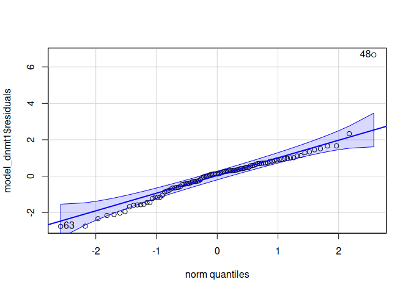<!-- -->

    [1] 48 63

**Levene’s Test**: Tests homogeneity of variance (equal variances across
groups).

- **Null hypothesis**: Variances are equal across all treatment groups
- **p-value \> 0.05**: Variances are homogeneous (assumption met) ✓
- **p-value ≤ 0.05**: Variances differ significantly (assumption
  violated)

``` r
leveneTest(model_dnmt1$residuals ~ polyIC * stress_type, 
           data = delta_Cq_df %>% filter(Target == "DNMT1"))

# If significant effects found, run post-hoc tests
if(any(summary(model_dnmt1)[[1]][["Pr(>F)"]][1:3] < 0.05, na.rm = TRUE)) {
  emm_dnmt1 <- emmeans(model_dnmt1, ~ polyIC * stress_type)
  pairs_dnmt1 <- pairs(emm_dnmt1)
  print(pairs_dnmt1)
  
  # Identify significant contrasts
  pairs_df <- as.data.frame(pairs_dnmt1)
  sig_contrasts <- pairs_df[pairs_df$p.value <= 0.05, ]
  
  cat("\n**DNMT1 - Pairwise Contrast Summary:**\n\n")
  if(nrow(sig_contrasts) > 0) {
    cat("Significant contrasts (p ≤ 0.05):\n")
    for(i in 1:nrow(sig_contrasts)) {
      cat("-", sig_contrasts$contrast[i], "(p =", round(sig_contrasts$p.value[i], 4), ")\n")
    }
  } else {
    cat("No significant pairwise contrasts found (all p > 0.05).\n")
  }
} else {
  cat("No significant effects found; post-hoc tests not performed.\n")
}
```

    Levene's Test for Homogeneity of Variance (center = median)
          Df F value Pr(>F)
    group  5  1.3122 0.2654
          95               
     contrast                                     estimate    SE df t.ratio p.value
     No_PolyIC Control - PolyIC Control            -1.4649 0.406 95  -3.611  0.0063
     No_PolyIC Control - No_PolyIC Mechanical       0.0171 0.395 95   0.043  1.0000
     No_PolyIC Control - PolyIC Mechanical         -0.7256 0.773 95  -0.939  0.9354
     No_PolyIC Control - No_PolyIC Temperature      0.1899 0.395 95   0.481  0.9967
     No_PolyIC Control - PolyIC Temperature        -0.1560 0.395 95  -0.395  0.9987
     PolyIC Control - No_PolyIC Mechanical          1.4820 0.406 95   3.654  0.0055
     PolyIC Control - PolyIC Mechanical             0.7393 0.779 95   0.950  0.9323
     PolyIC Control - No_PolyIC Temperature         1.6548 0.406 95   4.080  0.0013
     PolyIC Control - PolyIC Temperature            1.3089 0.406 95   3.227  0.0207
     No_PolyIC Mechanical - PolyIC Mechanical      -0.7427 0.773 95  -0.961  0.9290
     No_PolyIC Mechanical - No_PolyIC Temperature   0.1728 0.395 95   0.438  0.9979
     No_PolyIC Mechanical - PolyIC Temperature     -0.1731 0.395 95  -0.438  0.9979
     PolyIC Mechanical - No_PolyIC Temperature      0.9156 0.773 95   1.184  0.8432
     PolyIC Mechanical - PolyIC Temperature         0.5696 0.773 95   0.737  0.9768
     No_PolyIC Temperature - PolyIC Temperature    -0.3459 0.395 95  -0.876  0.9513

    P value adjustment: tukey method for comparing a family of 6 estimates 

    **DNMT1 - Pairwise Contrast Summary:**

    Significant contrasts (p ≤ 0.05):
    - No_PolyIC Control - PolyIC Control (p = 0.0063 )
    - PolyIC Control - No_PolyIC Mechanical (p = 0.0055 )
    - PolyIC Control - No_PolyIC Temperature (p = 0.0013 )
    - PolyIC Control - PolyIC Temperature (p = 0.0207 )

#### 6.3.4.2 DNMT1 ANOVA Interpretation

``` r
anova_results <- summary(model_dnmt1)[[1]]
# Fix: Trim whitespace from rownames
rownames(anova_results) <- trimws(rownames(anova_results))

levene_results <- leveneTest(model_dnmt1$residuals ~ polyIC * stress_type, 
                              data = delta_Cq_df %>% filter(Target == "DNMT1"))

cat("**DNMT1 ANOVA Results:**\n\n")
cat("This ANOVA evaluates whether PolyIC treatment and/or stress type affect DNMT1 expression (delta Cq).\n\n")

cat("**Treatment Effects (ANOVA):**\n\n")

if(anova_results["polyIC", "Pr(>F)"] < 0.05) {
  cat("- **PolyIC effect**: SIGNIFICANT (p =", round(anova_results["polyIC", "Pr(>F)"], 4), ")\n")
} else {
  cat("- **PolyIC effect**: Not significant (p =", round(anova_results["polyIC", "Pr(>F)"], 4), ")\n")
}

if(anova_results["stress_type", "Pr(>F)"] < 0.05) {
  cat("- **Stress type effect**: SIGNIFICANT (p =", round(anova_results["stress_type", "Pr(>F)"], 4), ")\n")
} else {
  cat("- **Stress type effect**: Not significant (p =", round(anova_results["stress_type", "Pr(>F)"], 4), ")\n")
}

if(anova_results["polyIC:stress_type", "Pr(>F)"] < 0.05) {
  cat("- **PolyIC × Stress interaction**: SIGNIFICANT (p =", round(anova_results["polyIC:stress_type", "Pr(>F)"], 4), ")\n")
  cat("  → The effect of stress depends on PolyIC treatment status.\n")
} else {
  cat("- **PolyIC × Stress interaction**: Not significant (p =", round(anova_results["polyIC:stress_type", "Pr(>F)"], 4), ")\n")
}

cat("\n**Assumption Checks:**\n\n")

levene_p <- levene_results$`Pr(>F)`[1]
if(levene_p > 0.05) {
  cat("- **Levene's Test** (homogeneity of variance): PASSED (p =", round(levene_p, 4), ") ✓\n")
  cat("  → Variances are equal across groups; ANOVA is appropriate.\n")
} else {
  cat("- **Levene's Test** (homogeneity of variance): FAILED (p =", round(levene_p, 4), ") ⚠️\n")
  cat("  → Variances differ across groups; ANOVA results should be interpreted with caution.\n")
}
```

    **DNMT1 ANOVA Results:**

    This ANOVA evaluates whether PolyIC treatment and/or stress type affect DNMT1 expression (delta Cq).

    **Treatment Effects (ANOVA):**

    - **PolyIC effect**: SIGNIFICANT (p = 0.0013 )
    - **Stress type effect**: SIGNIFICANT (p = 0.0382 )
    - **PolyIC × Stress interaction**: Not significant (p = 0.1451 )

    **Assumption Checks:**

    - **Levene's Test** (homogeneity of variance): PASSED (p = 0.2654 ) ✓
      → Variances are equal across groups; ANOVA is appropriate.

### 6.3.5 HSP70

Heat Shock Protein 70 (Hsp70) is a molecular chaperone that plays
crucial roles in maintaining cellular protein homeostasis and protecting
cells from stress.

``` r
model_hsp70 <- delta_Cq_df %>%
  filter(Target == "HSP70") %>%
  aov(delta_Cq ~ polyIC * stress_type, data = .)

summary(model_hsp70)
```

                       Df Sum Sq Mean Sq F value  Pr(>F)    
    polyIC              1   20.3    20.3   8.327 0.00482 ** 
    stress_type         2  642.5   321.2 131.755 < 2e-16 ***
    polyIC:stress_type  2    5.2     2.6   1.057 0.35167    
    Residuals          96  234.1     2.4                    
    ---
    Signif. codes:  0 '***' 0.001 '**' 0.01 '*' 0.05 '.' 0.1 ' ' 1

#### 6.3.5.1 Assumption Checks for HSP70

**QQ Plot (Quantile-Quantile Plot)**: Tests normality assumption of
residuals.

- **What to look for**: Points should fall along the diagonal reference
  line
- **Good fit**: Points closely follow the line, indicating normally
  distributed residuals
- **Violations**: Systematic deviations (S-curves, heavy tails) suggest
  non-normality
- **Minor deviations** at the ends are usually acceptable

``` r
qqPlot(model_hsp70$residuals)
```

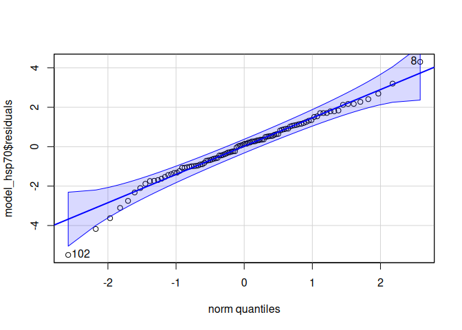<!-- -->

    [1] 102   8

**Levene’s Test**: Tests homogeneity of variance (equal variances across
groups).

- **Null hypothesis**: Variances are equal across all treatment groups
- **p-value \> 0.05**: Variances are homogeneous (assumption met) ✓
- **p-value ≤ 0.05**: Variances differ significantly (assumption
  violated)

``` r
leveneTest(model_hsp70$residuals ~ polyIC * stress_type, 
           data = delta_Cq_df %>% filter(Target == "HSP70"))

# If significant effects found, run post-hoc tests
if(any(summary(model_hsp70)[[1]][["Pr(>F)"]][1:3] < 0.05, na.rm = TRUE)) {
  emm_hsp70 <- emmeans(model_hsp70, ~ polyIC * stress_type)
  pairs_hsp70 <- pairs(emm_hsp70)
  print(pairs_hsp70)
  
  # Identify significant contrasts
  pairs_df <- as.data.frame(pairs_hsp70)
  sig_contrasts <- pairs_df[pairs_df$p.value <= 0.05, ]
  
  cat("\n**HSP70 - Pairwise Contrast Summary:**\n\n")
  if(nrow(sig_contrasts) > 0) {
    cat("Significant contrasts (p ≤ 0.05):\n")
    for(i in 1:nrow(sig_contrasts)) {
      cat("-", sig_contrasts$contrast[i], "(p =", round(sig_contrasts$p.value[i], 4), ")\n")
    }
  } else {
    cat("No significant pairwise contrasts found (all p > 0.05).\n")
  }
} else {
  cat("No significant effects found; post-hoc tests not performed.\n")
}
```

    Levene's Test for Homogeneity of Variance (center = median)
          Df F value Pr(>F)
    group  5   0.961 0.4457
          96               
     contrast                                     estimate    SE df t.ratio p.value
     No_PolyIC Control - PolyIC Control             -0.263 0.507 96  -0.519  0.9953
     No_PolyIC Control - No_PolyIC Mechanical       -0.115 0.494 96  -0.233  0.9999
     No_PolyIC Control - PolyIC Mechanical           1.011 0.855 96   1.183  0.8441
     No_PolyIC Control - No_PolyIC Temperature       4.985 0.494 96  10.096 <0.0001
     No_PolyIC Control - PolyIC Temperature          5.348 0.494 96  10.830 <0.0001
     PolyIC Control - No_PolyIC Mechanical           0.148 0.507 96   0.292  0.9997
     PolyIC Control - PolyIC Mechanical              1.275 0.863 96   1.477  0.6798
     PolyIC Control - No_PolyIC Temperature          5.249 0.507 96  10.346 <0.0001
     PolyIC Control - PolyIC Temperature             5.611 0.507 96  11.060 <0.0001
     No_PolyIC Mechanical - PolyIC Mechanical        1.126 0.855 96   1.317  0.7750
     No_PolyIC Mechanical - No_PolyIC Temperature    5.100 0.494 96  10.329 <0.0001
     No_PolyIC Mechanical - PolyIC Temperature       5.463 0.494 96  11.063 <0.0001
     PolyIC Mechanical - No_PolyIC Temperature       3.974 0.855 96   4.647  0.0002
     PolyIC Mechanical - PolyIC Temperature          4.336 0.855 96   5.070 <0.0001
     No_PolyIC Temperature - PolyIC Temperature      0.362 0.494 96   0.734  0.9773

    P value adjustment: tukey method for comparing a family of 6 estimates 

    **HSP70 - Pairwise Contrast Summary:**

    Significant contrasts (p ≤ 0.05):
    - No_PolyIC Control - No_PolyIC Temperature (p = 0 )
    - No_PolyIC Control - PolyIC Temperature (p = 0 )
    - PolyIC Control - No_PolyIC Temperature (p = 0 )
    - PolyIC Control - PolyIC Temperature (p = 0 )
    - No_PolyIC Mechanical - No_PolyIC Temperature (p = 0 )
    - No_PolyIC Mechanical - PolyIC Temperature (p = 0 )
    - PolyIC Mechanical - No_PolyIC Temperature (p = 2e-04 )
    - PolyIC Mechanical - PolyIC Temperature (p = 0 )

#### 6.3.5.2 HSP70 ANOVA Interpretation

``` r
anova_results <- summary(model_hsp70)[[1]]
# Fix: Trim whitespace from rownames
rownames(anova_results) <- trimws(rownames(anova_results))

levene_results <- leveneTest(model_hsp70$residuals ~ polyIC * stress_type, 
                              data = delta_Cq_df %>% filter(Target == "HSP70"))

cat("**HSP70 ANOVA Results:**\n\n")
cat("This ANOVA evaluates whether PolyIC treatment and/or stress type affect HSP70 expression (delta Cq).\n\n")

cat("**Treatment Effects (ANOVA):**\n\n")

if(anova_results["polyIC", "Pr(>F)"] < 0.05) {
  cat("- **PolyIC effect**: SIGNIFICANT (p =", round(anova_results["polyIC", "Pr(>F)"], 4), ")\n")
} else {
  cat("- **PolyIC effect**: Not significant (p =", round(anova_results["polyIC", "Pr(>F)"], 4), ")\n")
}

if(anova_results["stress_type", "Pr(>F)"] < 0.05) {
  cat("- **Stress type effect**: SIGNIFICANT (p =", round(anova_results["stress_type", "Pr(>F)"], 4), ")\n")
} else {
  cat("- **Stress type effect**: Not significant (p =", round(anova_results["stress_type", "Pr(>F)"], 4), ")\n")
}

if(anova_results["polyIC:stress_type", "Pr(>F)"] < 0.05) {
  cat("- **PolyIC × Stress interaction**: SIGNIFICANT (p =", round(anova_results["polyIC:stress_type", "Pr(>F)"], 4), ")\n")
  cat("  → The effect of stress depends on PolyIC treatment status.\n")
} else {
  cat("- **PolyIC × Stress interaction**: Not significant (p =", round(anova_results["polyIC:stress_type", "Pr(>F)"], 4), ")\n")
}

cat("\n**Assumption Checks:**\n\n")

levene_p <- levene_results$`Pr(>F)`[1]
if(levene_p > 0.05) {
  cat("- **Levene's Test** (homogeneity of variance): PASSED (p =", round(levene_p, 4), ") ✓\n")
  cat("  → Variances are equal across groups; ANOVA is appropriate.\n")
} else {
  cat("- **Levene's Test** (homogeneity of variance): FAILED (p =", round(levene_p, 4), ") ⚠️\n")
  cat("  → Variances differ across groups; ANOVA results should be interpreted with caution.\n")
}
```

    **HSP70 ANOVA Results:**

    This ANOVA evaluates whether PolyIC treatment and/or stress type affect HSP70 expression (delta Cq).

    **Treatment Effects (ANOVA):**

    - **PolyIC effect**: SIGNIFICANT (p = 0.0048 )
    - **Stress type effect**: SIGNIFICANT (p = 0 )
    - **PolyIC × Stress interaction**: Not significant (p = 0.3517 )

    **Assumption Checks:**

    - **Levene's Test** (homogeneity of variance): PASSED (p = 0.4457 ) ✓
      → Variances are equal across groups; ANOVA is appropriate.

### 6.3.6 GAPDH

Glyceraldehyde-3-phosphate dehydrogenase (GAPDH) is a glycolytic enzyme
commonly used as a reference/housekeeping gene in qPCR studies. It is
evaluated here as a gene of interest because it was the previous
normalizing-gene candidate but was excluded from that role (see the
Normalizing Gene Candidate Ranking section) after showing a significant
treatment effect in the raw-Cq ANOVA.

``` r
model_gapdh <- delta_Cq_df %>%
  filter(Target == "GAPDH") %>%
  aov(delta_Cq ~ polyIC * stress_type, data = .)

summary(model_gapdh)
```

                       Df Sum Sq Mean Sq F value  Pr(>F)   
    polyIC              1   3.76   3.759  11.371 0.00108 **
    stress_type         2   4.74   2.372   7.174 0.00125 **
    polyIC:stress_type  2   4.24   2.121   6.414 0.00243 **
    Residuals          96  31.74   0.331                   
    ---
    Signif. codes:  0 '***' 0.001 '**' 0.01 '*' 0.05 '.' 0.1 ' ' 1

#### 6.3.6.1 Assumption Checks for GAPDH

**QQ Plot (Quantile-Quantile Plot)**: Tests normality assumption of
residuals.

- **What to look for**: Points should fall along the diagonal reference
  line
- **Good fit**: Points closely follow the line, indicating normally
  distributed residuals
- **Violations**: Systematic deviations (S-curves, heavy tails) suggest
  non-normality
- **Minor deviations** at the ends are usually acceptable

``` r
qqPlot(model_gapdh$residuals)
```

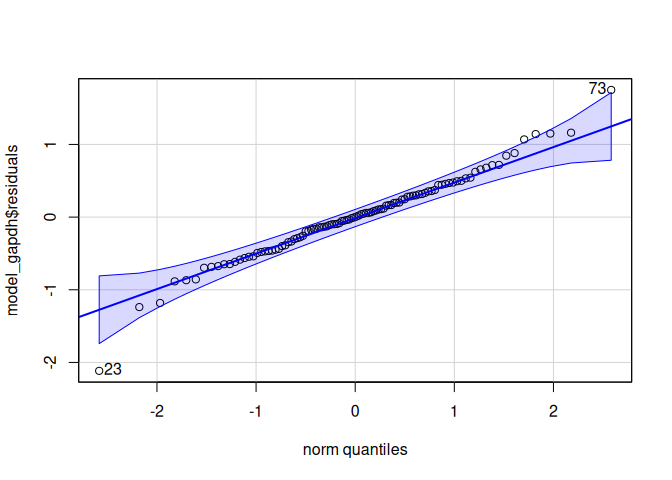<!-- -->

    [1] 23 73

**Levene’s Test**: Tests homogeneity of variance (equal variances across
groups).

- **Null hypothesis**: Variances are equal across all treatment groups
- **p-value \> 0.05**: Variances are homogeneous (assumption met) ✓
- **p-value ≤ 0.05**: Variances differ significantly (assumption
  violated)

``` r
leveneTest(model_gapdh$residuals ~ polyIC * stress_type, 
           data = delta_Cq_df %>% filter(Target == "GAPDH"))

# If significant effects found, run post-hoc tests
if(any(summary(model_gapdh)[[1]][["Pr(>F)"]][1:3] < 0.05, na.rm = TRUE)) {
  emm_gapdh <- emmeans(model_gapdh, ~ polyIC * stress_type)
  pairs_gapdh <- pairs(emm_gapdh)
  print(pairs_gapdh)
  
  # Identify significant contrasts
  pairs_df <- as.data.frame(pairs_gapdh)
  sig_contrasts <- pairs_df[pairs_df$p.value <= 0.05, ]
  
  cat("\n**GAPDH - Pairwise Contrast Summary:**\n\n")
  if(nrow(sig_contrasts) > 0) {
    cat("Significant contrasts (p ≤ 0.05):\n")
    for(i in 1:nrow(sig_contrasts)) {
      cat("-", sig_contrasts$contrast[i], "(p =", round(sig_contrasts$p.value[i], 4), ")\n")
    }
  } else {
    cat("No significant pairwise contrasts found (all p > 0.05).\n")
  }
} else {
  cat("No significant effects found; post-hoc tests not performed.\n")
}
```

    Levene's Test for Homogeneity of Variance (center = median)
          Df F value   Pr(>F)   
    group  5  3.2753 0.008959 **
          96                    
    ---
    Signif. codes:  0 '***' 0.001 '**' 0.01 '*' 0.05 '.' 0.1 ' ' 1
     contrast                                     estimate    SE df t.ratio p.value
     No_PolyIC Control - PolyIC Control             0.0915 0.187 96   0.490  0.9964
     No_PolyIC Control - No_PolyIC Mechanical      -0.1112 0.182 96  -0.612  0.9899
     No_PolyIC Control - PolyIC Mechanical         -0.7415 0.315 96  -2.355  0.1831
     No_PolyIC Control - No_PolyIC Temperature     -0.0306 0.182 96  -0.168  1.0000
     No_PolyIC Control - PolyIC Temperature        -0.8525 0.182 96  -4.689  0.0001
     PolyIC Control - No_PolyIC Mechanical         -0.2028 0.187 96  -1.085  0.8861
     PolyIC Control - PolyIC Mechanical            -0.8331 0.318 96  -2.621  0.1021
     PolyIC Control - No_PolyIC Temperature        -0.1221 0.187 96  -0.654  0.9864
     PolyIC Control - PolyIC Temperature           -0.9441 0.187 96  -5.054 <0.0001
     No_PolyIC Mechanical - PolyIC Mechanical      -0.6303 0.315 96  -2.001  0.3493
     No_PolyIC Mechanical - No_PolyIC Temperature   0.0806 0.182 96   0.443  0.9978
     No_PolyIC Mechanical - PolyIC Temperature     -0.7413 0.182 96  -4.077  0.0013
     PolyIC Mechanical - No_PolyIC Temperature      0.7109 0.315 96   2.257  0.2220
     PolyIC Mechanical - PolyIC Temperature        -0.1110 0.315 96  -0.352  0.9993
     No_PolyIC Temperature - PolyIC Temperature    -0.8219 0.182 96  -4.520  0.0002

    P value adjustment: tukey method for comparing a family of 6 estimates 

    **GAPDH - Pairwise Contrast Summary:**

    Significant contrasts (p ≤ 0.05):
    - No_PolyIC Control - PolyIC Temperature (p = 1e-04 )
    - PolyIC Control - PolyIC Temperature (p = 0 )
    - No_PolyIC Mechanical - PolyIC Temperature (p = 0.0013 )
    - No_PolyIC Temperature - PolyIC Temperature (p = 2e-04 )

#### 6.3.6.2 GAPDH ANOVA Interpretation

``` r
anova_results <- summary(model_gapdh)[[1]]
# Fix: Trim whitespace from rownames
rownames(anova_results) <- trimws(rownames(anova_results))

levene_results <- leveneTest(model_gapdh$residuals ~ polyIC * stress_type, 
                              data = delta_Cq_df %>% filter(Target == "GAPDH"))

cat("**GAPDH ANOVA Results:**\n\n")
cat("This ANOVA evaluates whether PolyIC treatment and/or stress type affect GAPDH expression (delta Cq).\n\n")

cat("**Treatment Effects (ANOVA):**\n\n")

if(anova_results["polyIC", "Pr(>F)"] < 0.05) {
  cat("- **PolyIC effect**: SIGNIFICANT (p =", round(anova_results["polyIC", "Pr(>F)"], 4), ")\n")
} else {
  cat("- **PolyIC effect**: Not significant (p =", round(anova_results["polyIC", "Pr(>F)"], 4), ")\n")
}

if(anova_results["stress_type", "Pr(>F)"] < 0.05) {
  cat("- **Stress type effect**: SIGNIFICANT (p =", round(anova_results["stress_type", "Pr(>F)"], 4), ")\n")
} else {
  cat("- **Stress type effect**: Not significant (p =", round(anova_results["stress_type", "Pr(>F)"], 4), ")\n")
}

if(anova_results["polyIC:stress_type", "Pr(>F)"] < 0.05) {
  cat("- **PolyIC × Stress interaction**: SIGNIFICANT (p =", round(anova_results["polyIC:stress_type", "Pr(>F)"], 4), ")\n")
  cat("  → The effect of stress depends on PolyIC treatment status.\n")
} else {
  cat("- **PolyIC × Stress interaction**: Not significant (p =", round(anova_results["polyIC:stress_type", "Pr(>F)"], 4), ")\n")
}

cat("\n**Assumption Checks:**\n\n")

levene_p <- levene_results$`Pr(>F)`[1]
if(levene_p > 0.05) {
  cat("- **Levene's Test** (homogeneity of variance): PASSED (p =", round(levene_p, 4), ") ✓\n")
  cat("  → Variances are equal across groups; ANOVA is appropriate.\n")
} else {
  cat("- **Levene's Test** (homogeneity of variance): FAILED (p =", round(levene_p, 4), ") ⚠️\n")
  cat("  → Variances differ across groups; ANOVA results should be interpreted with caution.\n")
}
```

    **GAPDH ANOVA Results:**

    This ANOVA evaluates whether PolyIC treatment and/or stress type affect GAPDH expression (delta Cq).

    **Treatment Effects (ANOVA):**

    - **PolyIC effect**: SIGNIFICANT (p = 0.0011 )
    - **Stress type effect**: SIGNIFICANT (p = 0.0012 )
    - **PolyIC × Stress interaction**: SIGNIFICANT (p = 0.0024 )
      → The effect of stress depends on PolyIC treatment status.

    **Assumption Checks:**

    - **Levene's Test** (homogeneity of variance): FAILED (p = 0.009 ) ⚠️
      → Variances differ across groups; ANOVA results should be interpreted with caution.

### 6.3.7 cGAS

The cGAS gene is involved in several processes, including cellular
response to exogenous dsRNA, positive regulation of intracellular signal
transduction, and regulation of defense response.

``` r
model_cgas <- delta_Cq_df %>%
  filter(Target == "cGAS") %>%
  aov(delta_Cq ~ polyIC * stress_type, data = .)

summary(model_cgas)
```

                       Df Sum Sq Mean Sq F value  Pr(>F)   
    polyIC              1   7.67   7.674   7.086 0.00911 **
    stress_type         2   2.14   1.068   0.987 0.37659   
    polyIC:stress_type  2   1.75   0.876   0.809 0.44821   
    Residuals          96 103.97   1.083                   
    ---
    Signif. codes:  0 '***' 0.001 '**' 0.01 '*' 0.05 '.' 0.1 ' ' 1

#### 6.3.7.1 Assumption Checks for cGAS

**QQ Plot (Quantile-Quantile Plot)**: Tests normality assumption of
residuals.

- **What to look for**: Points should fall along the diagonal reference
  line
- **Good fit**: Points closely follow the line, indicating normally
  distributed residuals
- **Violations**: Systematic deviations (S-curves, heavy tails) suggest
  non-normality
- **Minor deviations** at the ends are usually acceptable

``` r
qqPlot(model_cgas$residuals)
```

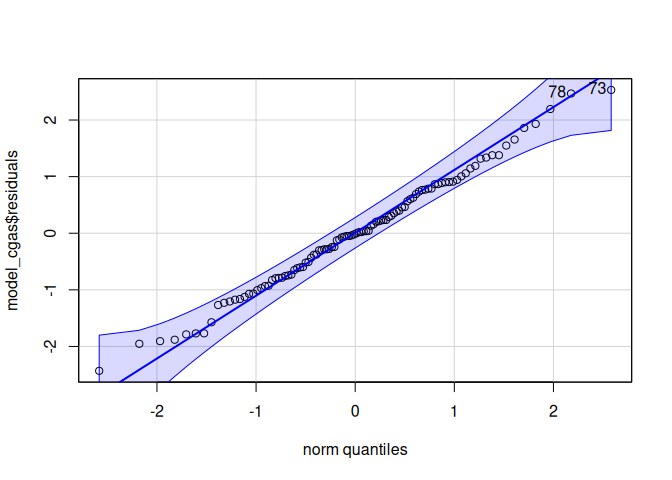<!-- -->

    [1] 73 78

**Levene’s Test**: Tests homogeneity of variance (equal variances across
groups).

- **Null hypothesis**: Variances are equal across all treatment groups
- **p-value \> 0.05**: Variances are homogeneous (assumption met) ✓
- **p-value ≤ 0.05**: Variances differ significantly (assumption
  violated)

``` r
leveneTest(model_cgas$residuals ~ polyIC * stress_type, 
           data = delta_Cq_df %>% filter(Target == "cGAS"))

# If significant effects found, run post-hoc tests
if(any(summary(model_cgas)[[1]][["Pr(>F)"]][1:3] < 0.05, na.rm = TRUE)) {
  emm_cgas <- emmeans(model_cgas, ~ polyIC * stress_type)
  pairs_cgas <- pairs(emm_cgas)
  print(pairs_cgas)
  
  # Identify significant contrasts
  pairs_df <- as.data.frame(pairs_cgas)
  sig_contrasts <- pairs_df[pairs_df$p.value <= 0.05, ]
  
  cat("\n**cGAS - Pairwise Contrast Summary:**\n\n")
  if(nrow(sig_contrasts) > 0) {
    cat("Significant contrasts (p ≤ 0.05):\n")
    for(i in 1:nrow(sig_contrasts)) {
      cat("-", sig_contrasts$contrast[i], "(p =", round(sig_contrasts$p.value[i], 4), ")\n")
    }
  } else {
    cat("No significant pairwise contrasts found (all p > 0.05).\n")
  }
} else {
  cat("No significant effects found; post-hoc tests not performed.\n")
}
```

    Levene's Test for Homogeneity of Variance (center = median)
          Df F value Pr(>F)
    group  5  0.7284 0.6038
          96               
     contrast                                     estimate    SE df t.ratio p.value
     No_PolyIC Control - PolyIC Control            -0.2266 0.338 96  -0.670  0.9848
     No_PolyIC Control - No_PolyIC Mechanical       0.3318 0.329 96   1.008  0.9142
     No_PolyIC Control - PolyIC Mechanical          0.0817 0.570 96   0.143  1.0000
     No_PolyIC Control - No_PolyIC Temperature      0.1355 0.329 96   0.412  0.9984
     No_PolyIC Control - PolyIC Temperature        -0.6557 0.329 96  -1.992  0.3543
     PolyIC Control - No_PolyIC Mechanical          0.5584 0.338 96   1.652  0.5669
     PolyIC Control - PolyIC Mechanical             0.3083 0.575 96   0.536  0.9945
     PolyIC Control - No_PolyIC Temperature         0.3621 0.338 96   1.071  0.8916
     PolyIC Control - PolyIC Temperature           -0.4291 0.338 96  -1.269  0.8010
     No_PolyIC Mechanical - PolyIC Mechanical      -0.2501 0.570 96  -0.439  0.9979
     No_PolyIC Mechanical - No_PolyIC Temperature  -0.1963 0.329 96  -0.596  0.9911
     No_PolyIC Mechanical - PolyIC Temperature     -0.9875 0.329 96  -3.001  0.0390
     PolyIC Mechanical - No_PolyIC Temperature      0.0538 0.570 96   0.094  1.0000
     PolyIC Mechanical - PolyIC Temperature        -0.7374 0.570 96  -1.294  0.7878
     No_PolyIC Temperature - PolyIC Temperature    -0.7912 0.329 96  -2.404  0.1651

    P value adjustment: tukey method for comparing a family of 6 estimates 

    **cGAS - Pairwise Contrast Summary:**

    Significant contrasts (p ≤ 0.05):
    - No_PolyIC Mechanical - PolyIC Temperature (p = 0.039 )

#### 6.3.7.2 cGAS ANOVA Interpretation

``` r
anova_results <- summary(model_cgas)[[1]]
# Fix: Trim whitespace from rownames
rownames(anova_results) <- trimws(rownames(anova_results))

levene_results <- leveneTest(model_cgas$residuals ~ polyIC * stress_type, 
                              data = delta_Cq_df %>% filter(Target == "cGAS"))

cat("**cGAS ANOVA Results:**\n\n")
cat("This ANOVA evaluates whether PolyIC treatment and/or stress type affect cGAS expression (delta Cq).\n\n")

cat("**Treatment Effects (ANOVA):**\n\n")

if(anova_results["polyIC", "Pr(>F)"] < 0.05) {
  cat("- **PolyIC effect**: SIGNIFICANT (p =", round(anova_results["polyIC", "Pr(>F)"], 4), ")\n")
} else {
  cat("- **PolyIC effect**: Not significant (p =", round(anova_results["polyIC", "Pr(>F)"], 4), ")\n")
}

if(anova_results["stress_type", "Pr(>F)"] < 0.05) {
  cat("- **Stress type effect**: SIGNIFICANT (p =", round(anova_results["stress_type", "Pr(>F)"], 4), ")\n")
} else {
  cat("- **Stress type effect**: Not significant (p =", round(anova_results["stress_type", "Pr(>F)"], 4), ")\n")
}

if(anova_results["polyIC:stress_type", "Pr(>F)"] < 0.05) {
  cat("- **PolyIC × Stress interaction**: SIGNIFICANT (p =", round(anova_results["polyIC:stress_type", "Pr(>F)"], 4), ")\n")
  cat("  → The effect of stress depends on PolyIC treatment status.\n")
} else {
  cat("- **PolyIC × Stress interaction**: Not significant (p =", round(anova_results["polyIC:stress_type", "Pr(>F)"], 4), ")\n")
}

cat("\n**Assumption Checks:**\n\n")

levene_p <- levene_results$`Pr(>F)`[1]
if(levene_p > 0.05) {
  cat("- **Levene's Test** (homogeneity of variance): PASSED (p =", round(levene_p, 4), ") ✓\n")
  cat("  → Variances are equal across groups; ANOVA is appropriate.\n")
} else {
  cat("- **Levene's Test** (homogeneity of variance): FAILED (p =", round(levene_p, 4), ") ⚠️\n")
  cat("  → Variances differ across groups; ANOVA results should be interpreted with caution.\n")
}
```

    **cGAS ANOVA Results:**

    This ANOVA evaluates whether PolyIC treatment and/or stress type affect cGAS expression (delta Cq).

    **Treatment Effects (ANOVA):**

    - **PolyIC effect**: SIGNIFICANT (p = 0.0091 )
    - **Stress type effect**: Not significant (p = 0.3766 )
    - **PolyIC × Stress interaction**: Not significant (p = 0.4482 )

    **Assumption Checks:**

    - **Levene's Test** (homogeneity of variance): PASSED (p = 0.6038 ) ✓
      → Variances are equal across groups; ANOVA is appropriate.

### 6.3.8 VIPERIN

Viperin limits replication of DNA and RNA viruses.

``` r
model_viperin <- delta_Cq_df %>%
  filter(Target == "VIPERIN") %>%
  aov(delta_Cq ~ polyIC * stress_type, data = .)

summary(model_viperin)
```

                       Df Sum Sq Mean Sq F value Pr(>F)  
    polyIC              1   3.32   3.319   2.894 0.0922 .
    stress_type         2   3.00   1.501   1.309 0.2749  
    polyIC:stress_type  2   1.69   0.845   0.737 0.4813  
    Residuals          96 110.10   1.147                 
    ---
    Signif. codes:  0 '***' 0.001 '**' 0.01 '*' 0.05 '.' 0.1 ' ' 1

#### 6.3.8.1 Assumption Checks for VIPERIN

**QQ Plot (Quantile-Quantile Plot)**: Tests normality assumption of
residuals.

- **What to look for**: Points should fall along the diagonal reference
  line
- **Good fit**: Points closely follow the line, indicating normally
  distributed residuals
- **Violations**: Systematic deviations (S-curves, heavy tails) suggest
  non-normality
- **Minor deviations** at the ends are usually acceptable

``` r
qqPlot(model_viperin$residuals)
```

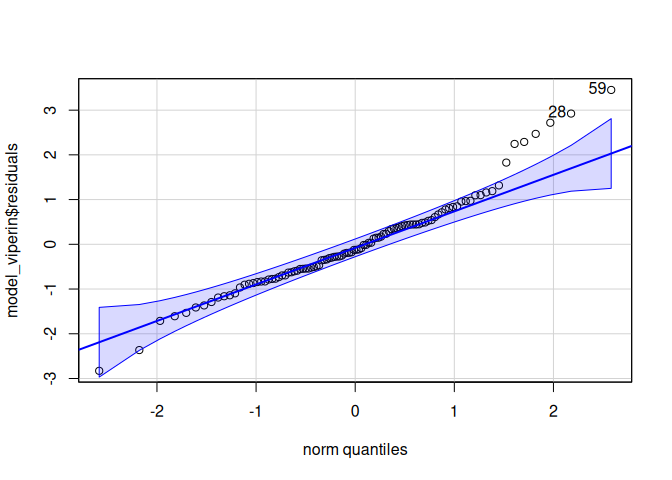<!-- -->

    [1] 59 28

**Levene’s Test**: Tests homogeneity of variance (equal variances across
groups).

- **Null hypothesis**: Variances are equal across all treatment groups
- **p-value \> 0.05**: Variances are homogeneous (assumption met) ✓
- **p-value ≤ 0.05**: Variances differ significantly (assumption
  violated)

``` r
leveneTest(model_viperin$residuals ~ polyIC * stress_type, 
           data = delta_Cq_df %>% filter(Target == "VIPERIN"))

# If significant effects found, run post-hoc tests
if(any(summary(model_viperin)[[1]][["Pr(>F)"]][1:3] < 0.05, na.rm = TRUE)) {
  emm_viperin <- emmeans(model_viperin, ~ polyIC * stress_type)
  pairs_viperin <- pairs(emm_viperin)
  print(pairs_viperin)
  
  # Identify significant contrasts
  pairs_df <- as.data.frame(pairs_viperin)
  sig_contrasts <- pairs_df[pairs_df$p.value <= 0.05, ]
  
  cat("\n**VIPERIN - Pairwise Contrast Summary:**\n\n")
  if(nrow(sig_contrasts) > 0) {
    cat("Significant contrasts (p ≤ 0.05):\n")
    for(i in 1:nrow(sig_contrasts)) {
      cat("-", sig_contrasts$contrast[i], "(p =", round(sig_contrasts$p.value[i], 4), ")\n")
    }
  } else {
    cat("No significant pairwise contrasts found (all p > 0.05).\n")
  }
} else {
  cat("No significant effects found; post-hoc tests not performed.\n")
}
```

    Levene's Test for Homogeneity of Variance (center = median)
          Df F value  Pr(>F)  
    group  5  2.1425 0.06686 .
          96                  
    ---
    Signif. codes:  0 '***' 0.001 '**' 0.01 '*' 0.05 '.' 0.1 ' ' 1
    No significant effects found; post-hoc tests not performed.

#### 6.3.8.2 VIPERIN ANOVA Interpretation

``` r
anova_results <- summary(model_viperin)[[1]]
# Fix: Trim whitespace from rownames
rownames(anova_results) <- trimws(rownames(anova_results))

levene_results <- leveneTest(model_viperin$residuals ~ polyIC * stress_type, 
                              data = delta_Cq_df %>% filter(Target == "VIPERIN"))

cat("**VIPERIN ANOVA Results:**\n\n")
cat("This ANOVA evaluates whether PolyIC treatment and/or stress type affect VIPERIN expression (delta Cq).\n\n")

cat("**Treatment Effects (ANOVA):**\n\n")

if(anova_results["polyIC", "Pr(>F)"] < 0.05) {
  cat("- **PolyIC effect**: SIGNIFICANT (p =", round(anova_results["polyIC", "Pr(>F)"], 4), ")\n")
} else {
  cat("- **PolyIC effect**: Not significant (p =", round(anova_results["polyIC", "Pr(>F)"], 4), ")\n")
}

if(anova_results["stress_type", "Pr(>F)"] < 0.05) {
  cat("- **Stress type effect**: SIGNIFICANT (p =", round(anova_results["stress_type", "Pr(>F)"], 4), ")\n")
} else {
  cat("- **Stress type effect**: Not significant (p =", round(anova_results["stress_type", "Pr(>F)"], 4), ")\n")
}

if(anova_results["polyIC:stress_type", "Pr(>F)"] < 0.05) {
  cat("- **PolyIC × Stress interaction**: SIGNIFICANT (p =", round(anova_results["polyIC:stress_type", "Pr(>F)"], 4), ")\n")
  cat("  → The effect of stress depends on PolyIC treatment status.\n")
} else {
  cat("- **PolyIC × Stress interaction**: Not significant (p =", round(anova_results["polyIC:stress_type", "Pr(>F)"], 4), ")\n")
}

cat("\n**Assumption Checks:**\n\n")

levene_p <- levene_results$`Pr(>F)`[1]
if(levene_p > 0.05) {
  cat("- **Levene's Test** (homogeneity of variance): PASSED (p =", round(levene_p, 4), ") ✓\n")
  cat("  → Variances are equal across groups; ANOVA is appropriate.\n")
} else {
  cat("- **Levene's Test** (homogeneity of variance): FAILED (p =", round(levene_p, 4), ") ⚠️\n")
  cat("  → Variances differ across groups; ANOVA results should be interpreted with caution.\n")
}
```

    **VIPERIN ANOVA Results:**

    This ANOVA evaluates whether PolyIC treatment and/or stress type affect VIPERIN expression (delta Cq).

    **Treatment Effects (ANOVA):**

    - **PolyIC effect**: Not significant (p = 0.0922 )
    - **Stress type effect**: Not significant (p = 0.2749 )
    - **PolyIC × Stress interaction**: Not significant (p = 0.4813 )

    **Assumption Checks:**

    - **Levene's Test** (homogeneity of variance): PASSED (p = 0.0669 ) ✓
      → Variances are equal across groups; ANOVA is appropriate.

### 6.3.9 Summary Plots

Visualize delta Cq values by treatment group for each target.

``` r
# Generate Compact Letter Display (CLD) for each gene with significant effects
# CLD shows which groups are significantly different: groups sharing a letter are NOT significantly different

cld_annotations <- data.frame()

# Loop generically over `significant_genes` (derived programmatically in the
# "Create ANOVA Models" section above) rather than a hand-picked gene list, since
# that list changes whenever the normalizing gene changes.
for (gene in significant_genes) {
  emm_var <- emm_var_names[[gene]]
  if (exists(emm_var)) {
    cld_gene <- cld(get(emm_var), Letters = letters, alpha = 0.05)
    cld_gene_df <- as.data.frame(cld_gene)
    cld_gene_df$Target <- gene
    cld_gene_df$label <- trimws(cld_gene_df$.group)
    cld_gene_df <- cld_gene_df[, c("Target", "polyIC", "stress_type", "label")]
    cld_annotations <- rbind(cld_annotations, cld_gene_df)
  }
}

# Calculate y positions for annotations (above max values)
if(nrow(cld_annotations) > 0) {
  y_positions <- delta_Cq_df %>%
    group_by(Target, stress_type, polyIC) %>%
    summarise(max_y = max(delta_Cq, na.rm = TRUE), .groups = "drop")
  
  # Calculate data range for each gene to use proportional offset
  y_range_per_gene <- delta_Cq_df %>%
    group_by(Target) %>%
    summarise(y_range = max(delta_Cq, na.rm = TRUE) - min(delta_Cq, na.rm = TRUE), .groups = "drop")
  
  cld_annotations <- cld_annotations %>%
    left_join(y_positions, by = c("Target", "stress_type", "polyIC")) %>%
    left_join(y_range_per_gene, by = "Target") %>%
    mutate(y_pos = max_y + y_range * 0.08)  # 8% of data range above max
}

# Create plot
p <- delta_Cq_df %>%
  ggplot(aes(x = stress_type, y = delta_Cq, fill = polyIC)) +
  geom_boxplot(position = position_dodge(0.8), alpha = 0.7, outlier.shape = NA) +
  geom_point(position = position_dodge(0.8), alpha = 0.5, size = 1) +
  facet_wrap(~Target, scales = "free_y", ncol = 2) +
  scale_fill_manual(values = c("No_PolyIC" = "darkgray", "PolyIC" = "salmon")) +
  scale_y_continuous(expand = expansion(mult = c(0.05, 0.15))) +  # Extra space at top for annotations
  geom_hline(yintercept = 0, linetype = "dashed", alpha = 0.5) +
  theme_bw() +
  labs(
    title = "Delta Cq by Treatment Group with ANOVA Significance (All Groups)",
    x = "Stress Type",
    y = "Delta Cq",
    fill = "PolyIC Treatment"
  ) +
  theme(
    axis.text.x = element_text(angle = 45, hjust = 1),
    legend.position = "bottom"
  )

# Add CLD annotations if any exist
if(nrow(cld_annotations) > 0) {
  p <- p + 
    geom_text(data = cld_annotations, 
              aes(x = stress_type, y = y_pos, label = label, group = polyIC),
              position = position_dodge(0.8), size = 4, vjust = 0, 
              color = "darkorange", fontface = "bold") +
    labs(subtitle = "Letters show statistical groupings (p ≤ 0.05). Groups sharing a letter are NOT significantly different from each other",
         caption = paste0("Compact Letter Display shown for: ", paste(significant_genes, collapse = ", "), ". See individual ANOVA sections for detailed p-values."))
}

print(p)
```

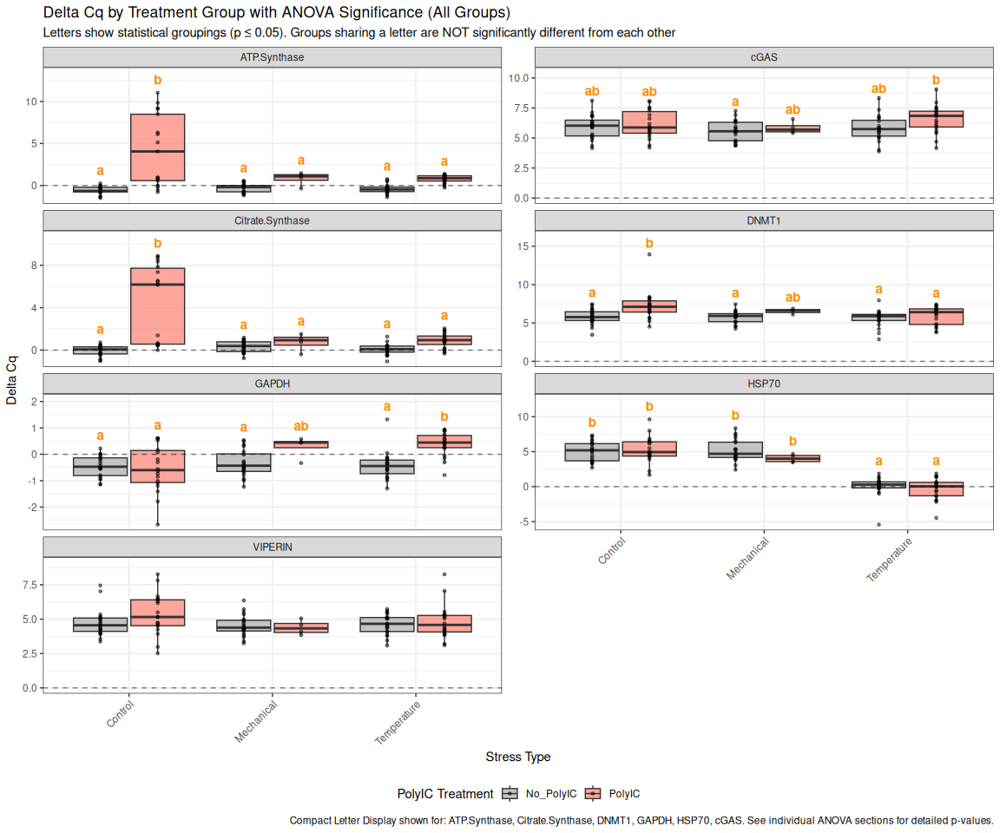<!-- -->

Repeat the same visualization restricted to Control and Temperature
stress types only (excluding Mechanical stress), to focus on the
Poly(I:C)-only comparisons.

``` r
# Filter out Mechanical treatment
plot_df <- delta_Cq_df %>%
  filter(stress_type != "Mechanical")

# Letters come from the all-stressor CLD (Tukey across all six PolyIC x stress-type
# groups). Their y positions are recomputed from the plotted (Mechanical-excluded)
# data: the all-stressor offsets scale with each gene's full range, which can exceed
# this subset's free y-axis and push the letters out of the panel.
subset_range <- plot_df %>%
  group_by(Target) %>%
  summarise(y_range = diff(range(delta_Cq, na.rm = TRUE)), .groups = "drop")
subset_max <- plot_df %>%
  group_by(Target, stress_type, polyIC) %>%
  summarise(max_y = max(delta_Cq, na.rm = TRUE), .groups = "drop")
cld_plot <- cld_annotations %>%
  filter(stress_type != "Mechanical") %>%
  dplyr::select(Target, polyIC, stress_type, label) %>%
  left_join(subset_max,   by = c("Target", "stress_type", "polyIC")) %>%
  left_join(subset_range, by = "Target") %>%
  mutate(y_pos = max_y + y_range * 0.06)

dodge <- position_dodge(0.8)

# Create plot: 4 x 2 grid so seven panels get usable height
p <- plot_df %>%
  ggplot(aes(x = stress_type, y = delta_Cq, fill = polyIC)) +
  geom_hline(yintercept = 0, linetype = "dashed", alpha = 0.5) +
  geom_boxplot(position = dodge, alpha = 0.7, outlier.shape = NA) +
  geom_point(position = dodge, alpha = 0.5, size = 1.2) +
  facet_wrap(~Target, scales = "free_y", ncol = 4) +
  scale_fill_manual(values = c("No_PolyIC" = "darkgray",
                               "PolyIC" = "salmon")) +
  scale_y_continuous(expand = expansion(mult = c(0.05, 0.22))) +  # headroom for letters
  theme_bw(base_size = 13) +
  labs(
    title = "Delta Cq by treatment group (Mechanical stress excluded)",
    x = "Stress Type",
    y = "Delta Cq",
    fill = "PolyIC Treatment"
  ) +
  theme(
    legend.position = "bottom",
    plot.caption = element_text(hjust = 0)
  )

# Add CLD annotations
if(nrow(cld_plot) > 0) {

  p <- p +
    geom_text(
      data = cld_plot,
      aes(x = stress_type, y = y_pos, label = label, group = polyIC),
      position = dodge,
      size = 4.5,
      vjust = 0,
      color = "darkorange",
      fontface = "bold",
      inherit.aes = FALSE
    ) +
    labs(
      subtitle = "Letters: Tukey-adjusted groupings (p ≤ 0.05); groups sharing a letter are NOT significantly different",
      caption = paste0("Letters are from the all-stressor ANOVAs (Tukey comparisons across Control, Temperature and Mechanical groups).\n",
                       "Shown for genes with >=1 significant ANOVA term: ", paste(significant_genes, collapse = ", "), ".\n",
                       "For letters from the temperature-only ANOVAs, see the per-gene plots in the Temperature-Only Analysis section.")
    )
}

print(p)
```

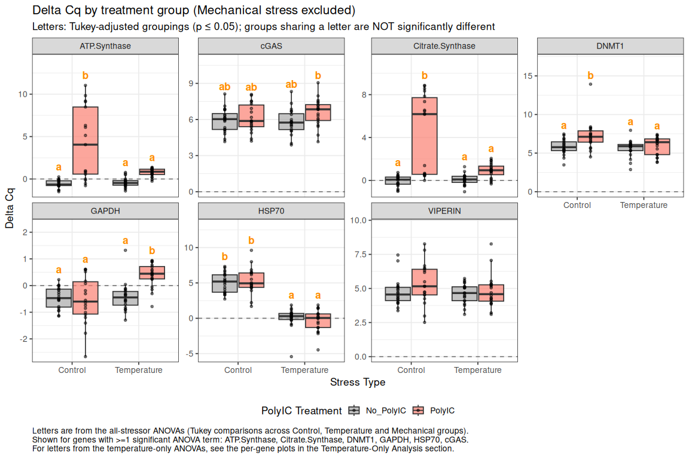<!-- -->

Check sample size.

``` r
sample_sizes <- delta_Cq_df %>%
  filter(!stress_type=="Mechanical")%>%
  group_by(Target, stress_type, polyIC) %>%
  summarise(
    n = sum(!is.na(delta_Cq)),
    .groups = "drop"
  );sample_sizes
```

    # A tibble: 28 × 4
       Target           stress_type polyIC        n
       <chr>            <chr>       <chr>     <int>
     1 ATP.Synthase     Control     No_PolyIC    20
     2 ATP.Synthase     Control     PolyIC       17
     3 ATP.Synthase     Temperature No_PolyIC    20
     4 ATP.Synthase     Temperature PolyIC       20
     5 Citrate.Synthase Control     No_PolyIC    20
     6 Citrate.Synthase Control     PolyIC       18
     7 Citrate.Synthase Temperature No_PolyIC    20
     8 Citrate.Synthase Temperature PolyIC       20
     9 DNMT1            Control     No_PolyIC    20
    10 DNMT1            Control     PolyIC       18
    # ℹ 18 more rows

# 7 Delta Delta Cq and Fold Change Analysis

## 7.1 Calculate delta delta Cq for each comparison

### 7.1.1 Comparison 1: Stressors vs Control (No PolyIC)

``` r
# Calculate delta delta Cq for Temperature vs Control (No PolyIC)
delta_delta_temp_no_polyIC <- no_polyIC_data %>%
  group_by(Target) %>%
  summarise(
    mean_control = mean(delta_Cq[stress_type == "Control"], na.rm = TRUE),
    mean_temp = mean(delta_Cq[stress_type == "Temperature"], na.rm = TRUE),
    delta_delta_Cq = mean_temp - mean_control,
    fold_change = 2^(-delta_delta_Cq),
    .groups = 'drop'
  )

print("Temperature vs Control (No PolyIC):")
print(delta_delta_temp_no_polyIC)

# Calculate delta delta Cq for Mechanical vs Control (No PolyIC)
delta_delta_mech_no_polyIC <- no_polyIC_data %>%
  group_by(Target) %>%
  summarise(
    mean_control = mean(delta_Cq[stress_type == "Control"], na.rm = TRUE),
    mean_mech = mean(delta_Cq[stress_type == "Mechanical"], na.rm = TRUE),
    delta_delta_Cq = mean_mech - mean_control,
    fold_change = 2^(-delta_delta_Cq),
    .groups = 'drop'
  )

print("Mechanical vs Control (No PolyIC):")
print(delta_delta_mech_no_polyIC)
```

    [1] "Temperature vs Control (No PolyIC):"
    # A tibble: 7 × 5
      Target           mean_control mean_temp delta_delta_Cq fold_change
      <chr>                   <dbl>     <dbl>          <dbl>       <dbl>
    1 ATP.Synthase          -0.575    -0.401          0.174        0.886
    2 Citrate.Synthase      -0.0669    0.0649         0.132        0.913
    3 DNMT1                  5.81      5.62          -0.190        1.14 
    4 GAPDH                 -0.457    -0.427          0.0306       0.979
    5 HSP70                  5.05      0.0659        -4.99        31.7  
    6 VIPERIN                4.73      4.63          -0.106        1.08 
    7 cGAS                   5.93      5.79          -0.136        1.10 
    [1] "Mechanical vs Control (No PolyIC):"
    # A tibble: 7 × 5
      Target           mean_control mean_mech delta_delta_Cq fold_change
      <chr>                   <dbl>     <dbl>          <dbl>       <dbl>
    1 ATP.Synthase          -0.575     -0.313         0.262        0.834
    2 Citrate.Synthase      -0.0669     0.339         0.406        0.755
    3 DNMT1                  5.81       5.79         -0.0171       1.01 
    4 GAPDH                 -0.457     -0.346         0.111        0.926
    5 HSP70                  5.05       5.17          0.115        0.923
    6 VIPERIN                4.73       4.54         -0.198        1.15 
    7 cGAS                   5.93       5.60         -0.332        1.26 

### 7.1.2 Comparison 2: PolyIC Control vs Basic Control

``` r
delta_delta_polyIC_control <- control_data %>%
  group_by(Target) %>%
  summarise(
    mean_no_polyIC = mean(delta_Cq[polyIC == "No_PolyIC"], na.rm = TRUE),
    mean_polyIC = mean(delta_Cq[polyIC == "PolyIC"], na.rm = TRUE),
    delta_delta_Cq = mean_polyIC - mean_no_polyIC,
    fold_change = 2^(-delta_delta_Cq),
    .groups = 'drop'
  )

print("PolyIC Control vs Basic Control:")
print(delta_delta_polyIC_control)
```

    [1] "PolyIC Control vs Basic Control:"
    # A tibble: 7 × 5
      Target           mean_no_polyIC mean_polyIC delta_delta_Cq fold_change
      <chr>                     <dbl>       <dbl>          <dbl>       <dbl>
    1 ATP.Synthase            -0.575        4.18          4.75        0.0371
    2 Citrate.Synthase        -0.0669       4.43          4.50        0.0442
    3 DNMT1                    5.81         7.27          1.46        0.362 
    4 GAPDH                   -0.457       -0.549        -0.0915      1.07  
    5 HSP70                    5.05         5.31          0.263       0.833 
    6 VIPERIN                  4.73         5.34          0.608       0.656 
    7 cGAS                     5.93         6.16          0.227       0.855 

### 7.1.3 Comparison 3: PolyIC Stressors vs PolyIC Control

``` r
# Calculate delta delta Cq for Temperature vs Control (PolyIC)
delta_delta_temp_polyIC <- polyIC_data %>%
  group_by(Target) %>%
  summarise(
    mean_control = mean(delta_Cq[stress_type == "Control"], na.rm = TRUE),
    mean_temp = mean(delta_Cq[stress_type == "Temperature"], na.rm = TRUE),
    delta_delta_Cq = mean_temp - mean_control,
    fold_change = 2^(-delta_delta_Cq),
    .groups = 'drop'
  )

print("Temperature vs Control (PolyIC):")
print(delta_delta_temp_polyIC)

# Calculate delta delta Cq for Mechanical vs Control (PolyIC)
delta_delta_mech_polyIC <- polyIC_data %>%
  group_by(Target) %>%
  summarise(
    mean_control = mean(delta_Cq[stress_type == "Control"], na.rm = TRUE),
    mean_mech = mean(delta_Cq[stress_type == "Mechanical"], na.rm = TRUE),
    delta_delta_Cq = mean_mech - mean_control,
    fold_change = 2^(-delta_delta_Cq),
    .groups = 'drop'
  )

print("Mechanical vs Control (PolyIC):")
print(delta_delta_mech_polyIC)
```

    [1] "Temperature vs Control (PolyIC):"
    # A tibble: 7 × 5
      Target           mean_control mean_temp delta_delta_Cq fold_change
      <chr>                   <dbl>     <dbl>          <dbl>       <dbl>
    1 ATP.Synthase            4.18      0.771         -3.41       10.6  
    2 Citrate.Synthase        4.43      0.904         -3.53       11.5  
    3 DNMT1                   7.27      5.96          -1.31        2.48 
    4 GAPDH                  -0.549     0.395          0.944       0.520
    5 HSP70                   5.31     -0.296         -5.61       48.9  
    6 VIPERIN                 5.34      4.81          -0.530       1.44 
    7 cGAS                    6.16      6.58           0.429       0.743
    [1] "Mechanical vs Control (PolyIC):"
    # A tibble: 7 × 5
      Target           mean_control mean_mech delta_delta_Cq fold_change
      <chr>                   <dbl>     <dbl>          <dbl>       <dbl>
    1 ATP.Synthase            4.18      0.821         -3.36       10.2  
    2 Citrate.Synthase        4.43      0.745         -3.69       12.9  
    3 DNMT1                   7.27      6.53          -0.739       1.67 
    4 GAPDH                  -0.549     0.284          0.833       0.561
    5 HSP70                   5.31      4.04          -1.27        2.42 
    6 VIPERIN                 5.34      4.39          -0.951       1.93 
    7 cGAS                    6.16      5.85          -0.308       1.24 

## 7.2 Fold Change Bar Plots

Bars show log2 fold change (log2 FC = −ΔΔCq) relative to the stated
control group, so increases and decreases of the same magnitude are the
same height above or below 0. The right-hand axis gives the equivalent
fold change (e.g. 2× = log2 FC of 1; 1/2× = −1).

### 7.2.1 No PolyIC: Stressors vs Control

``` r
# Combine temperature and mechanical comparisons
fold_change_no_polyIC <- bind_rows(
  delta_delta_temp_no_polyIC %>% mutate(comparison = "Temperature vs Control"),
  delta_delta_mech_no_polyIC %>% mutate(comparison = "Mechanical vs Control")
)

# Fold-change bar plot on a log2 scale: bars show log2(FC) = -delta_delta_Cq, so
# up- and down-regulation are symmetric around 0 and a large change (e.g. HSP70
# under temperature stress) no longer flattens every other gene, as it does on a
# linear fold-change axis. The right-hand axis labels the same gridlines in
# fold-change units.
plot_log2fc <- function(df, fill_var, title, fill_lab = NULL, show_fill_legend = TRUE) {
  df <- df %>% mutate(log2_fc = -delta_delta_Cq)
  brk <- seq(floor(min(c(df$log2_fc, 0), na.rm = TRUE)),
             ceiling(max(c(df$log2_fc, 0), na.rm = TRUE)), by = 1)
  fc_lab <- ifelse(brk >= 0, paste0(2^brk, "×"), paste0("1/", 2^(-brk), "×"))

  # Fold-change value printed at the end of each bar so small changes stay readable
  df <- df %>% mutate(fc_txt = sprintf("%.2f×", 2^log2_fc),
                      lab_vjust = ifelse(log2_fc >= 0, -0.4, 1.4))

  ggplot(df, aes(x = Target, y = log2_fc, fill = .data[[fill_var]])) +
    geom_col(position = position_dodge(0.9), width = 0.85) +
    geom_text(aes(label = fc_txt, vjust = lab_vjust, group = .data[[fill_var]]),
              position = position_dodge(0.9), size = 3) +
    geom_hline(aes(yintercept = 0, linetype = "No change (log2 FC = 0)"), color = "black") +
    scale_linetype_manual(name = "", values = c("No change (log2 FC = 0)" = "dashed")) +
    scale_y_continuous(breaks = brk,
                       expand = expansion(mult = 0.10),  # room for value labels
                       sec.axis = sec_axis(~ ., breaks = brk, labels = fc_lab,
                                           name = "Fold change")) +
    theme_bw() +
    labs(title = title, x = "Target Gene", y = "log2 fold change (−ΔΔCq)", fill = fill_lab) +
    theme(axis.text.x = element_text(angle = 45, hjust = 1),
          panel.grid.minor = element_blank()) +
    if (!show_fill_legend) guides(fill = "none") else NULL
}

plot_log2fc(fold_change_no_polyIC, "comparison",
            "Fold Change: Stressors vs Control (No PolyIC)", fill_lab = "Comparison")
```

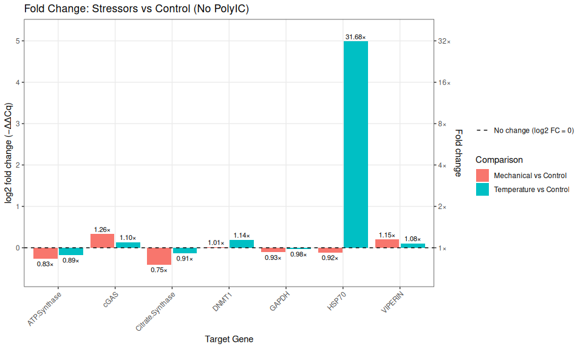<!-- -->

### 7.2.2 PolyIC Control vs Basic Control

``` r
# Gene is already on the x-axis, so the fill legend would be redundant
plot_log2fc(delta_delta_polyIC_control, "Target",
            "Fold Change: PolyIC Control vs Basic Control", show_fill_legend = FALSE)
```

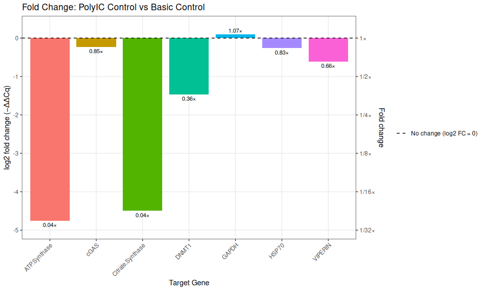<!-- -->

### 7.2.3 PolyIC: Stressors vs Control

``` r
# Combine temperature and mechanical comparisons for PolyIC
fold_change_polyIC <- bind_rows(
  delta_delta_temp_polyIC %>% mutate(comparison = "Temperature vs Control"),
  delta_delta_mech_polyIC %>% mutate(comparison = "Mechanical vs Control")
)

plot_log2fc(fold_change_polyIC, "comparison",
            "Fold Change: Stressors vs Control (PolyIC Treatment)", fill_lab = "Comparison")
```

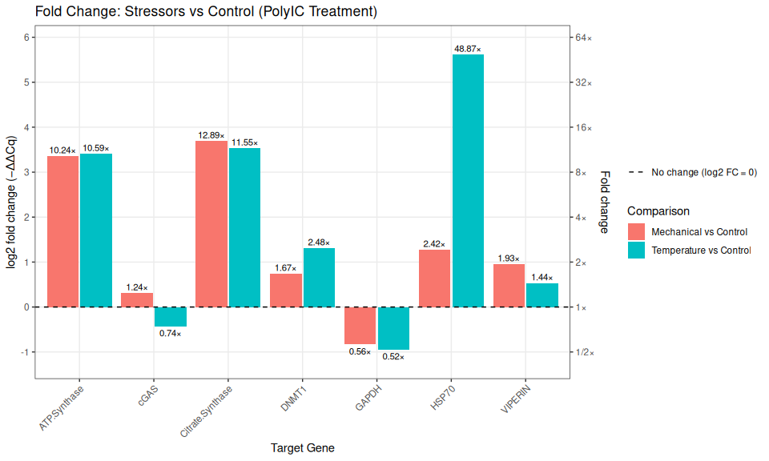<!-- -->

# 8 Temperature-Only Analysis: PolyIC vs No_PolyIC (Mechanical Excluded)

## 8.1 Data Subset and Sample Sizes

All analyses in this section use only the Control and Temperature stress
groups (Mechanical excluded).

``` r
data <- delta_Cq_df %>%
  filter(!stress_type=="Mechanical")
```

``` r
sample_sizes <- data %>%
  group_by(Target, stress_type, polyIC) %>%
  summarise(
    n = sum(!is.na(delta_Cq)),
    .groups = "drop"
  );sample_sizes
```

    # A tibble: 28 × 4
       Target           stress_type polyIC        n
       <chr>            <chr>       <chr>     <int>
     1 ATP.Synthase     Control     No_PolyIC    20
     2 ATP.Synthase     Control     PolyIC       17
     3 ATP.Synthase     Temperature No_PolyIC    20
     4 ATP.Synthase     Temperature PolyIC       20
     5 Citrate.Synthase Control     No_PolyIC    20
     6 Citrate.Synthase Control     PolyIC       18
     7 Citrate.Synthase Temperature No_PolyIC    20
     8 Citrate.Synthase Temperature PolyIC       20
     9 DNMT1            Control     No_PolyIC    20
    10 DNMT1            Control     PolyIC       18
    # ℹ 18 more rows

## 8.2 Per-gene Two-way ANOVAs (PolyIC × Stress Type)

Each gene’s first plot (colored by PolyIC) is annotated with a Compact
Letter Display (CLD) from that gene’s two-way ANOVA on the
temperature-only data. The method matches the all-stressor Summary
Plots: letters are shown only when at least one ANOVA term (polyIC,
stress_type or their interaction) has p \< 0.05, and they come from
Tukey-adjusted pairwise comparisons of the four PolyIC × stress-type
group means. Groups that share a letter are **not** significantly
different. The second plot (colored by biological replicate) is a
diagnostic and is not annotated.

Each gene ends with an interpretation generated from its results:
assumption checks, the two-way ANOVA terms, and the four Tukey-adjusted
comparisons that match the plot’s CLD letters (PolyIC vs No_PolyIC at
each temperature, and Temperature vs Control with and without PolyIC).

``` r
# Boxplot of delta Cq by stress type x PolyIC for one gene from the temperature-only
# `data` subset, annotated with CLD letters from the gene's two-way ANOVA.
plot_temp_cld <- function(gene) {
  gene_df <- data %>% filter(Target == gene)
  fit     <- aov(delta_Cq ~ polyIC * stress_type, data = gene_df)
  anova_p <- summary(fit)[[1]][["Pr(>F)"]][1:3]
  dodge   <- position_dodge(0.75)

  p <- ggplot(gene_df, aes(x = stress_type, colour = polyIC, y = delta_Cq)) +
    geom_boxplot(outlier.shape = NA, position = dodge) +
    geom_point(position = dodge) +
    theme_classic() +
    labs(title = gene)

  if (any(anova_p < 0.05, na.rm = TRUE)) {
    y_range <- diff(range(gene_df$delta_Cq, na.rm = TRUE))
    group_max <- gene_df %>%
      group_by(polyIC, stress_type) %>%
      summarise(max_y = max(delta_Cq, na.rm = TRUE), .groups = "drop")
    cld_df <- as.data.frame(cld(emmeans(fit, ~ polyIC * stress_type),
                                Letters = letters, alpha = 0.05)) %>%
      mutate(label = trimws(.group)) %>%
      left_join(group_max, by = c("polyIC", "stress_type")) %>%
      mutate(y_pos = max_y + y_range * 0.08)   # 8% of data range above group max

    p <- p +
      geom_text(data = cld_df,
                aes(x = stress_type, y = y_pos, label = label, group = polyIC),
                position = dodge, colour = "black", size = 4, vjust = 0,
                inherit.aes = FALSE) +
      scale_y_continuous(expand = expansion(mult = c(0.05, 0.15))) +
      labs(subtitle = "Letters: Tukey-adjusted groupings (alpha = 0.05)\nGroups sharing a letter are not significantly different")
  } else {
    p <- p + labs(subtitle = "No significant ANOVA terms (all p >= 0.05)\nLetters not shown")
  }
  p
}

# Results-driven interpretation text for one gene's temperature-only two-way ANOVA.
# Generated from the same model, assumption tests and Tukey family used for the
# plot's CLD letters, so it updates automatically when the data or the
# normalizing gene change (replaces hand-written verdicts that went stale).
interpret_temp_gene <- function(gene, alpha = 0.05) {
  p_txt   <- function(p) ifelse(p < 1e-4, "p < 0.0001",
                                paste0("p = ", formatC(p, format = "f", digits = 4)))
  sig_txt <- function(p) ifelse(p < alpha, "**significant**", "not significant")

  gene_df <- data %>%
    filter(Target == gene) %>%
    mutate(polyIC = factor(polyIC), stress_type = factor(stress_type))
  fit <- aov(delta_Cq ~ polyIC * stress_type, data = gene_df)
  tab <- summary(fit)[[1]]
  rownames(tab) <- trimws(rownames(tab))
  p_term <- setNames(tab[c("polyIC", "stress_type", "polyIC:stress_type"), "Pr(>F)"],
                     c("polyIC", "stress_type", "interaction"))

  # Same assumption tests as the Robustness section's assumption table
  shapiro_p <- shapiro.test(residuals(fit))$p.value
  levene_p  <- leveneTest(delta_Cq ~ polyIC * stress_type, data = gene_df)[1, "Pr(>F)"]
  normal_ok <- shapiro_p >= alpha
  var_ok    <- levene_p  >= alpha

  # Headline
  if (all(p_term >= alpha)) {
    head_txt <- "No significant effect of PolyIC, temperature, or their interaction."
  } else if (p_term[["interaction"]] < alpha) {
    head_txt <- paste("Significant PolyIC × temperature interaction: the PolyIC effect differs",
                      "between Control and Temperature, so interpret the group comparisons",
                      "below rather than the main effects alone.")
  } else if (p_term[["polyIC"]] < alpha && p_term[["stress_type"]] < alpha) {
    head_txt <- paste("Significant main effects of PolyIC and temperature, with no significant",
                      "interaction (the two effects are additive).")
  } else if (p_term[["polyIC"]] < alpha) {
    head_txt <- paste("Significant main effect of PolyIC, with no significant interaction",
                      "(the PolyIC effect is similar at both temperatures).")
  } else {
    head_txt <- paste("Significant main effect of temperature, with no significant interaction",
                      "(the temperature effect is similar with and without PolyIC).")
  }
  out <- c(paste0("**Summary (", gene, "):** ", head_txt), "")

  # Assumptions
  out <- c(out, "**Assumptions:**", "",
           paste0("- Residual normality (Shapiro–Wilk): ", ifelse(normal_ok, "met", "**not met**"),
                  " (", p_txt(shapiro_p), ")"),
           paste0("- Equal variances (Levene): ", ifelse(var_ok, "met", "**not met**"),
                  " (", p_txt(levene_p), ")"))
  if (!(normal_ok && var_ok)) {
    out <- c(out, paste0("- Because ", ifelse(!normal_ok && !var_ok, "neither assumption is met",
                                              "one assumption is not met"),
                         ", check *Robustness of Two-way ANOVA Results* below to see whether these ",
                         "conclusions hold under ",
                         ifelse(!var_ok, "the HC3 (unequal-variance) test", "the permutation test"), "."))
  }
  out <- c(out, "")

  # ANOVA terms (Type I, as printed by summary(model) above)
  out <- c(out, "**Two-way ANOVA** (from `summary(model)` above):", "",
           paste0("- PolyIC: ", sig_txt(p_term[["polyIC"]]), " (", p_txt(p_term[["polyIC"]]), ")"),
           paste0("- Stress type (Control vs Temperature): ", sig_txt(p_term[["stress_type"]]),
                  " (", p_txt(p_term[["stress_type"]]), ")"),
           paste0("- PolyIC × stress type: ", sig_txt(p_term[["interaction"]]),
                  " (", p_txt(p_term[["interaction"]]), ")"), "")

  # Group comparisons from the same Tukey family as the CLD letters on the plot
  pw <- as.data.frame(pairs(emmeans(fit, ~ polyIC * stress_type), adjust = "tukey"))
  pw$contrast <- gsub("[()]", "", as.character(pw$contrast))
  comps <- list(
    list(a = "PolyIC Control",        b = "No_PolyIC Control",     lab = "At Control",       an = "PolyIC",      bn = "No_PolyIC"),
    list(a = "PolyIC Temperature",    b = "No_PolyIC Temperature", lab = "At Temperature",   an = "PolyIC",      bn = "No_PolyIC"),
    list(a = "No_PolyIC Temperature", b = "No_PolyIC Control",     lab = "Without PolyIC",   an = "Temperature", bn = "Control"),
    list(a = "PolyIC Temperature",    b = "PolyIC Control",        lab = "With PolyIC",      an = "Temperature", bn = "Control")
  )
  out <- c(out, paste0("**Group comparisons** (Tukey-adjusted, same tests as the CLD letters; ",
                       "Δ = difference in mean delta Cq; negative Δ = higher expression relative to ",
                       normalizing_gene, "):"), "")
  for (cmp in comps) {
    r <- pw[pw$contrast == paste(cmp$a, "-", cmp$b), ]; sgn <- 1
    if (nrow(r) == 0) { r <- pw[pw$contrast == paste(cmp$b, "-", cmp$a), ]; sgn <- -1 }
    stopifnot(nrow(r) == 1)
    d <- sgn * r$estimate
    p <- r$p.value
    verdict <- if (p >= alpha) "no significant difference" else
      paste0("**", ifelse(d < 0, "higher", "lower"), " expression in ", cmp$an, "**")
    out <- c(out, paste0("- ", cmp$lab, ", ", cmp$an, " vs ", cmp$bn, ": Δ = ", sprintf("%+.2f", d),
                         ", ", p_txt(p), " (", verdict, ")"))
  }
  # A significant ANOVA term with no significant Tukey pair (all CLD letters shared)
  if (any(p_term < alpha) && all(pw$p.value >= alpha)) {
    out <- c(out, "", paste("*Note:* although at least one ANOVA term is significant, none of the",
                            "six Tukey-adjusted pairwise comparisons is, so the effect is small",
                            "relative to within-group variation."))
  }
  paste(c(out, ""), collapse = "\n")
}
```

### 8.2.1 ATP Synthase

Run ANOVA analyses and check assumptions

Plot raw data

``` r
plot1 <- plot_temp_cld("ATP.Synthase")

plot1
```

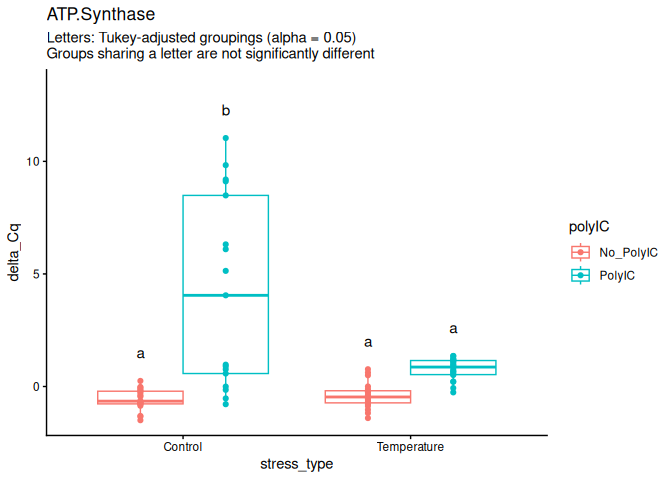<!-- -->

``` r
data%>%
  filter(Target=="ATP.Synthase")%>%
  
    ggplot(aes(x=stress_type, colour=bio_replicate, y=delta_Cq))+
  geom_boxplot(outlier.shape = NA)+
  geom_point(position=position_dodge(0.75))+
  theme_classic()
```

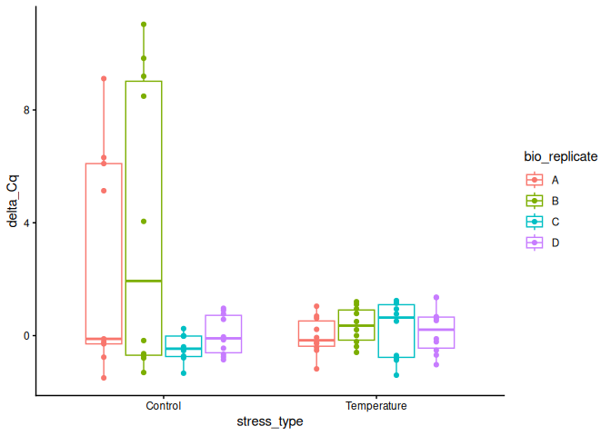<!-- -->

``` r
model<-data%>%
  filter(Target=="ATP.Synthase")%>%
  
  aov(delta_Cq~polyIC*stress_type, data=.)

summary(model)
```

                       Df Sum Sq Mean Sq F value   Pr(>F)    
    polyIC              1 153.27  153.27   37.38 4.36e-08 ***
    stress_type         1  45.50   45.50   11.10 0.001359 ** 
    polyIC:stress_type  1  61.35   61.35   14.96 0.000236 ***
    Residuals          73 299.33    4.10                     
    ---
    Signif. codes:  0 '***' 0.001 '**' 0.01 '*' 0.05 '.' 0.1 ' ' 1

``` r
qqPlot(model$residuals)
```

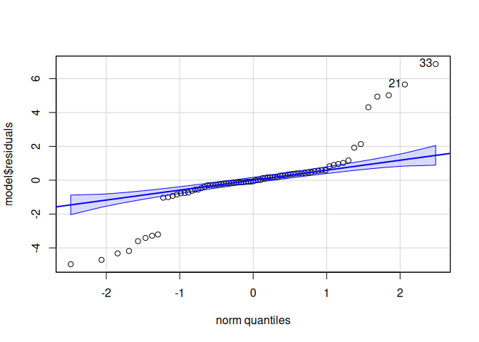<!-- -->

    [1] 33 21

``` r
plot(model, 1)
```

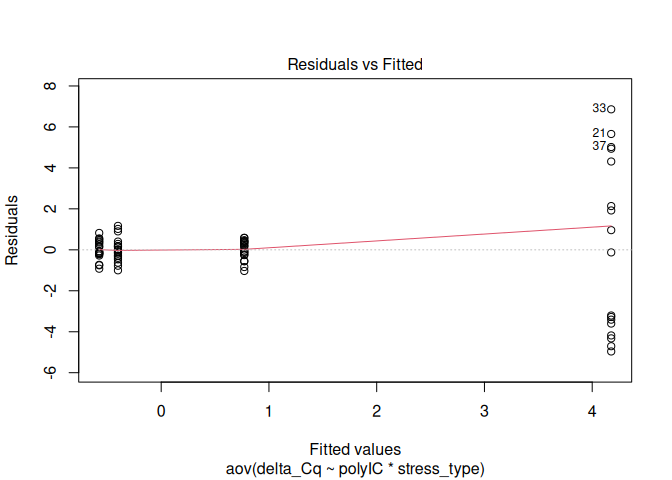<!-- -->

``` r
plot(model, 3)
```

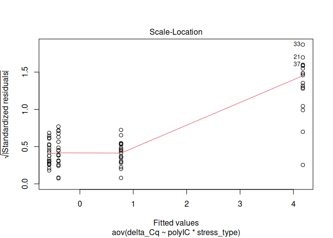<!-- -->

``` r
plot(model, 4)
```

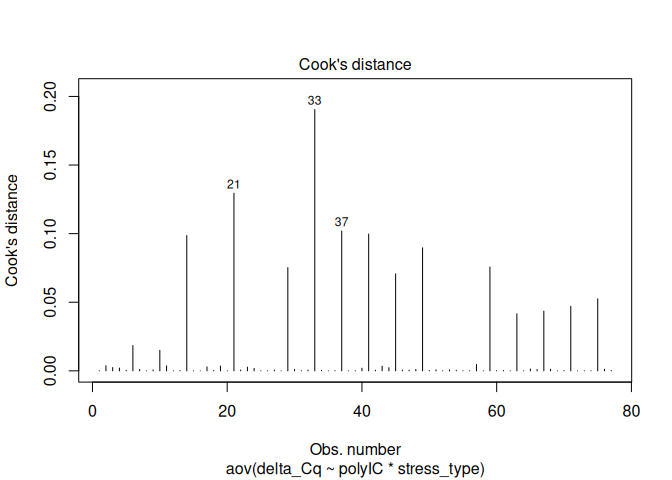<!-- -->

**Summary (ATP.Synthase):** Significant PolyIC × temperature
interaction: the PolyIC effect differs between Control and Temperature,
so interpret the group comparisons below rather than the main effects
alone.

**Assumptions:**

- Residual normality (Shapiro–Wilk): **not met** (p \< 0.0001)
- Equal variances (Levene): **not met** (p \< 0.0001)
- Because neither assumption is met, check *Robustness of Two-way ANOVA
  Results* below to see whether these conclusions hold under the HC3
  (unequal-variance) test.

**Two-way ANOVA** (from `summary(model)` above):

- PolyIC: **significant** (p \< 0.0001)
- Stress type (Control vs Temperature): **significant** (p = 0.0014)
- PolyIC × stress type: **significant** (p = 0.0002)

**Group comparisons** (Tukey-adjusted, same tests as the CLD letters; Δ
= difference in mean delta Cq; negative Δ = higher expression relative
to HSP90):

- At Control, PolyIC vs No_PolyIC: Δ = +4.75, p \< 0.0001 (**lower
  expression in PolyIC**)
- At Temperature, PolyIC vs No_PolyIC: Δ = +1.17, p = 0.2675 (no
  significant difference)
- Without PolyIC, Temperature vs Control: Δ = +0.17, p = 0.9929 (no
  significant difference)
- With PolyIC, Temperature vs Control: Δ = -3.41, p \< 0.0001 (**higher
  expression in Temperature**)

### 8.2.2 Citrate Synthase

Run ANOVA analyses and check assumptions

Plot raw data

``` r
plot2 <- plot_temp_cld("Citrate.Synthase")

plot2
```

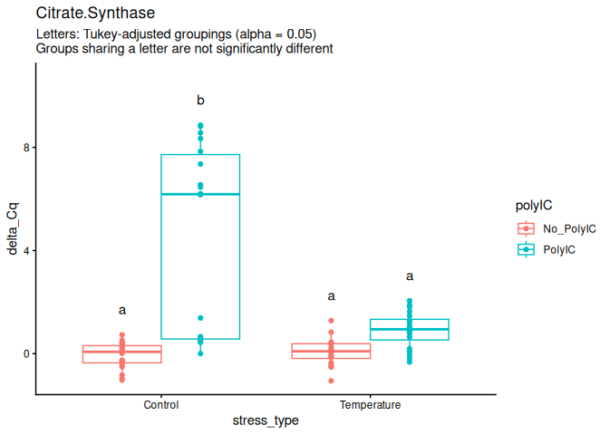<!-- -->

``` r
data%>%
  filter(Target=="Citrate.Synthase")%>%
  
    ggplot(aes(x=stress_type, colour=bio_replicate, y=delta_Cq))+
  geom_boxplot(outlier.shape = NA)+
  geom_point(position=position_dodge(0.75))+
  theme_classic()
```

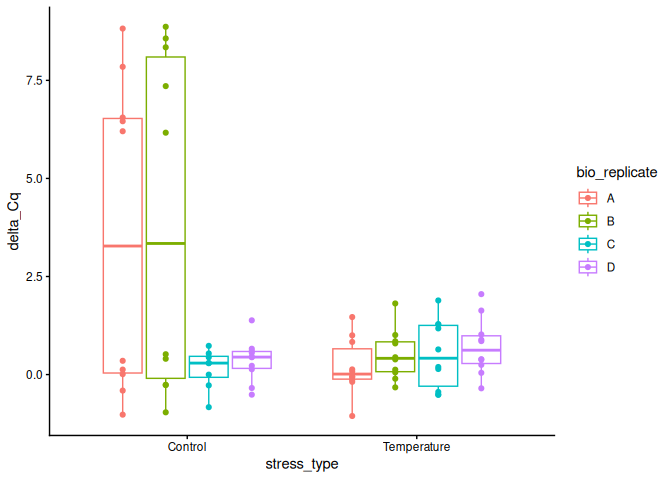<!-- -->

``` r
model<-data%>%
  filter(Target=="Citrate.Synthase")%>%
  
  aov(delta_Cq~polyIC*stress_type, data=.)

summary(model)
```

                       Df Sum Sq Mean Sq F value   Pr(>F)    
    polyIC              1 129.34  129.34   39.04 2.39e-08 ***
    stress_type         1  52.97   52.97   15.99 0.000149 ***
    polyIC:stress_type  1  65.21   65.21   19.68 3.13e-05 ***
    Residuals          74 245.16    3.31                     
    ---
    Signif. codes:  0 '***' 0.001 '**' 0.01 '*' 0.05 '.' 0.1 ' ' 1

``` r
qqPlot(model$residuals)
```

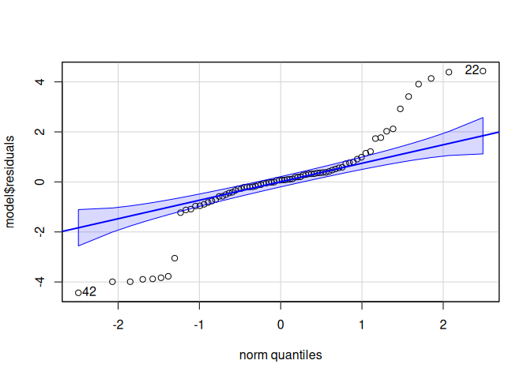<!-- -->

    [1] 42 22

``` r
plot(model, 1)
```

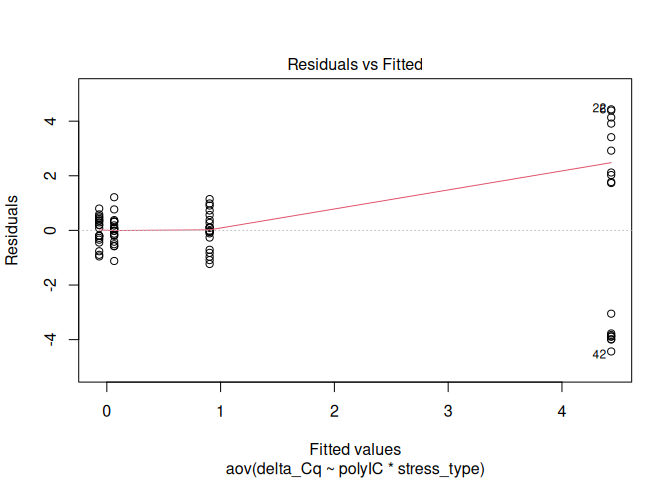<!-- -->

``` r
plot(model, 3)
```

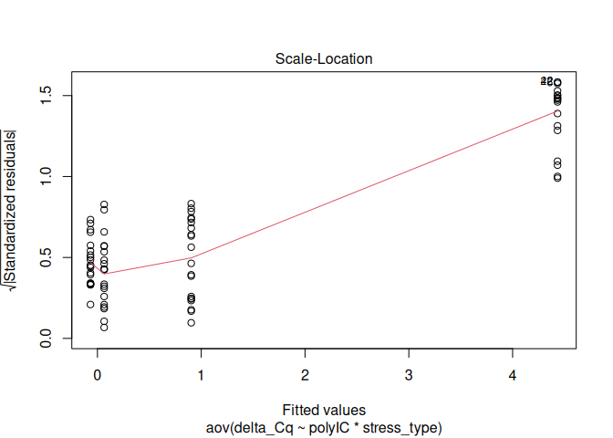<!-- -->

``` r
plot(model, 4)
```

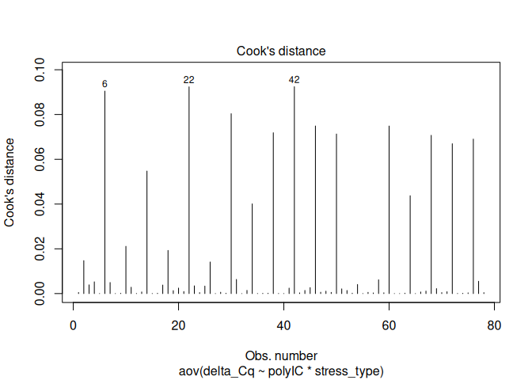<!-- -->

**Summary (Citrate.Synthase):** Significant PolyIC × temperature
interaction: the PolyIC effect differs between Control and Temperature,
so interpret the group comparisons below rather than the main effects
alone.

**Assumptions:**

- Residual normality (Shapiro–Wilk): **not met** (p \< 0.0001)
- Equal variances (Levene): **not met** (p \< 0.0001)
- Because neither assumption is met, check *Robustness of Two-way ANOVA
  Results* below to see whether these conclusions hold under the HC3
  (unequal-variance) test.

**Two-way ANOVA** (from `summary(model)` above):

- PolyIC: **significant** (p \< 0.0001)
- Stress type (Control vs Temperature): **significant** (p = 0.0001)
- PolyIC × stress type: **significant** (p \< 0.0001)

**Group comparisons** (Tukey-adjusted, same tests as the CLD letters; Δ
= difference in mean delta Cq; negative Δ = higher expression relative
to HSP90):

- At Control, PolyIC vs No_PolyIC: Δ = +4.50, p \< 0.0001 (**lower
  expression in PolyIC**)
- At Temperature, PolyIC vs No_PolyIC: Δ = +0.84, p = 0.4685 (no
  significant difference)
- Without PolyIC, Temperature vs Control: Δ = +0.13, p = 0.9957 (no
  significant difference)
- With PolyIC, Temperature vs Control: Δ = -3.53, p \< 0.0001 (**higher
  expression in Temperature**)

### 8.2.3 DNMT1

Run ANOVA analyses and check assumptions

Plot raw data

``` r
plot3 <- plot_temp_cld("DNMT1")

plot3
```

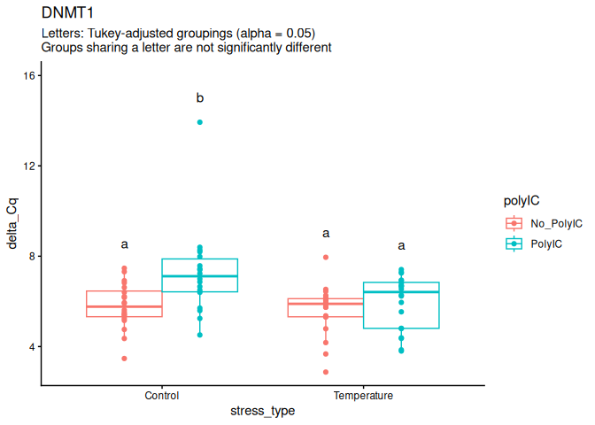<!-- -->

``` r
data%>%
  filter(Target=="DNMT1")%>%
  
    ggplot(aes(x=stress_type, colour=bio_replicate, y=delta_Cq))+
  geom_boxplot(outlier.shape = NA)+
  geom_point(position=position_dodge(0.75))+
  theme_classic()
```

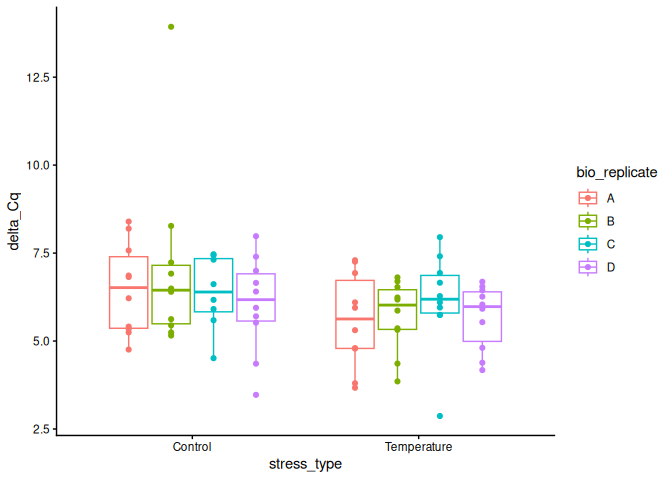<!-- -->

``` r
model<-data%>%
  filter(Target=="DNMT1")%>%
  
  aov(delta_Cq~polyIC*stress_type, data=.)

summary(model)
```

                       Df Sum Sq Mean Sq F value  Pr(>F)   
    polyIC              1  14.78  14.782   8.043 0.00589 **
    stress_type         1  10.50  10.500   5.713 0.01939 * 
    polyIC:stress_type  1   6.09   6.091   3.314 0.07273 . 
    Residuals          74 136.01   1.838                   
    ---
    Signif. codes:  0 '***' 0.001 '**' 0.01 '*' 0.05 '.' 0.1 ' ' 1

``` r
qqPlot(model$residuals)
```

<!-- -->

    [1] 38 50

``` r
plot(model, 1)
```

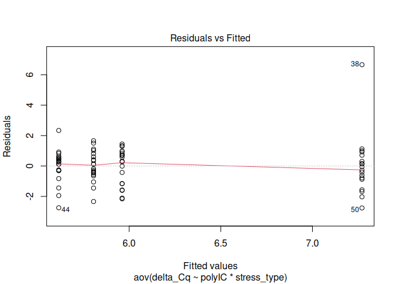<!-- -->

``` r
plot(model, 3)
```

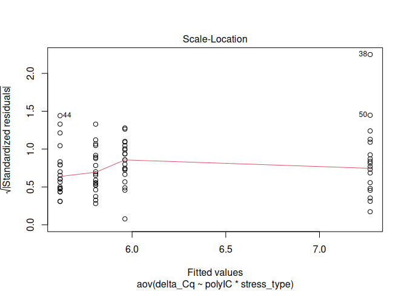<!-- -->

``` r
plot(model, 4)
```

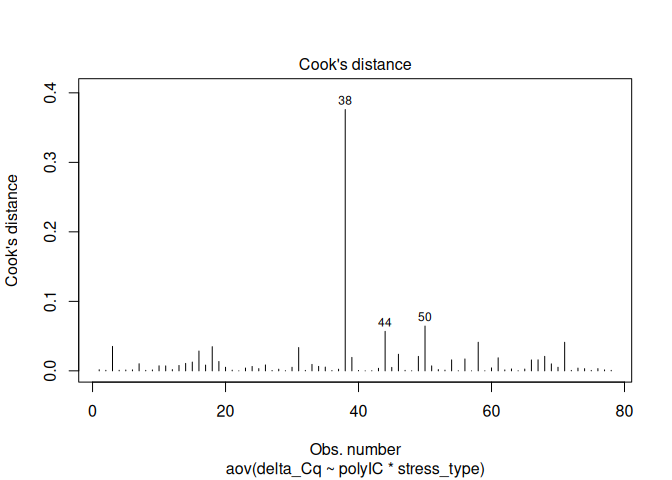<!-- -->

**Summary (DNMT1):** Significant main effects of PolyIC and temperature,
with no significant interaction (the two effects are additive).

**Assumptions:**

- Residual normality (Shapiro–Wilk): **not met** (p \< 0.0001)
- Equal variances (Levene): met (p = 0.4304)
- Because one assumption is not met, check *Robustness of Two-way ANOVA
  Results* below to see whether these conclusions hold under the
  permutation test.

**Two-way ANOVA** (from `summary(model)` above):

- PolyIC: **significant** (p = 0.0059)
- Stress type (Control vs Temperature): **significant** (p = 0.0194)
- PolyIC × stress type: not significant (p = 0.0727)

**Group comparisons** (Tukey-adjusted, same tests as the CLD letters; Δ
= difference in mean delta Cq; negative Δ = higher expression relative
to HSP90):

- At Control, PolyIC vs No_PolyIC: Δ = +1.46, p = 0.0074 (**lower
  expression in PolyIC**)
- At Temperature, PolyIC vs No_PolyIC: Δ = +0.35, p = 0.8510 (no
  significant difference)
- Without PolyIC, Temperature vs Control: Δ = -0.19, p = 0.9708 (no
  significant difference)
- With PolyIC, Temperature vs Control: Δ = -1.31, p = 0.0204 (**higher
  expression in Temperature**)

### 8.2.4 HSP70

Run ANOVA analyses and check assumptions

Plot raw data

``` r
plot4 <- plot_temp_cld("HSP70")

plot4
```

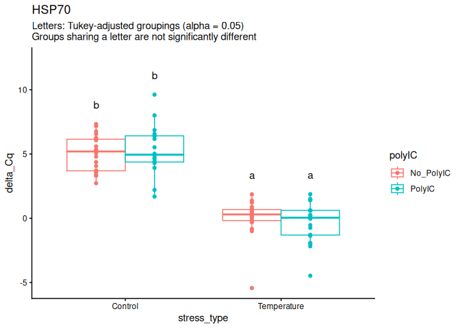<!-- -->

``` r
data%>%
  filter(Target=="HSP70")%>%
  
    ggplot(aes(x=stress_type, colour=bio_replicate, y=delta_Cq))+
  geom_boxplot(outlier.shape = NA)+
  geom_point(position=position_dodge(0.75))+
  theme_classic()
```

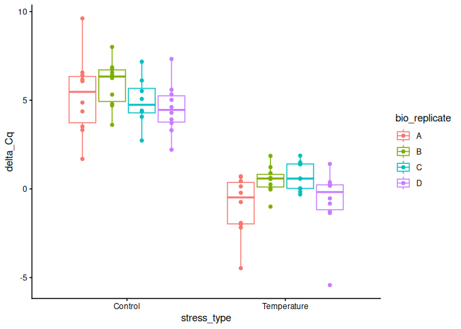<!-- -->

``` r
model<-data%>%
  filter(Target=="HSP70")%>%
  
  aov(delta_Cq~polyIC*stress_type, data=.)

summary(model)
```

                       Df Sum Sq Mean Sq F value Pr(>F)    
    polyIC              1    0.8     0.8   0.301  0.585    
    stress_type         1  544.9   544.9 216.311 <2e-16 ***
    polyIC:stress_type  1    1.9     1.9   0.756  0.388    
    Residuals          74  186.4     2.5                   
    ---
    Signif. codes:  0 '***' 0.001 '**' 0.01 '*' 0.05 '.' 0.1 ' ' 1

``` r
emm<-emmeans(model, ~ polyIC | stress_type)
pairs(emm)
```

    stress_type = Control:
     contrast           estimate    SE df t.ratio p.value
     No_PolyIC - PolyIC   -0.263 0.516 74  -0.511  0.6112

    stress_type = Temperature:
     contrast           estimate    SE df t.ratio p.value
     No_PolyIC - PolyIC    0.362 0.502 74   0.722  0.4728

``` r
qqPlot(model$residuals)
```

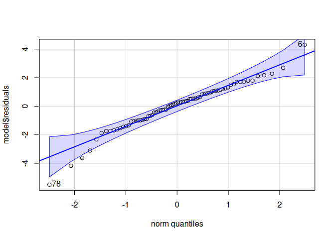<!-- -->

    [1] 78  6

``` r
plot(model, 1)
```

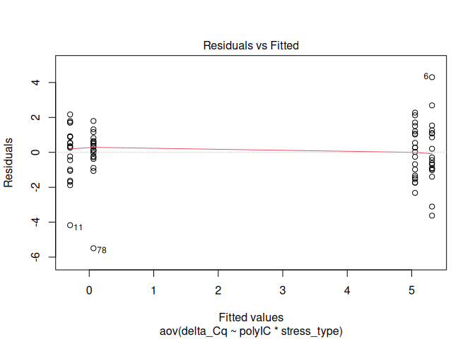<!-- -->

``` r
plot(model, 3)
```

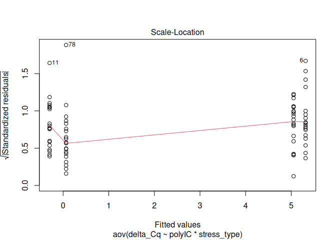<!-- -->

``` r
plot(model, 4)
```

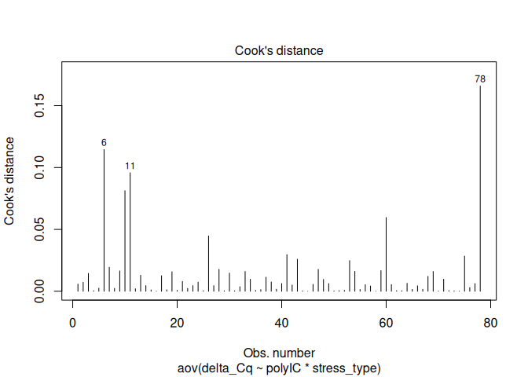<!-- -->

**Summary (HSP70):** Significant main effect of temperature, with no
significant interaction (the temperature effect is similar with and
without PolyIC).

**Assumptions:**

- Residual normality (Shapiro–Wilk): **not met** (p = 0.0207)
- Equal variances (Levene): met (p = 0.3823)
- Because one assumption is not met, check *Robustness of Two-way ANOVA
  Results* below to see whether these conclusions hold under the
  permutation test.

**Two-way ANOVA** (from `summary(model)` above):

- PolyIC: not significant (p = 0.5851)
- Stress type (Control vs Temperature): **significant** (p \< 0.0001)
- PolyIC × stress type: not significant (p = 0.3876)

**Group comparisons** (Tukey-adjusted, same tests as the CLD letters; Δ
= difference in mean delta Cq; negative Δ = higher expression relative
to HSP90):

- At Control, PolyIC vs No_PolyIC: Δ = +0.26, p = 0.9563 (no significant
  difference)
- At Temperature, PolyIC vs No_PolyIC: Δ = -0.36, p = 0.8881 (no
  significant difference)
- Without PolyIC, Temperature vs Control: Δ = -4.99, p \< 0.0001
  (**higher expression in Temperature**)
- With PolyIC, Temperature vs Control: Δ = -5.61, p \< 0.0001 (**higher
  expression in Temperature**)

### 8.2.5 GAPDH

Run ANOVA analyses and check assumptions

Plot raw data

``` r
plot5 <- plot_temp_cld("GAPDH")

plot5
```

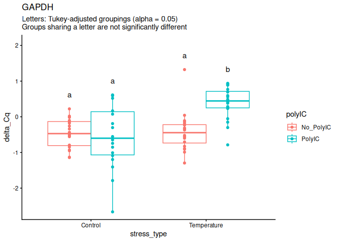<!-- -->

``` r
data%>%
  filter(Target=="GAPDH")%>%
  
  ggplot(aes(x=stress_type, colour=bio_replicate, y=delta_Cq))+
  geom_boxplot(outlier.shape = NA)+
  geom_point(position=position_dodge(0.75))+
  theme_classic()
```

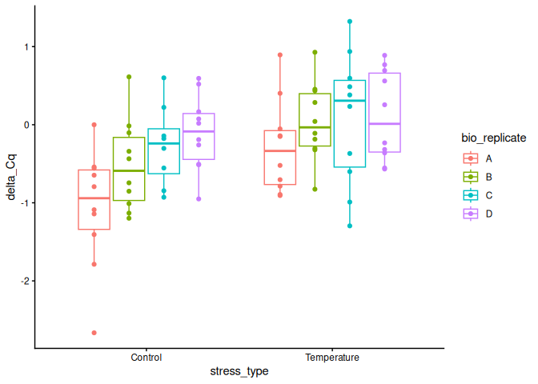<!-- -->

``` r
model<-data%>%
  filter(Target=="GAPDH")%>%
  
  aov(delta_Cq~polyIC*stress_type, data=.)

summary(model)
```

                       Df Sum Sq Mean Sq F value   Pr(>F)    
    polyIC              1  2.965   2.965   8.316 0.005143 ** 
    stress_type         1  4.394   4.394  12.325 0.000765 ***
    polyIC:stress_type  1  4.059   4.059  11.387 0.001180 ** 
    Residuals          74 26.380   0.356                     
    ---
    Signif. codes:  0 '***' 0.001 '**' 0.01 '*' 0.05 '.' 0.1 ' ' 1

``` r
emm<-emmeans(model, ~ polyIC | stress_type)
pairs(emm)
```

    stress_type = Control:
     contrast           estimate    SE df t.ratio p.value
     No_PolyIC - PolyIC   0.0915 0.194 74   0.472  0.6384

    stress_type = Temperature:
     contrast           estimate    SE df t.ratio p.value
     No_PolyIC - PolyIC  -0.8219 0.189 74  -4.353 <0.0001

``` r
qqPlot(model$residuals)
```

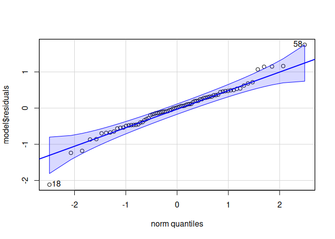<!-- -->

    [1] 18 58

``` r
plot(model, 1)
```

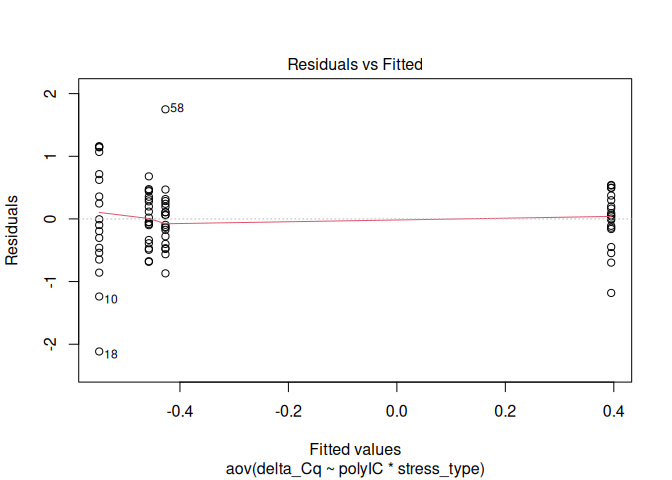<!-- -->

``` r
plot(model, 3)
```

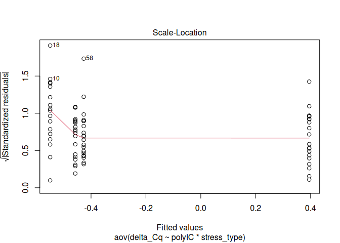<!-- -->

``` r
plot(model, 4)
```

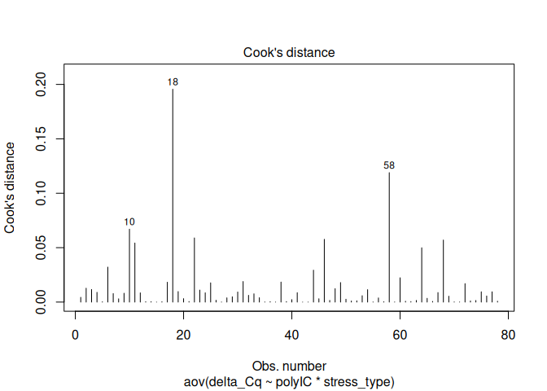<!-- -->

**Summary (GAPDH):** Significant PolyIC × temperature interaction: the
PolyIC effect differs between Control and Temperature, so interpret the
group comparisons below rather than the main effects alone.

**Assumptions:**

- Residual normality (Shapiro–Wilk): met (p = 0.0511)
- Equal variances (Levene): **not met** (p = 0.0043)
- Because one assumption is not met, check *Robustness of Two-way ANOVA
  Results* below to see whether these conclusions hold under the HC3
  (unequal-variance) test.

**Two-way ANOVA** (from `summary(model)` above):

- PolyIC: **significant** (p = 0.0051)
- Stress type (Control vs Temperature): **significant** (p = 0.0008)
- PolyIC × stress type: **significant** (p = 0.0012)

**Group comparisons** (Tukey-adjusted, same tests as the CLD letters; Δ
= difference in mean delta Cq; negative Δ = higher expression relative
to HSP90):

- At Control, PolyIC vs No_PolyIC: Δ = -0.09, p = 0.9650 (no significant
  difference)
- At Temperature, PolyIC vs No_PolyIC: Δ = +0.82, p = 0.0002 (**lower
  expression in PolyIC**)
- Without PolyIC, Temperature vs Control: Δ = +0.03, p = 0.9985 (no
  significant difference)
- With PolyIC, Temperature vs Control: Δ = +0.94, p \< 0.0001 (**lower
  expression in Temperature**)

### 8.2.6 VIPERIN

Run ANOVA analyses and check assumptions

Plot raw data

``` r
plot6 <- plot_temp_cld("VIPERIN")

plot6
```

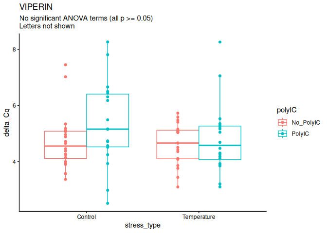<!-- -->

``` r
data%>%
  filter(Target=="VIPERIN")%>%
  
    ggplot(aes(x=stress_type, colour=bio_replicate, y=delta_Cq))+
  geom_boxplot(outlier.shape = NA)+
  geom_point(position=position_dodge(0.75))+
  theme_classic()
```

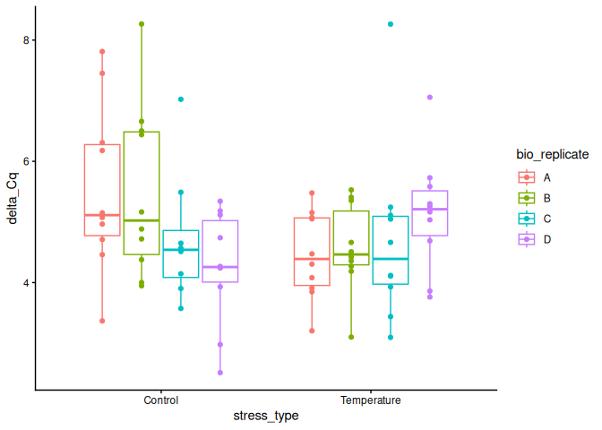<!-- -->

``` r
model<-data%>%
  filter(Target=="VIPERIN")%>%
  
  aov(delta_Cq~polyIC*stress_type, data=.)

summary(model)
```

                       Df Sum Sq Mean Sq F value Pr(>F)
    polyIC              1   2.84  2.8430   2.156  0.146
    stress_type         1   1.90  1.8999   1.441  0.234
    polyIC:stress_type  1   0.88  0.8778   0.666  0.417
    Residuals          74  97.58  1.3186               

``` r
emm<-emmeans(model, ~ polyIC | stress_type)
pairs(emm)
```

    stress_type = Control:
     contrast           estimate    SE df t.ratio p.value
     No_PolyIC - PolyIC   -0.608 0.373 74  -1.631  0.1072

    stress_type = Temperature:
     contrast           estimate    SE df t.ratio p.value
     No_PolyIC - PolyIC   -0.184 0.363 74  -0.505  0.6148

``` r
qqPlot(model$residuals)
```

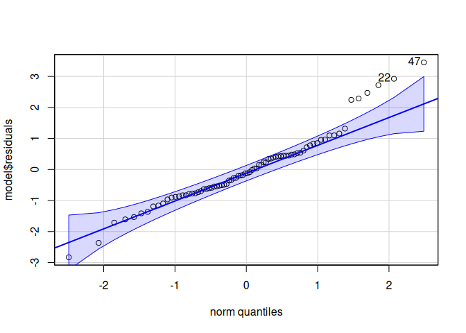<!-- -->

    [1] 47 22

``` r
plot(model, 1)
```

<!-- -->

``` r
plot(model, 3)
```

<!-- -->

``` r
plot(model, 4)
```

<!-- -->

**Summary (VIPERIN):** No significant effect of PolyIC, temperature, or
their interaction.

**Assumptions:**

- Residual normality (Shapiro–Wilk): **not met** (p = 0.0110)
- Equal variances (Levene): met (p = 0.0912)
- Because one assumption is not met, check *Robustness of Two-way ANOVA
  Results* below to see whether these conclusions hold under the
  permutation test.

**Two-way ANOVA** (from `summary(model)` above):

- PolyIC: not significant (p = 0.1462)
- Stress type (Control vs Temperature): not significant (p = 0.2338)
- PolyIC × stress type: not significant (p = 0.4172)

**Group comparisons** (Tukey-adjusted, same tests as the CLD letters; Δ
= difference in mean delta Cq; negative Δ = higher expression relative
to HSP90):

- At Control, PolyIC vs No_PolyIC: Δ = +0.61, p = 0.3680 (no significant
  difference)
- At Temperature, PolyIC vs No_PolyIC: Δ = +0.18, p = 0.9576 (no
  significant difference)
- Without PolyIC, Temperature vs Control: Δ = -0.11, p = 0.9913 (no
  significant difference)
- With PolyIC, Temperature vs Control: Δ = -0.53, p = 0.4899 (no
  significant difference)

### 8.2.7 cGAS

Run ANOVA analyses and check assumptions

Plot raw data

``` r
plot7 <- plot_temp_cld("cGAS")

plot7
```

<!-- -->

``` r
data%>%
  filter(Target=="cGAS")%>%
  
    ggplot(aes(x=stress_type, colour=bio_replicate, y=delta_Cq))+
  geom_boxplot(outlier.shape = NA)+
  geom_point(position=position_dodge(0.75))+
  theme_classic()
```

<!-- -->

``` r
model<-data%>%
  filter(Target=="cGAS")%>%
  
  aov(delta_Cq~polyIC*stress_type, data=.)

summary(model)
```

                       Df Sum Sq Mean Sq F value Pr(>F)  
    polyIC              1   5.27   5.274   4.380 0.0398 *
    stress_type         1   0.38   0.377   0.313 0.5774  
    polyIC:stress_type  1   1.55   1.551   1.288 0.2601  
    Residuals          74  89.09   1.204                 
    ---
    Signif. codes:  0 '***' 0.001 '**' 0.01 '*' 0.05 '.' 0.1 ' ' 1

``` r
qqPlot(model$residuals)
```

<!-- -->

    [1] 58 61

``` r
plot(model, 1)
```

<!-- -->

``` r
plot(model, 3)
```

<!-- -->

``` r
plot(model, 4)
```

<!-- -->

**Summary (cGAS):** Significant main effect of PolyIC, with no
significant interaction (the PolyIC effect is similar at both
temperatures).

**Assumptions:**

- Residual normality (Shapiro–Wilk): met (p = 0.8710)
- Equal variances (Levene): met (p = 0.8094)

**Two-way ANOVA** (from `summary(model)` above):

- PolyIC: **significant** (p = 0.0398)
- Stress type (Control vs Temperature): not significant (p = 0.5774)
- PolyIC × stress type: not significant (p = 0.2601)

**Group comparisons** (Tukey-adjusted, same tests as the CLD letters; Δ
= difference in mean delta Cq; negative Δ = higher expression relative
to HSP90):

- At Control, PolyIC vs No_PolyIC: Δ = +0.23, p = 0.9201 (no significant
  difference)
- At Temperature, PolyIC vs No_PolyIC: Δ = +0.79, p = 0.1120 (no
  significant difference)
- Without PolyIC, Temperature vs Control: Δ = -0.14, p = 0.9796 (no
  significant difference)
- With PolyIC, Temperature vs Control: Δ = +0.43, p = 0.6265 (no
  significant difference)

*Note:* although at least one ANOVA term is significant, none of the six
Tukey-adjusted pairwise comparisons is, so the effect is small relative
to within-group variation.

## 8.3 Robustness of Two-way ANOVA Results

The per-gene ANOVAs above use `aov()`, which has two limitations for
this data subset:

1.  **Sequential (Type I) sums of squares.** Group sizes here are
    slightly unequal (see *Data Subset and Sample Sizes*), so with
    `aov()` the polyIC and stress_type tests depend on the order in
    which the terms are entered.
2.  **Normality and equal-variance assumptions.** Several genes have
    non-normal residuals and/or unequal group variances (see the
    assumption checks in each gene’s section above).

To check whether the conclusions depend on these issues, every gene is
re-tested on the full temperature-only data (no samples discarded) with
three methods:

- **Type II ANOVA** (`car::Anova(..., type = 2)`): each main effect is
  tested after adjusting for the other, so results do not depend on term
  order.
- **HC3 Type II ANOVA** (`white.adjust = "hc3"`): the same tests with
  heteroscedasticity-consistent standard errors, which are robust to
  unequal group variances.
- **Permutation Type II ANOVA** (Freedman–Lane, 5,000 permutations): for
  each term, residuals from the model without that term are randomly
  shuffled and the Type II F-statistic is recomputed, giving a p-value
  that does not assume normally distributed residuals.

The two robust methods target different assumptions. HC3 corrects for
unequal variances but still relies on approximate normality, while the
permutation test drops the normality assumption but treats residuals as
interchangeable, which effectively assumes similar variances across
groups. So for genes with unequal variances (Levene p \< 0.05), the HC3
result is the more reliable of the two.

A result is treated as robust when all three methods agree on whether p
\< 0.05. When the polyIC × stress_type interaction is significant, the
main effects should be interpreted through the group comparisons (CLD
letters) in the per-gene plots above rather than on their own.

### 8.3.1 Assumption Checks and Test Results

``` r
set.seed(42)
n_perm <- 5000
alpha  <- 0.05

# Test every gene in the temperature-only subset (not a pre-selected subset).
robust_genes <- intersect(all_genes_of_interest, unique(data$Target))

term_names <- c("polyIC", "stress_type", "polyIC:stress_type")

# Type II F-statistics computed from residual sums of squares (RSS), so they can be
# evaluated for thousands of permuted responses at once: qr.resid() accepts a matrix
# whose columns are separate response vectors.
#   polyIC:      RSS(~ stress_type)          - RSS(~ polyIC + stress_type)
#   stress_type: RSS(~ polyIC)               - RSS(~ polyIC + stress_type)
#   interaction: RSS(~ polyIC + stress_type) - RSS(~ polyIC * stress_type)
# each divided by its df and by the full-model error mean square.
type2_F <- function(Y, qrs, df_err) {
  rss <- lapply(qrs, function(q) colSums(qr.resid(q, Y)^2))
  ms_err <- rss$full / df_err
  cbind(
    polyIC               = ((rss$stress   - rss$additive) / (qrs$additive$rank - qrs$stress$rank)) / ms_err,
    stress_type          = ((rss$polyIC   - rss$additive) / (qrs$additive$rank - qrs$polyIC$rank)) / ms_err,
    `polyIC:stress_type` = ((rss$additive - rss$full)     / (qrs$full$rank - qrs$additive$rank))  / ms_err
  )
}

# Reduced model used for each term's Freedman-Lane permutation (the Type II
# comparison model that omits the term being tested).
reduced_for <- c(polyIC = "stress", stress_type = "polyIC", `polyIC:stress_type` = "additive")

robust_results  <- list()
assumption_rows <- list()

for (gene in robust_genes) {
  gene_df <- data %>%
    filter(Target == gene, !is.na(delta_Cq)) %>%
    mutate(polyIC = factor(polyIC), stress_type = factor(stress_type))
  y <- gene_df$delta_Cq
  n <- length(y)

  fit <- lm(delta_Cq ~ polyIC * stress_type, data = gene_df)

  # Assumption checks on the full model
  assumption_rows[[gene]] <- data.frame(
    Target     = gene,
    n          = n,
    shapiro_p  = shapiro.test(residuals(fit))$p.value,
    levene_p   = leveneTest(delta_Cq ~ polyIC * stress_type, data = gene_df)[1, "Pr(>F)"]
  )

  # 1) Type II ANOVA and 2) HC3 Type II ANOVA
  a2   <- Anova(fit, type = 2)
  ahc3 <- Anova(fit, type = 2, white.adjust = "hc3")

  # 3) Permutation Type II ANOVA (Freedman-Lane)
  qrs <- list(
    stress   = qr(model.matrix(~ stress_type,          data = gene_df)),
    polyIC   = qr(model.matrix(~ polyIC,               data = gene_df)),
    additive = qr(model.matrix(~ polyIC + stress_type, data = gene_df)),
    full     = qr(model.matrix(~ polyIC * stress_type, data = gene_df))
  )
  df_err <- n - qrs$full$rank
  F_obs  <- type2_F(matrix(y), qrs, df_err)[1, ]

  # Sanity check: the fast F-statistics must match car::Anova's Type II F-values
  stopifnot(isTRUE(all.equal(unname(F_obs), unname(a2[term_names, "F value"]), tolerance = 1e-8)))

  perm_index <- replicate(n_perm, sample.int(n))   # n x n_perm matrix of shuffles
  perm_p <- sapply(term_names, function(term) {
    q_red   <- qrs[[reduced_for[[term]]]]
    fit_red <- qr.fitted(q_red, y)
    res_red <- qr.resid(q_red, y)
    Y_star  <- fit_red + matrix(res_red[perm_index], nrow = n)
    F_star  <- type2_F(Y_star, qrs, df_err)[, term]
    (1 + sum(F_star >= F_obs[[term]] * (1 - 1e-10))) / (n_perm + 1)
  })

  robust_results[[gene]] <- data.frame(
    Target         = gene,
    term           = term_names,
    p_type2        = a2[term_names, "Pr(>F)"],
    p_hc3          = ahc3[term_names, "Pr(>F)"],
    p_permutation  = unname(perm_p)
  )
}

robust_results  <- bind_rows(robust_results) %>%
  mutate(
    n_sig  = (p_type2 < alpha) + (p_hc3 < alpha) + (p_permutation < alpha),
    agree  = n_sig %in% c(0, 3),
    call   = case_when(n_sig == 3 ~ "Significant (all methods)",
                       n_sig == 0 ~ "Not significant (all methods)",
                       TRUE       ~ "Methods disagree")
  )
assumption_results <- bind_rows(assumption_rows) %>%
  mutate(normal_residuals = shapiro_p >= alpha,
         equal_variances  = levene_p  >= alpha)

# p-value formatting: permutation p-values cannot go below 1/(n_perm + 1)
p_floor <- 1 / (n_perm + 1)
fmt_p <- function(p, perm = FALSE) {
  ifelse(perm & p <= p_floor + 1e-12, paste0("≤ ", formatC(p_floor, format = "f", digits = 4)),
         ifelse(p < 1e-4, "< 0.0001", formatC(p, format = "f", digits = 4)))
}

assumption_results %>%
  transmute(Gene = Target, n,
            `Shapiro-Wilk p (residuals)` = fmt_p(shapiro_p),
            `Levene p` = fmt_p(levene_p),
            `Normal residuals` = ifelse(normal_residuals, "Yes", "No"),
            `Equal variances`  = ifelse(equal_variances,  "Yes", "No")) %>%
  knitr::kable(caption = "Assumption checks for each gene's two-way ANOVA (temperature-only data). Shapiro-Wilk tests normality of residuals; Levene's test (median-centered) tests equality of group variances. p < 0.05 indicates the assumption is violated.")
```

| Gene | n | Shapiro-Wilk p (residuals) | Levene p | Normal residuals | Equal variances |
|:---|---:|:---|----|:---|:---|
| ATP.Synthase | 77 | \< 0.0001 | \< 0.0001 | No | No |
| Citrate.Synthase | 78 | \< 0.0001 | \< 0.0001 | No | No |
| DNMT1 | 78 | \< 0.0001 | 0.4304 | No | Yes |
| GAPDH | 78 | 0.0511 | 0.0043 | Yes | No |
| HSP70 | 78 | 0.0207 | 0.3823 | No | Yes |
| cGAS | 78 | 0.8710 | 0.8094 | Yes | Yes |
| VIPERIN | 78 | 0.0110 | 0.0912 | No | Yes |

Assumption checks for each gene’s two-way ANOVA (temperature-only data).
Shapiro-Wilk tests normality of residuals; Levene’s test
(median-centered) tests equality of group variances. p \< 0.05 indicates
the assumption is violated.

``` r
robust_results %>%
  transmute(Gene = Target, Term = term,
            `Type II p` = fmt_p(p_type2),
            `HC3 Type II p` = fmt_p(p_hc3),
            `Permutation p` = fmt_p(p_permutation, perm = TRUE),
            Conclusion = call) %>%
  knitr::kable(caption = paste0("Two-way ANOVA p-values by method (temperature-only data). Permutation p-values are from ",
                                format(n_perm, big.mark = ","), " Freedman-Lane permutations; the smallest attainable value is ",
                                formatC(p_floor, format = "f", digits = 4), "."))
```

| Gene | Term | Type II p | HC3 Type II p | Permutation p | Conclusion |
|:---|:---|:---|:---|----|:---|
| ATP.Synthase | polyIC | \< 0.0001 | \< 0.0001 | ≤ 0.0002 | Significant (all methods) |
| ATP.Synthase | stress_type | 0.0014 | 0.6071 | 0.0020 | Methods disagree |
| ATP.Synthase | polyIC:stress_type | 0.0002 | 0.0013 | ≤ 0.0002 | Significant (all methods) |
| Citrate.Synthase | polyIC | \< 0.0001 | \< 0.0001 | ≤ 0.0002 | Significant (all methods) |
| Citrate.Synthase | stress_type | 0.0001 | 0.9423 | ≤ 0.0002 | Methods disagree |
| Citrate.Synthase | polyIC:stress_type | \< 0.0001 | 0.0001 | ≤ 0.0002 | Significant (all methods) |
| DNMT1 | polyIC | 0.0049 | 0.0222 | 0.0028 | Significant (all methods) |
| DNMT1 | stress_type | 0.0194 | 0.0917 | 0.0144 | Methods disagree |
| DNMT1 | polyIC:stress_type | 0.0727 | 0.0896 | 0.0670 | Not significant (all methods) |
| GAPDH | polyIC | 0.0067 | 0.0001 | 0.0088 | Significant (all methods) |
| GAPDH | stress_type | 0.0008 | 0.0277 | 0.0004 | Significant (all methods) |
| GAPDH | polyIC:stress_type | 0.0012 | 0.0022 | 0.0004 | Significant (all methods) |
| HSP70 | polyIC | 0.8725 | 0.8023 | 0.8654 | Not significant (all methods) |
| HSP70 | stress_type | \< 0.0001 | \< 0.0001 | ≤ 0.0002 | Significant (all methods) |
| HSP70 | polyIC:stress_type | 0.3876 | 0.4055 | 0.3931 | Not significant (all methods) |
| cGAS | polyIC | 0.0412 | 0.0482 | 0.0404 | Significant (all methods) |
| cGAS | stress_type | 0.5774 | 0.6869 | 0.5749 | Not significant (all methods) |
| cGAS | polyIC:stress_type | 0.2601 | 0.2749 | 0.2521 | Not significant (all methods) |
| VIPERIN | polyIC | 0.1380 | 0.2034 | 0.1412 | Not significant (all methods) |
| VIPERIN | stress_type | 0.2338 | 0.3625 | 0.2376 | Not significant (all methods) |
| VIPERIN | polyIC:stress_type | 0.4172 | 0.4386 | 0.4229 | Not significant (all methods) |

Two-way ANOVA p-values by method (temperature-only data). Permutation
p-values are from 5,000 Freedman-Lane permutations; the smallest
attainable value is 0.0002.

### 8.3.2 P-value Comparison Across Methods

``` r
neglog_cap <- 6   # draw -log10(p) values above this at the cap so small p-values don't flatten the plot

robust_long <- robust_results %>%
  pivot_longer(c(p_type2, p_hc3, p_permutation), names_to = "method", values_to = "p") %>%
  mutate(
    method = factor(method, levels = c("p_type2", "p_hc3", "p_permutation"),
                    labels = c("Type II", "HC3 Type II", "Permutation")),
    term   = factor(term, levels = term_names,
                    labels = c("PolyIC", "Stress type", "PolyIC ×\nstress type")),
    neglog = -log10(p),
    capped = neglog > neglog_cap,
    neglog_plot = pmin(neglog, neglog_cap),
    Target = factor(Target, levels = robust_genes)   # same gene order as the tables
  )

p_robust <- ggplot(robust_long, aes(x = term, y = neglog_plot, colour = method, shape = capped)) +
  geom_hline(yintercept = -log10(alpha), linetype = "dashed", colour = "grey40") +
  geom_point(position = position_dodge(width = 0.6), size = 2.5) +
  facet_wrap(~ Target, nrow = 2) +
  scale_shape_manual(values = c(`FALSE` = 16, `TRUE` = 17),
                     labels = c(`FALSE` = "Exact", `TRUE` = paste0("> ", neglog_cap, " (capped)")),
                     name = "-log10(p)") +
  scale_colour_manual(values = c("Type II" = "grey30", "HC3 Type II" = "steelblue", "Permutation" = "darkorange"),
                      name = "Method") +
  scale_y_continuous(limits = c(0, neglog_cap), expand = expansion(mult = c(0.04, 0.04))) +
  labs(title = "Two-way ANOVA p-values by method (temperature-only data)",
       subtitle = paste0("Dashed line: p = ", alpha, ". Points above the line are significant. ",
                         "Permutation p-values cannot exceed -log10(", formatC(p_floor, format = "f", digits = 4), ") = ",
                         round(-log10(p_floor), 2), "."),
       x = NULL, y = "-log10(p)") +
  theme_bw() +
  theme(legend.position = "right")

print(p_robust)
```

<!-- -->

### 8.3.3 Interpretation

``` r
fmt_list <- function(x) if (length(x) == 0) "none" else paste(x, collapse = ", ")
# "p = 0.0123", "p < 0.0001", or (permutation floor) "p ≤ 0.0002"
p_str <- function(p, perm = FALSE) {
  f <- fmt_p(p, perm)
  ifelse(grepl("^[<≤]", f), paste("p", f), paste("p =", f))
}

non_normal  <- assumption_results$Target[!assumption_results$normal_residuals]
unequal_var <- assumption_results$Target[!assumption_results$equal_variances]
disagree    <- robust_results %>% filter(!agree)
n_tests     <- nrow(robust_results)

cat("- **Genes with non-normal residuals (Shapiro-Wilk p < 0.05):** ", fmt_list(non_normal), "\n", sep = "")
```

- **Genes with non-normal residuals (Shapiro-Wilk p \< 0.05):**
  ATP.Synthase, Citrate.Synthase, DNMT1, HSP70, VIPERIN

``` r
cat("- **Genes with unequal group variances (Levene p < 0.05):** ", fmt_list(unequal_var), "\n", sep = "")
```

- **Genes with unequal group variances (Levene p \< 0.05):**
  ATP.Synthase, Citrate.Synthase, GAPDH

``` r
cat("- **Agreement:** the three methods agree on significance for ", sum(robust_results$agree), " of ",
    n_tests, " gene × term tests.\n", sep = "")
```

- **Agreement:** the three methods agree on significance for 18 of 21
  gene × term tests.

``` r
if (nrow(disagree) > 0) {
  cat("- **Tests where methods disagree** (treat as not robust):\n")
  for (i in seq_len(nrow(disagree))) {
    r <- disagree[i, ]
    note <- if (r$Target %in% unequal_var) {
      paste0(" -- ", r$Target, " has unequal group variances, so the HC3 result (",
             ifelse(r$p_hc3 < alpha, "significant", "not significant"), ") is the more reliable one")
    } else ""
    cat("    - ", r$Target, ", ", r$term, ": Type II ", p_str(r$p_type2),
        "; HC3 ", p_str(r$p_hc3), "; permutation ", p_str(r$p_permutation, perm = TRUE), note, "\n", sep = "")
  }
} else {
  cat("- **Tests where methods disagree:** none.\n")
}
```

- **Tests where methods disagree** (treat as not robust):
  - ATP.Synthase, stress_type: Type II p = 0.0014; HC3 p = 0.6071;
    permutation p = 0.0020 – ATP.Synthase has unequal group variances,
    so the HC3 result (not significant) is the more reliable one
  - Citrate.Synthase, stress_type: Type II p = 0.0001; HC3 p = 0.9423;
    permutation p ≤ 0.0002 – Citrate.Synthase has unequal group
    variances, so the HC3 result (not significant) is the more reliable
    one
  - DNMT1, stress_type: Type II p = 0.0194; HC3 p = 0.0917; permutation
    p = 0.0144

``` r
robust_sig <- robust_results %>% filter(n_sig == 3)
cat("\n**Robust significant effects (all three methods p < ", alpha, "):**\n\n", sep = "")
```

**Robust significant effects (all three methods p \< 0.05):**

``` r
if (nrow(robust_sig) > 0) {
  for (g in unique(robust_sig$Target)) {
    cat("- ", g, ": ", paste(robust_sig$term[robust_sig$Target == g], collapse = ", "), "\n", sep = "")
  }
} else {
  cat("- none\n")
}
```

- ATP.Synthase: polyIC, polyIC:stress_type
- Citrate.Synthase: polyIC, polyIC:stress_type
- DNMT1: polyIC
- GAPDH: polyIC, stress_type, polyIC:stress_type
- HSP70: stress_type
- cGAS: polyIC

## 8.4 Fold Change Figures: PolyIC vs No_PolyIC at Control and High Temperature

Visualize per-sample delta-delta Cq and fold change relative to the
No_PolyIC Control group mean. The genes shown are those with at least
one significant term (polyIC, stress_type or polyIC × stress_type, p \<
0.05) in the *Create ANOVA Models* ANOVAs, which include all three
stress types (Control, Temperature **and Mechanical**): ATP.Synthase,
Citrate.Synthase, DNMT1, GAPDH, HSP70, cGAS. These figures show only the
Control and Temperature groups, so a gene can appear here because of a
Mechanical-stress effect even if it shows no PolyIC or temperature
difference in this subset; see the per-gene temperature-only ANOVAs
above for which comparisons are significant here.

Each point represents one biological replicate sample. The reference
group (No_PolyIC_Control) anchors at delta-delta Cq = 0 / fold change
= 1. Individual points are shown alongside group mean ± SE to convey
both biological variability and the central tendency.

``` r
# Reference: mean delta_Cq of No_PolyIC_Control for each gene
ref_means <- data %>%
  filter(polyIC == "No_PolyIC", stress_type == "Control") %>%
  group_by(Target) %>%
  summarise(ref_delta_Cq = mean(delta_Cq, na.rm = TRUE), .groups = "drop")

# Per-sample delta-delta Cq and fold change
ddCq_per_sample <- data %>%
  left_join(ref_means, by = "Target") %>%
  mutate(
    delta_delta_Cq   = delta_Cq - ref_delta_Cq,
    fold_change      = 2^(-delta_delta_Cq),
    log2_fold_change = -delta_delta_Cq        # log2(FC) = -ddCq
  )

# Group summary (mean ± SE) for overlay
ddCq_summary <- ddCq_per_sample %>%
  group_by(Target, polyIC, stress_type) %>%
  summarise(
    mean_ddCq = mean(delta_delta_Cq,   na.rm = TRUE),
    se_ddCq   = sd(delta_delta_Cq,     na.rm = TRUE) /
                  sqrt(sum(!is.na(delta_delta_Cq))),
    mean_log2fc = mean(log2_fold_change, na.rm = TRUE),
    se_log2fc   = sd(log2_fold_change,   na.rm = TRUE) /
                    sqrt(sum(!is.na(log2_fold_change))),
    n = sum(!is.na(delta_delta_Cq)),
    .groups = "drop"
  )

# Treatment label ordering for consistent x-axis
ddCq_per_sample <- ddCq_per_sample %>%
  mutate(
    stress_type = factor(stress_type, levels = c("Control", "Temperature")),
    polyIC      = factor(polyIC,      levels = c("No_PolyIC", "PolyIC"))
  )

ddCq_summary <- ddCq_summary %>%
  mutate(
    stress_type = factor(stress_type, levels = c("Control", "Temperature")),
    polyIC      = factor(polyIC,      levels = c("No_PolyIC", "PolyIC"))
  )

cat("Per-sample delta-delta Cq calculated for", n_distinct(ddCq_per_sample$Sample),
    "samples across", n_distinct(ddCq_per_sample$Target), "genes.\n")
cat("Reference group: No_PolyIC_Control (delta-delta Cq = 0 / fold change = 1)\n")
```

    Per-sample delta-delta Cq calculated for 78 samples across 7 genes.
    Reference group: No_PolyIC_Control (delta-delta Cq = 0 / fold change = 1)

### 8.4.1 Delta-Delta Cq: Individual Replicates

Delta-delta Cq values per sample, relative to the No_PolyIC_Control
group mean. Negative values indicate lower Cq (higher expression)
relative to the reference; positive values indicate higher Cq (lower
expression). Points are individual biological replicates; diamonds show
group mean ± SE.

``` r
dodge_width <- 0.55

ggplot() +
  # Individual replicate points
  geom_point(
    data     = ddCq_per_sample,
    aes(x    = stress_type,
        y    = delta_delta_Cq,
        color = polyIC,
        shape = bio_replicate),
    position = position_jitterdodge(jitter.width = 0.12,
                                    dodge.width  = dodge_width),
    size  = 2.2,
    alpha = 0.75
  ) +
  # Mean ± SE error bars
  geom_errorbar(
    data     = ddCq_summary,
    aes(x    = stress_type,
        ymin = mean_ddCq - se_ddCq,
        ymax = mean_ddCq + se_ddCq,
        color = polyIC),
    position = position_dodge(dodge_width),
    width    = 0.18,
    linewidth = 0.8
  ) +
  # Group mean as a diamond
  geom_point(
    data     = ddCq_summary,
    aes(x    = stress_type,
        y    = mean_ddCq,
        color = polyIC),
    position = position_dodge(dodge_width),
    shape    = 18,   # filled diamond
    size     = 4
  ) +
  # Reference line at 0 (= No_PolyIC_Control level)
  geom_hline(yintercept = 0, linetype = "dashed", color = "black", alpha = 0.4) +
  facet_wrap(~Target, scales = "free_y", nrow = 2) +
  scale_color_manual(
    values = c("No_PolyIC" = "darkgray", "PolyIC" = "salmon"),
    labels = c("No_PolyIC" = "No PolyIC", "PolyIC" = "PolyIC")
  ) +
  scale_shape_manual(
    values = c("A" = 16, "B" = 17, "C" = 15, "D" = 3),
    name   = "Biological replicate"
  ) +
  theme_classic() +
  labs(
    title    = "Delta-Delta Cq Relative to No PolyIC Control",
    subtitle = "Dashed line = reference level (No PolyIC Control). Points = individual replicates; diamonds = mean ± SE.",
    x        = "Stress Treatment",
    y        = "Delta-Delta Cq",
    color    = "PolyIC Treatment"
  ) +
  theme(
    legend.position = "right",
    strip.text      = element_text(face = "bold")
  )
```

<!-- -->

### 8.4.2 Fold Change: Individual Replicates (log2 scale)

Fold change relative to No_PolyIC_Control, plotted on a log2 scale so
up- and down-regulation appear symmetrical. A log2 fold change of 1 =
2-fold upregulation; -1 = 2-fold downregulation. Points are individual
biological replicates; diamonds show group mean ± SE.

``` r
# Use the significant-gene set derived programmatically in the "Create ANOVA Models"
# section above (genes with >=1 significant term in the ANOVA that INCLUDES the
# Mechanical group), rather than a hand-picked list -- the composition and count of
# significant genes changes whenever the normalizing gene changes. Note these plots
# show only Control and Temperature; see the section intro text.
genes_plot <- significant_genes

# Build lettered panel labels dynamically (A, B, C, ...) so this scales to however
# many genes are in `genes_plot`, instead of hand-enumerating three gene names.
panel_levels <- genes_plot
panel_labels <- paste0(LETTERS[seq_along(genes_plot)], ". ", genes_plot)

# Add panel labels to gene names for facet titles
ddCq_per_sample_labeled <- ddCq_per_sample %>%
  filter(Target %in% genes_plot) %>%
  mutate(Target = factor(Target,
                         levels = panel_levels,
                         labels = panel_labels))

ddCq_summary_labeled <- ddCq_summary %>%
  filter(Target %in% genes_plot) %>%
  mutate(Target = factor(Target,
                         levels = panel_levels,
                         labels = panel_labels))

sig_annotations <- ddCq_per_sample %>%
  filter(Target %in% genes_plot) %>%
  group_by(Target, stress_type) %>%
  summarise(y_max = max(log2_fold_change, na.rm = TRUE), .groups = "drop") %>%
  group_by(Target) %>%
  mutate(
    gene_range = max(y_max) - min(y_max),
    y_pos      = y_max + gene_range * 0.12 + 0.15
  ) %>%
  ungroup() %>%
  mutate(Target = factor(Target,
                         levels = panel_levels,
                         labels = panel_labels))

plot_fc <- ggplot() +
  geom_point(
    data     = ddCq_per_sample_labeled,
    aes(x    = stress_type,
        y    = log2_fold_change,
        color = polyIC),
    position = position_jitterdodge(jitter.width = 0.12,
                                    dodge.width  = dodge_width),
    size  = 2.2,
    alpha = 0.3
  ) +
  geom_errorbar(
    data     = ddCq_summary_labeled,
    aes(x    = stress_type,
        ymin = mean_log2fc - se_log2fc,
        ymax = mean_log2fc + se_log2fc,
        color = polyIC),
    position = position_dodge(dodge_width),
    width    = 0.18,
    linewidth = 0.8
  ) +
  geom_point(
    data     = ddCq_summary_labeled,
    aes(x    = stress_type,
        y    = mean_log2fc,
        color = polyIC),
    position = position_dodge(dodge_width),
    shape    = 18,
    size     = 4
  ) +
  geom_hline(yintercept = 0, linetype = "dashed", color = "black", alpha = 0.8) +
  geom_text(
    data  = sig_annotations,
    aes(x = stress_type, y = y_pos),
    label = "*",
    size  = 6,
    color = "black"
  ) +
  facet_wrap(~Target, scales = "free_y", nrow = 1) +
  scale_color_manual(
    values = c("No_PolyIC" = "turquoise", "PolyIC" = "salmon"),
    labels = c("No_PolyIC" = "PolyIC Control", "PolyIC" = "PolyIC Treated")
  ) +
  scale_x_discrete(
    labels = c("Control" = "Control 10°C", "Temperature" = "High 44°C")
  ) +
  theme_classic() +
  labs(
    x     = "Acute Stress Treatment",
    y     = "Log2 Fold Change",
    color = "Poly(I:C) Treatment"
  ) +
  theme(
    legend.position = "bottom",
    strip.text      = element_text(face = "bold")
  ); plot_fc
```

<!-- -->

``` r
# Save to output_dir/figures/ (created in the setup chunk) rather than a separate
# top-level figures/qPCR/ path, so the path stays relative to output_dir.
#
# Scale the saved figure's width with the number of panels (one per significant gene,
# nrow = 1 above) rather than a fixed width -- a fixed width made sense when this was
# hand-enumerated for three genes, but with `genes_plot` now sized programmatically,
# a fixed width means each panel gets narrower as more genes turn out significant,
# eventually crowding/wrapping the two-line x-axis labels and truncating facet titles.
fc_plot_width <- max(8, 2.3 * length(genes_plot))
ggsave(
  plot_fc,
  filename = file.path(output_dir, "figures", "fc_genes.png"),
  width = fc_plot_width, height = 4.5
)
```

### 8.4.3 Fold Change Summary Table

``` r
ddCq_summary %>%
  filter(Target %in% genes_plot)%>%
  mutate(
    mean_FC   = round(2^mean_log2fc, 3),
    se_FC     = round(se_log2fc * log(2) * 2^mean_log2fc, 3),  # delta method SE on FC scale
    mean_log2fc = round(mean_log2fc, 3),
    se_log2fc   = round(se_log2fc,   3)
  ) %>%
  dplyr::select(Target, polyIC, stress_type, n,
                mean_log2fc, se_log2fc,
                mean_FC, se_FC) %>%
  arrange(Target, stress_type, polyIC) %>%
  knitr::kable(
    col.names = c("Gene", "PolyIC", "Stress", "n",
                  "Mean log2 FC", "SE log2 FC",
                  "Mean FC", "SE FC"),
    caption   = "Fold change relative to No_PolyIC_Control group mean. FC = 2^(log2 FC)."
  )
```

| Gene | PolyIC | Stress | n | Mean log2 FC | SE log2 FC | Mean FC | SE FC |
|:---|:---|:---|---:|---:|---:|---:|---:|
| ATP.Synthase | No_PolyIC | Control | 20 | 0.000 | 0.104 | 1.000 | 0.072 |
| ATP.Synthase | PolyIC | Control | 17 | -4.752 | 1.023 | 0.037 | 0.026 |
| ATP.Synthase | No_PolyIC | Temperature | 20 | -0.174 | 0.127 | 0.886 | 0.078 |
| ATP.Synthase | PolyIC | Temperature | 20 | -1.346 | 0.105 | 0.393 | 0.029 |
| Citrate.Synthase | No_PolyIC | Control | 20 | 0.000 | 0.113 | 1.000 | 0.079 |
| Citrate.Synthase | PolyIC | Control | 18 | -4.500 | 0.860 | 0.044 | 0.026 |
| Citrate.Synthase | No_PolyIC | Temperature | 20 | -0.132 | 0.115 | 0.913 | 0.073 |
| Citrate.Synthase | PolyIC | Temperature | 20 | -0.970 | 0.155 | 0.510 | 0.055 |
| DNMT1 | No_PolyIC | Control | 20 | 0.000 | 0.221 | 1.000 | 0.154 |
| DNMT1 | PolyIC | Control | 18 | -1.465 | 0.468 | 0.362 | 0.118 |
| DNMT1 | No_PolyIC | Temperature | 20 | 0.190 | 0.246 | 1.141 | 0.195 |
| DNMT1 | PolyIC | Temperature | 20 | -0.156 | 0.268 | 0.898 | 0.167 |
| GAPDH | No_PolyIC | Control | 20 | 0.000 | 0.091 | 1.000 | 0.063 |
| GAPDH | PolyIC | Control | 18 | 0.092 | 0.214 | 1.066 | 0.158 |
| GAPDH | No_PolyIC | Temperature | 20 | -0.031 | 0.119 | 0.979 | 0.081 |
| GAPDH | PolyIC | Temperature | 20 | -0.853 | 0.100 | 0.554 | 0.038 |
| HSP70 | No_PolyIC | Control | 20 | 0.000 | 0.316 | 1.000 | 0.219 |
| HSP70 | PolyIC | Control | 18 | -0.263 | 0.448 | 0.833 | 0.259 |
| HSP70 | No_PolyIC | Temperature | 20 | 4.985 | 0.328 | 31.677 | 7.206 |
| HSP70 | PolyIC | Temperature | 20 | 5.348 | 0.348 | 40.717 | 9.809 |
| cGAS | No_PolyIC | Control | 20 | 0.000 | 0.220 | 1.000 | 0.153 |
| cGAS | PolyIC | Control | 18 | -0.227 | 0.281 | 0.855 | 0.166 |
| cGAS | No_PolyIC | Temperature | 20 | 0.136 | 0.239 | 1.098 | 0.182 |
| cGAS | PolyIC | Temperature | 20 | -0.656 | 0.256 | 0.635 | 0.112 |

Fold change relative to No_PolyIC_Control group mean. FC = 2^(log2 FC).

## 8.5 Effect Sizes (Cohen’s d)

``` r
# Cohen's d effect sizes for polyIC effect per gene and stress type
effect_sizes <- data %>%
  filter(Target %in% genes_plot) %>%
  group_by(Target, stress_type) %>%
  summarise(
    mean_polyIC   = mean(delta_Cq[polyIC == "PolyIC"],    na.rm = TRUE),
    mean_noPolyIC = mean(delta_Cq[polyIC == "No_PolyIC"], na.rm = TRUE),
    sd_polyIC     = sd(delta_Cq[polyIC == "PolyIC"],      na.rm = TRUE),
    sd_noPolyIC   = sd(delta_Cq[polyIC == "No_PolyIC"],   na.rm = TRUE),
    n_polyIC      = sum(!is.na(delta_Cq[polyIC == "PolyIC"])),
    n_noPolyIC    = sum(!is.na(delta_Cq[polyIC == "No_PolyIC"])),
    .groups = "drop"
  ) %>%
  mutate(
    pooled_sd = sqrt(
      ((n_polyIC - 1) * sd_polyIC^2 + (n_noPolyIC - 1) * sd_noPolyIC^2) /
      (n_polyIC + n_noPolyIC - 2)
    ),
    cohens_d  = (mean_polyIC - mean_noPolyIC) / pooled_sd
  )

knitr::kable(
  effect_sizes %>%
    dplyr::select(Target, stress_type, n_polyIC, n_noPolyIC, cohens_d) %>%
    mutate(
      cohens_d    = round(cohens_d, 3),
      magnitude   = case_when(
        abs(cohens_d) >= 0.8 ~ "large",
        abs(cohens_d) >= 0.5 ~ "medium",
        abs(cohens_d) >= 0.2 ~ "small",
        TRUE                 ~ "negligible"
      )
    ),
  col.names = c("Gene", "Stress", "n PolyIC", "n No PolyIC", "Cohen's d", "Magnitude"),
  caption   = "Cohen's d effect sizes for Poly(I:C) effect on ΔCq. Positive d = higher ΔCq (lower expression) in PolyIC group."
)
```

| Gene             | Stress      | n PolyIC | n No PolyIC | Cohen’s d | Magnitude  |
|:-----------------|:------------|---------:|------------:|----------:|:-----------|
| ATP.Synthase     | Control     |       17 |          20 |     1.654 | large      |
| ATP.Synthase     | Temperature |       20 |          20 |     2.246 | large      |
| Citrate.Synthase | Control     |       18 |          20 |     1.776 | large      |
| Citrate.Synthase | Temperature |       20 |          20 |     1.376 | large      |
| DNMT1            | Control     |       18 |          20 |     0.949 | large      |
| DNMT1            | Temperature |       20 |          20 |     0.301 | small      |
| GAPDH            | Control     |       18 |          20 |    -0.133 | negligible |
| GAPDH            | Temperature |       20 |          20 |     1.667 | large      |
| HSP70            | Control     |       18 |          20 |     0.158 | negligible |
| HSP70            | Temperature |       20 |          20 |    -0.240 | small      |
| cGAS             | Control     |       18 |          20 |     0.208 | small      |
| cGAS             | Temperature |       20 |          20 |     0.715 | medium     |

Cohen’s d effect sizes for Poly(I:C) effect on ΔCq. Positive d = higher
ΔCq (lower expression) in PolyIC group.
