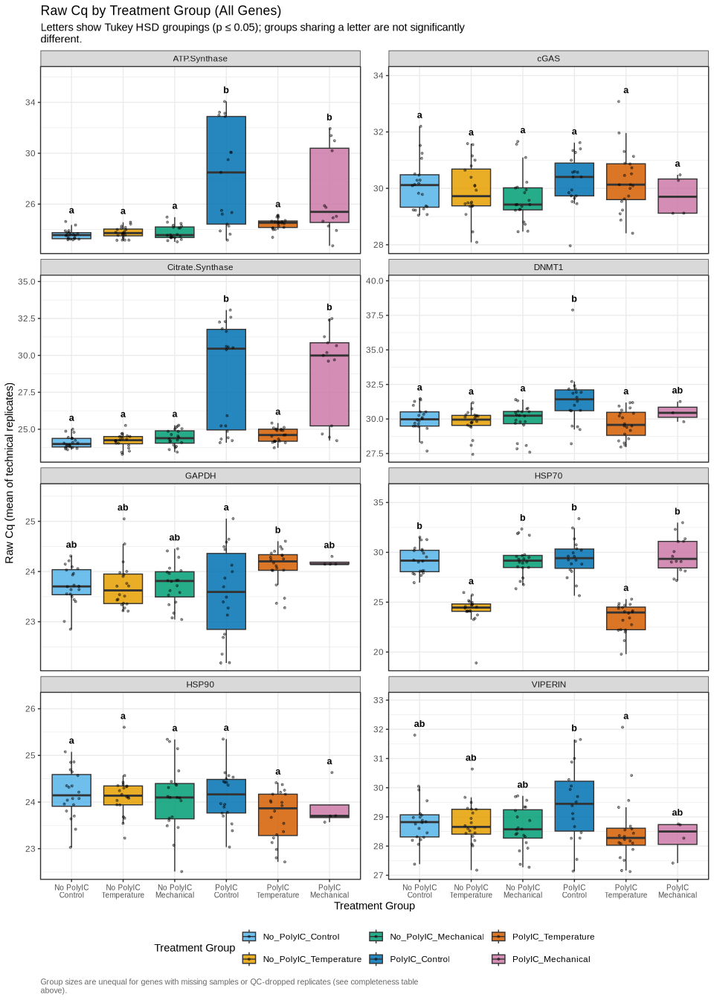

01.01-polyIC-qPCR-analysis
================
Sam White
2026-10-08

- [1 Background](#1-background)
- [2 Load Data](#2-load-data)
- [3 Data Cleaning](#3-data-cleaning)
  - [3.1 Remove NTC samples](#31-remove-ntc-samples)
  - [3.2 Check for high standard
    deviations](#32-check-for-high-standard-deviations)
  - [3.3 Remove outlier technical
    replicates](#33-remove-outlier-technical-replicates)
    - [3.3.1 Samples excluded due to quality
      control](#331-samples-excluded-due-to-quality-control)
- [4 Group and Summarize Data](#4-group-and-summarize-data)
- [5 Parse Sample Names and Add Treatment
  Columns](#5-parse-sample-names-and-add-treatment-columns)
  - [5.1 View treatment groups](#51-view-treatment-groups)
- [6 Raw Cq Variation Assessment for Normalizing Gene
  Selection](#6-raw-cq-variation-assessment-for-normalizing-gene-selection)
  - [6.1 Data completeness by gene](#61-data-completeness-by-gene)
  - [6.2 Raw Cq summary statistics (all
    genes)](#62-raw-cq-summary-statistics-all-genes)
  - [6.3 Box plots and statistical comparisons: raw Cq by treatment
    group (all
    genes)](#63-box-plots-and-statistical-comparisons-raw-cq-by-treatment-group-all-genes)
  - [6.4 Normalizing gene candidate
    ranking](#64-normalizing-gene-candidate-ranking)
- [7 Conclusion](#7-conclusion)

# 1 Background

Oyster larvae in this experiment were exposed to poly:IC (a synthetic
viral-infection mimic) and/or mechanical stress, crossed into six
treatment groups: `No_PolyIC_Control`, `No_PolyIC_Temperature`,
`No_PolyIC_Mechanical`, `PolyIC_Control`, `PolyIC_Temperature`, and
`PolyIC_Mechanical`. Expression of eight candidate genes (ATP.Synthase,
Citrate.Synthase, DNMT1, GAPDH, HSP70, HSP90, VIPERIN, cGAS) was
measured by qPCR.

Before relative-expression (delta-Cq) analysis can be performed on any
of these genes, a **normalizing (reference) gene** is needed – a gene
whose raw Cq is stable across all treatment groups, so that it can be
used to correct for sample-to-sample differences in input RNA/cDNA
quantity. A gene that itself responds to treatment is not a valid
normalizer, regardless of how technically consistent its measurement is.

This script identifies that normalizing gene. It:

1.  Loads and QCs the raw Cq data (removes NTC wells, flags
    high-variance technical replicates, removes outlier replicates).
2.  Summarizes raw Cq per sample/gene and parses treatment-group
    identity from sample names. For five genes (DNMT1, GAPDH, HSP90,
    VIPERIN, cGAS), `PolyIC_Control` draws on two complementary qPCR
    runs – an earlier run on Sam’s own biological samples and a
    2026-10-08 run that filled in the remaining notebook samples – and
    both are kept, consistent with how every other treatment group
    already combines samples from multiple runs.
3.  Compares raw Cq distributions across all six treatment groups for
    each gene via one-way ANOVA with Tukey HSD post-hoc testing.
4.  Ranks the eight candidate genes by coefficient of variation (CV%) of
    raw Cq, and flags any gene whose raw Cq differs significantly across
    treatment groups.

The gene identified here as the most stable, treatment-insensitive
candidate is carried forward as the normalizing gene in a separate
downstream relative-expression analysis script.

``` r
# Set output directory
output_dir <- "output/qPCR/01.00-polyIC-qPCR-analysis"
dir.create(output_dir, recursive = TRUE, showWarnings = FALSE)

knitr::opts_chunk$set(
  echo = TRUE,         # Display code chunks
  eval = TRUE,        # Evaluate code chunks
  warning = FALSE,     # Hide warnings
  message = FALSE,     # Hide messages
  comment = "",        # Prevents appending '##' to beginning of lines in code output
  fig.path = file.path(output_dir, "figures/")
)

library(tidyverse)
```

    ## Warning: Your system is mis-configured: '/etc/localtime' is not a symlink

    ## Warning: '/etc/localtime' is not identical to any known timezone file

    ## ── Attaching core tidyverse packages ──────────────────────── tidyverse 2.0.0 ──
    ## ✔ dplyr     1.2.1     ✔ readr     2.2.0
    ## ✔ forcats   1.0.1     ✔ stringr   1.6.0
    ## ✔ ggplot2   4.0.3     ✔ tibble    3.3.1
    ## ✔ lubridate 1.9.5     ✔ tidyr     1.3.2
    ## ✔ purrr     1.2.2     
    ## ── Conflicts ────────────────────────────────────────── tidyverse_conflicts() ──
    ## ✖ dplyr::filter() masks stats::filter()
    ## ✖ dplyr::lag()    masks stats::lag()
    ## ℹ Use the conflicted package (<http://conflicted.r-lib.org/>) to force all conflicts to become errors

``` r
library(ggplot2)
library(car)
```

    ## Loading required package: carData
    ## 
    ## Attaching package: 'car'
    ## 
    ## The following object is masked from 'package:dplyr':
    ## 
    ##     recode
    ## 
    ## The following object is masked from 'package:purrr':
    ## 
    ##     some

``` r
library(emmeans)
```

    ## Welcome to emmeans.
    ## Caution: You lose important information if you filter this package's results.
    ## See '? untidy'

``` r
library(multcomp)
```

    ## Loading required package: mvtnorm
    ## Loading required package: survival
    ## Loading required package: TH.data
    ## Loading required package: MASS
    ## 
    ## Attaching package: 'MASS'
    ## 
    ## The following object is masked from 'package:dplyr':
    ## 
    ##     select
    ## 
    ## 
    ## Attaching package: 'TH.data'
    ## 
    ## The following object is masked from 'package:MASS':
    ## 
    ##     geyser

# 2 Load Data

``` r
# Load qPCR data

# Define file URLs and target names in a structured format
file_list <- list(
  # CITRATE SYNTHASE
  list(url = "https://raw.githubusercontent.com/RobertsLab/polyIC-larvae/refs/heads/main/data/qPCR/Cq/sam_2026-01-27_15-32-08_Connect-citrate_synthase-01--Quantification-Cq_Results.csv", 
       target = "Citrate.Synthase", gene = "citrate_synthase"),
  list(url = "https://raw.githubusercontent.com/RobertsLab/polyIC-larvae/refs/heads/main/data/qPCR/Cq/sam_2026-01-27_15-30-47_CFX96-citrate_synthase-02-Quantification-Cq_Results.csv", 
       target = "Citrate.Synthase", gene = "citrate_synthase"),
  list(url = "https://raw.githubusercontent.com/RobertsLab/polyIC-larvae/refs/heads/main/data/qPCR/Cq/sam_2026-01-27_16-31-12_Connect-citrate_synthase-03-Quantification-Cq_Results.csv", 
       target = "Citrate.Synthase", gene = "citrate_synthase"),
  list(url = "https://raw.githubusercontent.com/RobertsLab/polyIC-larvae/refs/heads/main/data/qPCR/Cq/admin_2025-08-12%2011-18-15_Connect_citrate_VV-SJW-Quantification-Cq_Results.csv", 
       target = "Citrate.Synthase", gene = "citrate_synthase"),
  
  # DNMT1
  list(url = "https://raw.githubusercontent.com/RobertsLab/polyIC-larvae/refs/heads/main/data/qPCR/Cq/sam_2026-01-27_13-34-02_Connect-DNMT1-01-Quantification-Cq_Results.csv", 
       target = "DNMT1", gene = "DNMT1"),
  list(url = "https://raw.githubusercontent.com/RobertsLab/polyIC-larvae/refs/heads/main/data/qPCR/Cq/sam_2026-01-27_13-29-34_CFX96-DNMT1-02%20Quantification-Cq_Results.csv", 
       target = "DNMT1", gene = "DNMT1"),
  list(url = "https://raw.githubusercontent.com/RobertsLab/polyIC-larvae/refs/heads/main/data/qPCR/Cq/sam_2026-01-27_14-33-31_Connect-DNMT1-03-Quantification-Cq_Results.csv", 
       target = "DNMT1", gene = "DNMT1"),
  list(url = "https://github.com/RobertsLab/polyIC-larvae/raw/refs/heads/main/data/qPCR/Cq/sam_2026-10-08_09-19-38_Connect-DNMT1-Quantification-Cq_Results.csv", 
       target = "DNMT1", gene = "DNMT1"),
  
  # cGAS
  list(url = "https://raw.githubusercontent.com/RobertsLab/polyIC-larvae/refs/heads/main/data/qPCR/Cq/sam_2026-01-27_11-25-14_Connect-cGAS-01-Quantification-Cq_Results.csv", 
       target = "cGAS", gene = "cGAS"),
  list(url = "https://raw.githubusercontent.com/RobertsLab/polyIC-larvae/refs/heads/main/data/qPCR/Cq/sam_2026-01-27_11-49-08_CFX96-cGAS-02-Quantification-Cq_Results.csv", 
       target = "cGAS", gene = "cGAS"),
  list(url = "https://raw.githubusercontent.com/RobertsLab/polyIC-larvae/refs/heads/main/data/qPCR/Cq/sam_2026-01-27_12-35-04_Connect-cGAS-03-QuantificationCq_Results.csv", 
       target = "cGAS", gene = "cGAS"),
  list(url = "https://github.com/RobertsLab/polyIC-larvae/raw/refs/heads/main/data/qPCR/Cq/sam_2026-10-08_09-37-12_CFX96-cGAS-Quantification-Cq_Results.csv", 
       target = "cGAS", gene = "cGAS"),
  
  # ATP SYNTHASE
  list(url = "https://raw.githubusercontent.com/RobertsLab/polyIC-larvae/refs/heads/main/data/qPCR/Cq/sam_2026-01-28_09-56-00_Connect-ATP_synthase-01-QuantificationCq_Results.csv", 
       target = "ATP.Synthase", gene = "ATP_synthase"),
  list(url = "https://raw.githubusercontent.com/RobertsLab/polyIC-larvae/refs/heads/main/data/qPCR/Cq/sam_2026-01-28_10-13-15_CFX96-ATP_synthase-02-Quantification-Cq_Results.csv", 
       target = "ATP.Synthase", gene = "ATP_synthase"),
  list(url = "https://raw.githubusercontent.com/RobertsLab/polyIC-larvae/refs/heads/main/data/qPCR/Cq/sam_2026-01-28_10-55-49_Connect-ATP_synthase-03-Quantification-Cq_Results.csv", 
       target = "ATP.Synthase", gene = "ATP_synthase"),
  list(url = "https://raw.githubusercontent.com/RobertsLab/polyIC-larvae/refs/heads/main/data/qPCR/Cq/admin_2025-08-14%2011-11-18_Connect_ATPase_vv-SJW-Quantification-Cq_Results.csv", 
       target = "ATP.Synthase", gene = "ATP_synthase"),
  
  # GAPDH
  list(url = "https://raw.githubusercontent.com/RobertsLab/polyIC-larvae/refs/heads/main/data/qPCR/Cq/sam_2026-01-28_12-06-16_Connect-GAPDH-01-Quantification-Cq_Results.csv", 
       target = "GAPDH", gene = "GAPDH"),
  list(url = "https://raw.githubusercontent.com/RobertsLab/polyIC-larvae/refs/heads/main/data/qPCR/Cq/sam_2026-01-28_12-07-20_CFX96-GAPDH-02-Quantification-Cq_Results.csv", 
       target = "GAPDH", gene = "GAPDH"),
  list(url = "https://raw.githubusercontent.com/RobertsLab/polyIC-larvae/refs/heads/main/data/qPCR/Cq/sam_2026-01-28_13-05-59_Connect-GAPDH-03-Quantification-Cq_Results.csv", 
       target = "GAPDH", gene = "GAPDH"),
  list(url = "https://github.com/RobertsLab/polyIC-larvae/raw/refs/heads/main/data/qPCR/Cq/sam_2026-10-08_10-20-43_Connect-GAPDH-Quantification-Cq_Results.csv", 
       target = "GAPDH", gene = "GAPDH"),
  
  # HSP70
  list(url = "https://raw.githubusercontent.com/RobertsLab/polyIC-larvae/refs/heads/main/data/qPCR/Cq/sam_2026-01-28_14-03-35_Connect-HSP70-01-Quantification-Cq_Results.csv", 
       target = "HSP70", gene = "HSP70"),
  list(url = "https://raw.githubusercontent.com/RobertsLab/polyIC-larvae/refs/heads/main/data/qPCR/Cq/sam_2026-01-28_14-25-31_CFX96-HSP70-02-Quantification-Cq_Results.csv", 
       target = "HSP70", gene = "HSP70"),
  list(url = "https://raw.githubusercontent.com/RobertsLab/polyIC-larvae/refs/heads/main/data/qPCR/Cq/sam_2026-01-28_15-00-57_Connect-HSP70-03-Quantification-Cq_Results.csv", 
       target = "HSP70", gene = "HSP70"),
  list(url = "https://raw.githubusercontent.com/RobertsLab/polyIC-larvae/refs/heads/main/data/qPCR/Cq/admin_2025-08-12%2014-19-37_Connect_HSP70_vv-SJW-Quantification-Cq_Results.csv", 
       target = "HSP70", gene = "HSP70"),
  
  # HSP90
  list(url = "https://raw.githubusercontent.com/RobertsLab/polyIC-larvae/refs/heads/main/data/qPCR/Cq/sam_2026-01-28-16-06-43_Connect-HSP90-01-QuantificationCq_Results.csv", 
       target = "HSP90", gene = "HSP90"),
  list(url = "https://raw.githubusercontent.com/RobertsLab/polyIC-larvae/refs/heads/main/data/qPCR/Cq/sam_2026-01-28_16-07-47_CFX96-HSP90-02-Quantification-Cq_Results.csv", 
       target = "HSP90", gene = "HSP90"),
  list(url = "https://raw.githubusercontent.com/RobertsLab/polyIC-larvae/refs/heads/main/data/qPCR/Cq/sam_2026-01-28_17-07-09_Connect-HSP90-03-Quantification-Cq_Results.csv", 
       target = "HSP90", gene = "HSP90"),
  list(url = "https://github.com/RobertsLab/polyIC-larvae/raw/refs/heads/main/data/qPCR/Cq/sam_2026-10-08_09-37-12_CFX96-HSP90-Quantification-Cq_Results.csv", 
       target = "HSP90", gene = "HSP90"),
  
  # VIPERIN
  list(url = "https://raw.githubusercontent.com/RobertsLab/polyIC-larvae/refs/heads/main/data/qPCR/Cq/sam_2026-01-29_07-21-16_Connect-VIPERIN-01-QuantificationCq_Results.csv", 
       target = "VIPERIN", gene = "VIPERIN"),
  list(url = "https://raw.githubusercontent.com/RobertsLab/polyIC-larvae/refs/heads/main/data/qPCR/Cq/sam_2026-01-29_07-39-06_CFX96-VIPERIN-02-Quantification-Cq_Results.csv", 
       target = "VIPERIN", gene = "VIPERIN"),
  list(url = "https://raw.githubusercontent.com/RobertsLab/polyIC-larvae/refs/heads/main/data/qPCR/Cq/sam_2026-01-29_08-24-59_Connect-VIPERIN-03-QuantificationCq_Results.csv", 
       target = "VIPERIN", gene = "VIPERIN"),
  list(url = "https://github.com/RobertsLab/polyIC-larvae/raw/refs/heads/main/data/qPCR/Cq/sam_2026-10-08_09-19-38_Connect-VIPERIN-Quantification-Cq_Results.csv", 
       target = "VIPERIN", gene = "VIPERIN")
)

# Load all files and combine automatically
qpcr_data <- map_df(file_list, function(file_info) {
  read.csv(file_info$url) %>%
    mutate(Target = file_info$target,
           source_file = basename(file_info$url))
})
```

# 3 Data Cleaning

## 3.1 Remove NTC samples

``` r
# Remove rows with Sample name "NTC" or empty/NA Sample names
qpcr_data <- qpcr_data %>%
  filter(Sample != "NTC" & !is.na(Sample) & Sample != "")

str(qpcr_data)
```

    'data.frame':   2552 obs. of  17 variables:
     $ X                     : logi  NA NA NA NA NA NA ...
     $ Well                  : chr  "A01" "A02" "A03" "A04" ...
     $ Fluor                 : chr  "SYBR" "SYBR" "SYBR" "SYBR" ...
     $ Target                : chr  "Citrate.Synthase" "Citrate.Synthase" "Citrate.Synthase" "Citrate.Synthase" ...
     $ Content               : chr  "Unkn-01" "Unkn-01" "Unkn-01" "Unkn-02" ...
     $ Sample                : chr  "A1C" "A1C" "A1C" "A2C" ...
     $ Biological.Set.Name   : logi  NA NA NA NA NA NA ...
     $ Cq                    : num  24.1 24 23.8 25.1 24.7 ...
     $ Cq.Mean               : num  23.9 23.9 23.9 24.9 24.9 ...
     $ Cq.Std..Dev           : num  0.147 0.147 0.147 0.208 0.208 ...
     $ Starting.Quantity..SQ.: num  NaN NaN NaN NaN NaN NaN NaN NaN NaN NaN ...
     $ Log.Starting.Quantity : num  NaN NaN NaN NaN NaN NaN NaN NaN NaN NaN ...
     $ SQ.Mean               : num  NaN NaN NaN NaN NaN NaN NaN NaN NaN NaN ...
     $ SQ.Std..Dev           : num  NaN NaN NaN NaN NaN NaN NaN NaN NaN NaN ...
     $ Set.Point             : int  60 60 60 60 60 60 60 60 60 60 ...
     $ Well.Note             : logi  NA NA NA NA NA NA ...
     $ source_file           : chr  "sam_2026-01-27_15-32-08_Connect-citrate_synthase-01--Quantification-Cq_Results.csv" "sam_2026-01-27_15-32-08_Connect-citrate_synthase-01--Quantification-Cq_Results.csv" "sam_2026-01-27_15-32-08_Connect-citrate_synthase-01--Quantification-Cq_Results.csv" "sam_2026-01-27_15-32-08_Connect-citrate_synthase-01--Quantification-Cq_Results.csv" ...

## 3.2 Check for high standard deviations

``` r
# Filter out rows where Cq.Std..Dev is NA
qpcr_data <- qpcr_data[!is.na(qpcr_data$Cq.Std..Dev), ]

# Filter rows where Cq.Std..Dev is greater than 0.5
high_cq_std_dev <- qpcr_data[qpcr_data$Cq.Std..Dev > 0.5, ]

# Print the filtered rows with specified columns, without row names
print(high_cq_std_dev[, c("Target", "Sample", "Cq", "Cq.Std..Dev")], row.names = FALSE)
```

               Target Sample       Cq Cq.Std..Dev
     Citrate.Synthase   D4PC 23.58953   1.2262012
     Citrate.Synthase   D4PC 25.22609   1.2262012
     Citrate.Synthase   D4PC 25.98956   1.2262012
     Citrate.Synthase   C1PT 24.22698   0.6305806
     Citrate.Synthase   C1PT 24.09781   0.6305806
     Citrate.Synthase   C1PT 25.24885   0.6305806
     Citrate.Synthase   C5PT 24.30653   0.6151831
     Citrate.Synthase   C5PT 24.05928   0.6151831
     Citrate.Synthase   C5PT 25.22670   0.6151831
                DNMT1    A5M 30.84670   1.9690822
                DNMT1    A5M 27.36680   1.9690822
                DNMT1    A5M 30.70349   1.9690822
                DNMT1   D4PC 31.61104   0.6475757
                DNMT1   D4PC 31.51718   0.6475757
                DNMT1   D4PC 30.44542   0.6475757
                DNMT1   D5PC 31.81420   0.8774717
                DNMT1   D5PC 30.09977   0.8774717
                DNMT1   D5PC 31.28165   0.8774717
                DNMT1   D4PM 31.84097   0.6990197
                DNMT1   D4PM 31.56654   0.6990197
                DNMT1   D4PM 32.89094   0.6990197
                DNMT1   A3PT 31.37176   0.6647356
                DNMT1   A3PT 31.00085   0.6647356
                DNMT1   A3PT 32.29195   0.6647356
                DNMT1   C3PT 30.93391   1.9559044
                DNMT1   C3PT 34.32213   1.9559044
                DNMT1   C3PT 30.93490   1.9559044
                DNMT1   D4PT 28.51543   0.8274428
                DNMT1   D4PT 29.40357   0.8274428
                DNMT1   D4PT 30.16879   0.8274428
                DNMT1   B4PC 29.36018   2.4257208
                DNMT1   B4PC 29.50856   2.4257208
                DNMT1   B4PC 33.63388   2.4257208
                 cGAS    A1C 31.09889   0.5958513
                 cGAS    A1C 30.51096   0.5958513
                 cGAS    A1C 29.90723   0.5958513
                 cGAS    A3C 30.71172   0.6725415
                 cGAS    A3C 30.23246   0.6725415
                 cGAS    A3C 29.38366   0.6725415
                 cGAS    A4C 32.47341   0.5704754
                 cGAS    A4C 31.67087   0.5704754
                 cGAS    A4C 31.36981   0.5704754
                 cGAS    B1C 28.69140   1.5243846
                 cGAS    B1C 31.55769   1.5243846
                 cGAS    B1C 29.22481   1.5243846
                 cGAS    C1C 29.16134   0.7172895
                 cGAS    C1C 29.31145   0.7172895
                 cGAS    C1C 30.47195   0.7172895
                 cGAS    C3M 29.88386   1.8065816
                 cGAS    C3M 29.81184   1.8065816
                 cGAS    C3M 32.97631   1.8065816
                 cGAS    A5T 33.66309   2.4759798
                 cGAS    A5T 29.55374   2.4759798
                 cGAS    A5T 29.21543   2.4759798
                 cGAS   D4PC 29.52347   0.7216823
                 cGAS   D4PC 29.38534   0.7216823
                 cGAS   D4PC 30.69866   0.7216823
                 cGAS   B2PT 30.33579   2.9187950
                 cGAS   B2PT 35.74373   2.9187950
                 cGAS   B2PT 31.13614   2.9187950
                 cGAS   C2PT 29.41279   0.8378923
                 cGAS   C2PT 29.04691   0.8378923
                 cGAS   C2PT 30.64611   0.8378923
                 cGAS   D1PT 31.53902   1.1351264
                 cGAS   D1PT 33.08089   1.1351264
                 cGAS   D1PT 33.75305   1.1351264
         ATP.Synthase    B1M 21.94408   0.6345520
         ATP.Synthase    B1M 22.95451   0.6345520
         ATP.Synthase    B1M 23.11430   0.6345520
         ATP.Synthase   C3PC 24.15370   0.5694444
         ATP.Synthase   C3PC 23.19252   0.5694444
         ATP.Synthase   C3PC 23.14405   0.5694444
         ATP.Synthase   D3PT 24.70960   0.5708900
         ATP.Synthase   D3PT 24.60682   0.5708900
         ATP.Synthase   D3PT 25.64301   0.5708900
         ATP.Synthase   A1PC 29.49846   3.7832839
         ATP.Synthase   A1PC 30.53143   3.7832839
         ATP.Synthase   A1PC 23.52346   3.7832839
         ATP.Synthase   A2PC 29.79862   4.1202801
         ATP.Synthase   A2PC 30.34860   4.1202801
         ATP.Synthase   A2PC 22.95298   4.1202801
         ATP.Synthase   A4PC 31.51927   0.8092799
         ATP.Synthase   A4PC 32.72186   0.8092799
         ATP.Synthase   A4PC 33.05872   0.8092799
         ATP.Synthase   A2PC 29.22068   1.2680354
         ATP.Synthase   A2PC 31.04155   1.2680354
         ATP.Synthase   A2PC 31.65986   1.2680354
         ATP.Synthase   A1PM 25.88041   0.5968540
         ATP.Synthase   A1PM 25.38009   0.5968540
         ATP.Synthase   A1PM 26.56884   0.5968540
         ATP.Synthase   B1PC 28.20285   3.0574664
         ATP.Synthase   B1PC 33.21694   3.0574664
         ATP.Synthase   B1PC 33.74113   3.0574664
         ATP.Synthase   B2PC 31.61585   2.4554921
         ATP.Synthase   B2PC 26.77269   2.4554921
         ATP.Synthase   B2PC 28.48989   2.4554921
         ATP.Synthase   B5PC 33.25991   0.9734783
         ATP.Synthase   B5PC 33.02801   0.9734783
         ATP.Synthase   B5PC 34.81807   0.9734783
         ATP.Synthase   A2PM 31.87285   4.1105820
         ATP.Synthase   A2PM 25.74462   4.1105820
         ATP.Synthase   A2PM 24.06276   4.1105820
         ATP.Synthase   A3PM 37.05442   6.7379697
         ATP.Synthase   A3PM 23.69949   6.7379697
         ATP.Synthase   A3PM 31.93743   6.7379697
         ATP.Synthase   A4PM 30.86969   1.3433926
         ATP.Synthase   A4PM 31.10307   1.3433926
         ATP.Synthase   A4PM 33.30441   1.3433926
         ATP.Synthase   A5PM 23.07786   1.7068305
         ATP.Synthase   A5PM 23.92584   1.7068305
         ATP.Synthase   A5PM 26.36550   1.7068305
         ATP.Synthase   B1PM 31.02730   5.0891703
         ATP.Synthase   B1PM 23.83012   5.0891703
         ATP.Synthase   B2PM 30.27510   4.3654487
         ATP.Synthase   B2PM 24.10142   4.3654487
         ATP.Synthase   B3PM 38.17801   8.9249343
         ATP.Synthase   B3PM 22.96081   8.9249343
         ATP.Synthase   B3PM 22.48913   8.9249343
                GAPDH    A3T 22.96407   0.6473489
                GAPDH    A3T 23.45998   0.6473489
                GAPDH    A3T 24.24775   0.6473489
                HSP70    B5M 33.74524   0.8087996
                HSP70    B5M 32.37369   0.8087996
                HSP70    B5M 32.31676   0.8087996
                HSP70   B4PC 30.71240   0.6802331
                HSP70   B4PC 29.83791   0.6802331
                HSP70   B4PC 29.37261   0.6802331
                HSP70   A1PM 29.45236   3.1088225
                HSP70   A1PM 29.73179   3.1088225
                HSP70   A1PM 24.21288   3.1088225
                HSP70   A4PM 33.09655   0.6821469
                HSP70   A4PM 31.81483   0.6821469
                HSP70   A4PM 32.86049   0.6821469
                HSP70   B1PM 27.93827   0.5637303
                HSP70   B1PM 28.32120   0.5637303
                HSP70   B1PM 29.04810   0.5637303
                HSP90    B2C 24.79178   2.3098674
                HSP90    B2C 28.85831   2.3098674
                HSP90    B2C 24.92664   2.3098674

## 3.3 Remove outlier technical replicates

``` r
# Group by Sample and Target, then filter out the outlier replicate
qpcr_filtered <- qpcr_data %>%
  group_by(Sample, Target) %>%
  filter(n() == 1 | abs(Cq - median(Cq, na.rm = TRUE)) <= 0.5) %>%
  ungroup()

str(qpcr_filtered)
```

    tibble [2,427 × 17] (S3: tbl_df/tbl/data.frame)
     $ X                     : logi [1:2427] NA NA NA NA NA NA ...
     $ Well                  : chr [1:2427] "A01" "A02" "A03" "A04" ...
     $ Fluor                 : chr [1:2427] "SYBR" "SYBR" "SYBR" "SYBR" ...
     $ Target                : chr [1:2427] "Citrate.Synthase" "Citrate.Synthase" "Citrate.Synthase" "Citrate.Synthase" ...
     $ Content               : chr [1:2427] "Unkn-01" "Unkn-01" "Unkn-01" "Unkn-02" ...
     $ Sample                : chr [1:2427] "A1C" "A1C" "A1C" "A2C" ...
     $ Biological.Set.Name   : logi [1:2427] NA NA NA NA NA NA ...
     $ Cq                    : num [1:2427] 24.1 24 23.8 25.1 24.7 ...
     $ Cq.Mean               : num [1:2427] 23.9 23.9 23.9 24.9 24.9 ...
     $ Cq.Std..Dev           : num [1:2427] 0.147 0.147 0.147 0.208 0.208 ...
     $ Starting.Quantity..SQ.: num [1:2427] NaN NaN NaN NaN NaN NaN NaN NaN NaN NaN ...
     $ Log.Starting.Quantity : num [1:2427] NaN NaN NaN NaN NaN NaN NaN NaN NaN NaN ...
     $ SQ.Mean               : num [1:2427] NaN NaN NaN NaN NaN NaN NaN NaN NaN NaN ...
     $ SQ.Std..Dev           : num [1:2427] NaN NaN NaN NaN NaN NaN NaN NaN NaN NaN ...
     $ Set.Point             : int [1:2427] 60 60 60 60 60 60 60 60 60 60 ...
     $ Well.Note             : logi [1:2427] NA NA NA NA NA NA ...
     $ source_file           : chr [1:2427] "sam_2026-01-27_15-32-08_Connect-citrate_synthase-01--Quantification-Cq_Results.csv" "sam_2026-01-27_15-32-08_Connect-citrate_synthase-01--Quantification-Cq_Results.csv" "sam_2026-01-27_15-32-08_Connect-citrate_synthase-01--Quantification-Cq_Results.csv" "sam_2026-01-27_15-32-08_Connect-citrate_synthase-01--Quantification-Cq_Results.csv" ...

### 3.3.1 Samples excluded due to quality control

``` r
# Identify samples that were filtered out
all_samples <- qpcr_data %>%
  dplyr::select(Sample, Target) %>%
  distinct()

retained_samples <- qpcr_filtered %>%
  dplyr::select(Sample, Target) %>%
  distinct()

excluded_samples <- all_samples %>%
  anti_join(retained_samples, by = c("Sample", "Target"))

if(nrow(excluded_samples) > 0) {
  cat("Samples excluded from analysis due to high standard deviation (> 0.5):\n\n")
  excluded_samples %>%
    arrange(Target, Sample) %>%
    knitr::kable()
} else {
  cat("No samples were excluded from the analysis.\n")
}
```

    Samples excluded from analysis due to high standard deviation (> 0.5):

| Sample | Target           |
|:-------|:-----------------|
| B1PM   | ATP.Synthase     |
| B2PM   | ATP.Synthase     |
| A2PM   | Citrate.Synthase |
| D4PM   | DNMT1            |

# 4 Group and Summarize Data

``` r
# Group by Sample and Target, then summarize to get unique rows for each sample
grouped_df <- qpcr_filtered %>%
  group_by(Sample, Target) %>%
  summarise(
    Cq.Mean = mean(Cq, na.rm = TRUE),
    Cq.Std..Dev = sd(Cq, na.rm = TRUE),
    .groups = 'drop'
  )

str(grouped_df)
```

    tibble [841 × 4] (S3: tbl_df/tbl/data.frame)
     $ Sample     : chr [1:841] "A1C" "A1C" "A1C" "A1C" ...
     $ Target     : chr [1:841] "ATP.Synthase" "Citrate.Synthase" "DNMT1" "GAPDH" ...
     $ Cq.Mean    : num [1:841] 23.6 23.9 29.7 23.6 30.4 ...
     $ Cq.Std..Dev: num [1:841] 0.0674 0.1467 0.1991 0.3435 0.2572 ...

# 5 Parse Sample Names and Add Treatment Columns

Sample naming convention: Letter + Number + P (optional) + Treatment

- Letter: Biological replicate
- Number: Replicate number
- P: PolyIC treatment (absent if no PolyIC)
- C/T/M: Control/Temperature/Mechanical stress

``` r
# Parse sample names to extract treatment information
grouped_df <- grouped_df %>%
  mutate(
    # Extract biological replicate (first letter)
    bio_replicate = str_extract(Sample, "^[A-Z]"),
    
    # Extract replicate number
    replicate_num = str_extract(Sample, "\\d+"),
    
    # Check if PolyIC treatment (contains P)
    polyIC = ifelse(str_detect(Sample, "P"), "PolyIC", "No_PolyIC"),
    
    # Extract stress type (last letter: C, T, or M)
    stress_type = case_when(
      str_detect(Sample, "C$") ~ "Control",
      str_detect(Sample, "T$") ~ "Temperature",
      str_detect(Sample, "M$") ~ "Mechanical",
      TRUE ~ NA_character_
    ),
    
    # Create combined treatment group
    treatment_group = paste(polyIC, stress_type, sep = "_")
  )

str(grouped_df)
```

    tibble [841 × 9] (S3: tbl_df/tbl/data.frame)
     $ Sample         : chr [1:841] "A1C" "A1C" "A1C" "A1C" ...
     $ Target         : chr [1:841] "ATP.Synthase" "Citrate.Synthase" "DNMT1" "GAPDH" ...
     $ Cq.Mean        : num [1:841] 23.6 23.9 29.7 23.6 30.4 ...
     $ Cq.Std..Dev    : num [1:841] 0.0674 0.1467 0.1991 0.3435 0.2572 ...
     $ bio_replicate  : chr [1:841] "A" "A" "A" "A" ...
     $ replicate_num  : chr [1:841] "1" "1" "1" "1" ...
     $ polyIC         : chr [1:841] "No_PolyIC" "No_PolyIC" "No_PolyIC" "No_PolyIC" ...
     $ stress_type    : chr [1:841] "Control" "Control" "Control" "Control" ...
     $ treatment_group: chr [1:841] "No_PolyIC_Control" "No_PolyIC_Control" "No_PolyIC_Control" "No_PolyIC_Control" ...

## 5.1 View treatment groups

``` r
# Check the unique treatment groups
unique(grouped_df$treatment_group)
```

    [1] "No_PolyIC_Control"     "No_PolyIC_Mechanical"  "PolyIC_Control"       
    [4] "PolyIC_Mechanical"     "PolyIC_Temperature"    "No_PolyIC_Temperature"

``` r
# Count samples per treatment group
grouped_df %>%
  group_by(treatment_group, Target) %>%
  summarise(n_samples = n(), .groups = 'drop') %>%
  pivot_wider(names_from = Target, values_from = n_samples) %>%
  knitr::kable()
```

| treatment_group | ATP.Synthase | Citrate.Synthase | DNMT1 | GAPDH | HSP70 | HSP90 | VIPERIN | cGAS |
|:---|---:|---:|---:|---:|---:|---:|---:|---:|
| No_PolyIC_Control | 20 | 20 | 20 | 20 | 20 | 20 | 20 | 20 |
| No_PolyIC_Mechanical | 20 | 20 | 20 | 20 | 20 | 20 | 20 | 20 |
| No_PolyIC_Temperature | 20 | 20 | 20 | 20 | 20 | 20 | 20 | 20 |
| PolyIC_Control | 17 | 18 | 18 | 18 | 18 | 18 | 18 | 18 |
| PolyIC_Mechanical | 12 | 13 | 3 | 4 | 14 | 4 | 4 | 4 |
| PolyIC_Temperature | 20 | 20 | 20 | 20 | 20 | 20 | 20 | 20 |

# 6 Raw Cq Variation Assessment for Normalizing Gene Selection

This section evaluates **raw Cq values** (i.e., prior to any delta-Cq
normalization) for each gene, using the post-QC, per-sample mean Cq
already calculated in `grouped_df` (`Cq.Mean` = mean of technical
replicates per Sample x Target, after NTC removal, high Std. Dev.
filtering, and outlier technical-replicate removal above). The goal is
to identify which gene varies least across samples/treatment groups,
since a low and consistent raw Cq across all conditions is the defining
property of a good normalizing (“housekeeping”) gene. Genes whose
expression itself responds to treatment are poor normalizers, even if
technically “stable” in a QC sense.

Box plots and statistical group comparisons below include **every
gene**, including those missing some sample-gene combinations and/or
with samples dropped for QC (Std. Dev. or outlier-replicate filtering).
Treatment-group sample sizes are therefore unequal for genes with
missing data – the completeness table immediately below reports exactly
how many samples are missing/dropped per gene, so that result should be
read alongside the box plots and ANOVA results for those genes.

## 6.1 Data completeness by gene

``` r
# Define the "complete" sample universe as every Sample name that was actually run
# for AT LEAST ONE gene in this dataset. (A handful of samples -- e.g. some PolyIC +
# Mechanical combinations -- were never assayed for any gene, so they are not a fair
# basis for flagging other genes as "incomplete".)
rawcq_sample_universe <- grouped_df %>%
  dplyr::select(Sample) %>%
  distinct() %>%
  pull(Sample) %>%
  sort()

rawcq_all_genes <- sort(unique(grouped_df$Target))

cat("Sample universe size (samples run for >= 1 gene):", length(rawcq_sample_universe), "\n")
cat("Genes evaluated:", paste(rawcq_all_genes, collapse = ", "), "\n\n")

# Expected sample x gene combinations, given the sample universe above
rawcq_expected_combinations <- expand.grid(
  Sample = rawcq_sample_universe,
  Target = rawcq_all_genes,
  stringsAsFactors = FALSE
)

rawcq_actual_combinations <- grouped_df %>%
  dplyr::select(Sample, Target) %>%
  distinct()

rawcq_missing_combinations <- rawcq_expected_combinations %>%
  anti_join(rawcq_actual_combinations, by = c("Sample", "Target"))

rawcq_missing_by_gene <- rawcq_missing_combinations %>%
  group_by(Target) %>%
  summarise(n_missing = n(), .groups = "drop")

# Samples dropped for QC reasons (high Std. Dev. / outlier replicates), from the
# `excluded_samples` object computed above in the "Samples excluded due to quality
# control" chunk
rawcq_qc_dropped_by_gene <- excluded_samples %>%
  group_by(Target) %>%
  summarise(n_qc_dropped = n(), .groups = "drop")

gene_completeness <- data.frame(Target = rawcq_all_genes, stringsAsFactors = FALSE) %>%
  left_join(rawcq_missing_by_gene, by = "Target") %>%
  left_join(rawcq_qc_dropped_by_gene, by = "Target") %>%
  mutate(
    n_missing = ifelse(is.na(n_missing), 0, n_missing),
    n_qc_dropped = ifelse(is.na(n_qc_dropped), 0, n_qc_dropped),
    n_expected = length(rawcq_sample_universe),
    n_present = n_expected - n_missing,
    complete = (n_missing == 0) & (n_qc_dropped == 0)
  ) %>%
  dplyr::select(Target, n_expected, n_present, n_missing, n_qc_dropped, complete) %>%
  arrange(Target)

knitr::kable(gene_completeness,
             caption = "Data completeness by gene, relative to the full sample universe (post-QC)")

complete_genes <- gene_completeness %>%
  filter(complete) %>%
  pull(Target)

cat("\nGenes with a complete set of samples (none missing, none dropped for QC):\n  ",
    paste(complete_genes, collapse = ", "), "\n")
cat("\nAll genes are carried forward into the box plots and statistical tests below;",
    "treatment-group sample sizes are unequal for the incomplete genes listed above.\n")
```

    Sample universe size (samples run for >= 1 gene): 112 
    Genes evaluated: ATP.Synthase, cGAS, Citrate.Synthase, DNMT1, GAPDH, HSP70, HSP90, VIPERIN 

| Target           | n_expected | n_present | n_missing | n_qc_dropped | complete |
|:-----------------|-----------:|----------:|----------:|-------------:|:---------|
| ATP.Synthase     |        112 |       109 |         3 |            2 | FALSE    |
| Citrate.Synthase |        112 |       111 |         1 |            1 | FALSE    |
| DNMT1            |        112 |       101 |        11 |            1 | FALSE    |
| GAPDH            |        112 |       102 |        10 |            0 | FALSE    |
| HSP70            |        112 |       112 |         0 |            0 | TRUE     |
| HSP90            |        112 |       102 |        10 |            0 | FALSE    |
| VIPERIN          |        112 |       102 |        10 |            0 | FALSE    |
| cGAS             |        112 |       102 |        10 |            0 | FALSE    |

Data completeness by gene, relative to the full sample universe
(post-QC)

    Genes with a complete set of samples (none missing, none dropped for QC):
       HSP70 

    All genes are carried forward into the box plots and statistical tests below; treatment-group sample sizes are unequal for the incomplete genes listed above.

## 6.2 Raw Cq summary statistics (all genes)

``` r
raw_cq_summary <- grouped_df %>%
  group_by(Target) %>%
  summarise(
    n_samples = n(),
    mean_Cq = mean(Cq.Mean, na.rm = TRUE),
    sd_Cq = sd(Cq.Mean, na.rm = TRUE),
    median_Cq = median(Cq.Mean, na.rm = TRUE),
    min_Cq = min(Cq.Mean, na.rm = TRUE),
    max_Cq = max(Cq.Mean, na.rm = TRUE),
    range_Cq = max_Cq - min_Cq,
    cv_percent = (sd_Cq / mean_Cq) * 100,
    .groups = "drop"
  ) %>%
  left_join(gene_completeness %>% dplyr::select(Target, n_missing, n_qc_dropped, complete),
            by = "Target") %>%
  mutate(data_status = ifelse(complete,
                               "Complete (all samples, no QC drops)",
                               "Incomplete (missing/dropped samples present)")) %>%
  arrange(cv_percent) %>%
  mutate(rank_CV = row_number()) %>%
  dplyr::select(rank_CV, Target, n_samples, mean_Cq, sd_Cq, median_Cq, min_Cq, max_Cq,
                range_Cq, cv_percent, n_missing, n_qc_dropped, data_status)

knitr::kable(raw_cq_summary, digits = 3,
             caption = paste("Raw Cq summary statistics by gene, ranked by coefficient of",
                              "variation (CV%) -- lower CV indicates more stable raw Cq",
                              "across all samples/groups and greater suitability as a",
                              "normalizing gene. Genes flagged 'Incomplete' are missing",
                              "samples or had samples dropped for QC, so their CV may not be",
                              "directly comparable to the complete-data genes."))
```

| rank_CV | Target | n_samples | mean_Cq | sd_Cq | median_Cq | min_Cq | max_Cq | range_Cq | cv_percent | n_missing | n_qc_dropped | data_status |
|---:|:---|---:|---:|---:|---:|---:|---:|---:|---:|---:|---:|:---|
| 1 | GAPDH | 102 | 23.794 | 0.546 | 23.825 | 22.179 | 25.053 | 2.874 | 2.297 | 10 | 0 | Incomplete (missing/dropped samples present) |
| 2 | HSP90 | 102 | 24.043 | 0.578 | 24.079 | 22.510 | 25.604 | 3.094 | 2.404 | 10 | 0 | Incomplete (missing/dropped samples present) |
| 3 | cGAS | 102 | 30.046 | 0.952 | 29.976 | 27.964 | 33.081 | 5.117 | 3.170 | 10 | 0 | Incomplete (missing/dropped samples present) |
| 4 | VIPERIN | 102 | 28.827 | 1.008 | 28.620 | 27.128 | 32.071 | 4.943 | 3.497 | 10 | 0 | Incomplete (missing/dropped samples present) |
| 5 | DNMT1 | 101 | 30.125 | 1.367 | 30.204 | 27.439 | 37.882 | 10.444 | 4.538 | 11 | 1 | Incomplete (missing/dropped samples present) |
| 6 | ATP.Synthase | 109 | 24.897 | 2.570 | 24.113 | 22.725 | 34.070 | 11.345 | 10.324 | 3 | 2 | Incomplete (missing/dropped samples present) |
| 7 | Citrate.Synthase | 111 | 25.560 | 2.657 | 24.485 | 23.298 | 33.068 | 9.770 | 10.394 | 1 | 1 | Incomplete (missing/dropped samples present) |
| 8 | HSP70 | 112 | 27.400 | 3.123 | 28.116 | 18.904 | 33.380 | 14.476 | 11.398 | 0 | 0 | Complete (all samples, no QC drops) |

Raw Cq summary statistics by gene, ranked by coefficient of variation
(CV%) – lower CV indicates more stable raw Cq across all samples/groups
and greater suitability as a normalizing gene. Genes flagged
‘Incomplete’ are missing samples or had samples dropped for QC, so their
CV may not be directly comparable to the complete-data genes.

## 6.3 Box plots and statistical comparisons: raw Cq by treatment group (all genes)

``` r
treatment_order <- c("No_PolyIC_Control", "No_PolyIC_Temperature", "No_PolyIC_Mechanical",
                      "PolyIC_Control", "PolyIC_Temperature", "PolyIC_Mechanical")

rawcq_all_df <- grouped_df %>%
  mutate(treatment_group = factor(treatment_group, levels = treatment_order))

# One-way ANOVA per gene (Cq.Mean ~ treatment_group) with Tukey HSD post-hoc and
# a Compact Letter Display (CLD) for plot annotation. `emmeans:::cld.emmGrid` is
# called directly (rather than the `multcomp::cld()` generic) because the S3 method
# dispatch for emmGrid objects is sensitive to package load order in some sessions.
# Treatment-group sample sizes are unbalanced for genes with missing data (see the
# completeness table above); `aov`/`TukeyHSD`/`emmeans` all handle unbalanced designs,
# but statistical power is reduced for groups with few observations.
rawcq_anova_models <- list()
rawcq_tukey <- list()
rawcq_cld <- data.frame()

for (gene in rawcq_all_genes) {
  gene_df <- rawcq_all_df %>% filter(Target == gene)
  mod <- aov(Cq.Mean ~ treatment_group, data = gene_df)
  rawcq_anova_models[[gene]] <- mod
  rawcq_tukey[[gene]] <- TukeyHSD(mod)

  emm <- emmeans(mod, ~ treatment_group)
  cld_df <- as.data.frame(emmeans:::cld.emmGrid(emm, Letters = letters, alpha = 0.05))
  cld_df$Target <- gene
  cld_df$label <- trimws(cld_df$.group)
  rawcq_cld <- rbind(rawcq_cld, cld_df[, c("Target", "treatment_group", "label")])
}

rawcq_cld <- rawcq_cld %>%
  mutate(treatment_group = factor(treatment_group, levels = treatment_order))

# Position CLD letters above the max value for each gene x treatment_group panel
rawcq_y_range_per_gene <- rawcq_all_df %>%
  group_by(Target) %>%
  summarise(y_range = max(Cq.Mean, na.rm = TRUE) - min(Cq.Mean, na.rm = TRUE), .groups = "drop")

rawcq_y_max_per_group <- rawcq_all_df %>%
  group_by(Target, treatment_group) %>%
  summarise(max_y = max(Cq.Mean, na.rm = TRUE), .groups = "drop")

rawcq_cld_plot <- rawcq_cld %>%
  left_join(rawcq_y_max_per_group, by = c("Target", "treatment_group")) %>%
  left_join(rawcq_y_range_per_gene, by = "Target") %>%
  mutate(y_pos = max_y + y_range * 0.08)

# Colorblind-safe palette (Okabe-Ito categorical set). Control and Temperature
# are threaded by hue family (sky-blue/blue, orange/vermillion: No_PolyIC = the
# lighter member of the pair, PolyIC = the more saturated member); Mechanical
# uses two distinct Okabe-Ito hues rather than a lightness pair, since a
# lightened/darkened single-hue pair collapsed under simulated tritanopia.
# Verified via colorspace::deutan()/protan()/tritan() simulation + CIE Lab
# distance: minimum pairwise Delta-E across all three CVD types is 16.2 (well
# above the ~10 just-noticeable-difference threshold).
treatment_palette <- c(
  "No_PolyIC_Control" = "#56B4E9", "No_PolyIC_Temperature" = "#E69F00",
  "No_PolyIC_Mechanical" = "#009E73", "PolyIC_Control" = "#0072B2",
  "PolyIC_Temperature" = "#D55E00", "PolyIC_Mechanical" = "#CC79A7"
)

p_rawcq_all <- rawcq_all_df %>%
  ggplot(aes(x = treatment_group, y = Cq.Mean, fill = treatment_group)) +
  geom_boxplot(outlier.shape = NA, alpha = 0.85) +
  geom_jitter(width = 0.15, alpha = 0.4, size = 0.8) +
  facet_wrap(~Target, scales = "free_y", ncol = 2) +
  scale_fill_manual(values = treatment_palette) +
  scale_x_discrete(labels = function(x) str_wrap(gsub("_", " ", x), width = 9)) +
  scale_y_continuous(expand = expansion(mult = c(0.05, 0.15))) +
  coord_cartesian(clip = "off") +
  theme_bw(base_size = 11) +
  labs(
    title = "Raw Cq by Treatment Group (All Genes)",
    subtitle = paste(strwrap(
      paste("Letters show Tukey HSD groupings (p \u2264 0.05); groups sharing a letter",
            "are not significantly different."),
      width = 95), collapse = "\n"),
    caption = paste(strwrap(
      paste("Group sizes are unequal for genes with missing samples or QC-dropped",
            "replicates (see completeness table above)."),
      width = 110), collapse = "\n"),
    x = "Treatment Group", y = "Raw Cq (mean of technical replicates)", fill = "Treatment Group"
  ) +
  theme(axis.text.x = element_text(angle = 0, hjust = 0.5, vjust = 1, size = 7.5, lineheight = 0.85),
        plot.caption = element_text(hjust = 0, size = 8, color = "gray40"),
        legend.position = "bottom") +
  geom_text(data = rawcq_cld_plot, aes(x = treatment_group, y = y_pos, label = label),
            inherit.aes = FALSE, size = 3.3, fontface = "bold", color = "black")

print(p_rawcq_all)
```

<!-- -->

``` r
rawcq_anova_summary <- purrr::map_dfr(rawcq_all_genes, function(gene) {
  sm <- summary(rawcq_anova_models[[gene]])[[1]]
  data.frame(
    Target = gene,
    df_treatment = sm["treatment_group", "Df"],
    F_value = sm["treatment_group", "F value"],
    p_value = sm["treatment_group", "Pr(>F)"]
  )
}) %>%
  mutate(significant = p_value <= 0.05) %>%
  arrange(p_value)

knitr::kable(rawcq_anova_summary, digits = c(0, 0, 0, 3, 6, 0),
             caption = paste("One-way ANOVA (Cq.Mean ~ treatment_group) per gene.",
                              "A significant result (p <= 0.05) indicates raw Cq differs",
                              "across treatment groups -- i.e., the gene is NOT stable",
                              "across conditions and is a poor normalizing-gene candidate."))
```

| Target           | df_treatment | F_value | p_value | significant |
|:-----------------|-------------:|--------:|--------:|:------------|
| HSP70            |            5 |      63 |   0.000 | TRUE        |
| Citrate.Synthase |            5 |      26 |   0.000 | TRUE        |
| ATP.Synthase     |            5 |      17 |   0.000 | TRUE        |
| DNMT1            |            5 |       5 |   0.001 | TRUE        |
| GAPDH            |            5 |       3 |   0.030 | TRUE        |
| VIPERIN          |            5 |       2 |   0.043 | TRUE        |
| HSP90            |            5 |       2 |   0.089 | FALSE       |
| cGAS             |            5 |       1 |   0.321 | FALSE       |

One-way ANOVA (Cq.Mean ~ treatment_group) per gene. A significant result
(p \<= 0.05) indicates raw Cq differs across treatment groups – i.e.,
the gene is NOT stable across conditions and is a poor normalizing-gene
candidate.

## 6.4 Normalizing gene candidate ranking

``` r
cat("=== Candidate normalizing genes, ranked by raw Cq coefficient of variation (CV%) ===\n\n")
cat("All genes (lower CV = more stable raw Cq across all samples/treatments):\n\n")
print(raw_cq_summary %>% dplyr::select(rank_CV, Target, cv_percent, sd_Cq, range_Cq, data_status),
      row.names = FALSE)

cat("\n\nOne-way ANOVA significance (raw Cq ~ treatment_group), all genes:\n\n")
print(rawcq_anova_summary %>% dplyr::select(Target, F_value, p_value, significant),
      row.names = FALSE)

cat("\nNote: the CV ranking above and the ANOVA results above are two SEPARATE criteria,",
    "shown here side by side but not yet combined. A low overall CV is necessary but not",
    "sufficient for a good normalizer -- a gene can have a low CV (little raw variation",
    "overall) while still shifting systematically with treatment group (a significant",
    "ANOVA), which would make it unsuitable for normalization despite its low CV. This is",
    "exactly what happens below: the gene with the single lowest CV in this list is",
    "EXCLUDED in the Conclusion because its ANOVA is significant. The Conclusion section",
    "combines both criteria into one ranking -- see that table for the actual decision.",
    "Genes flagged 'Incomplete' have unequal group sizes due to missing/QC-dropped",
    "samples, which should be weighed when interpreting both criteria.\n")
```

    === Candidate normalizing genes, ranked by raw Cq coefficient of variation (CV%) ===

    All genes (lower CV = more stable raw Cq across all samples/treatments):

    # A tibble: 8 × 6
      rank_CV Target           cv_percent sd_Cq range_Cq data_status                
        <int> <chr>                 <dbl> <dbl>    <dbl> <chr>                      
    1       1 GAPDH                  2.30 0.546     2.87 Incomplete (missing/droppe…
    2       2 HSP90                  2.40 0.578     3.09 Incomplete (missing/droppe…
    3       3 cGAS                   3.17 0.952     5.12 Incomplete (missing/droppe…
    4       4 VIPERIN                3.50 1.01      4.94 Incomplete (missing/droppe…
    5       5 DNMT1                  4.54 1.37     10.4  Incomplete (missing/droppe…
    6       6 ATP.Synthase          10.3  2.57     11.3  Incomplete (missing/droppe…
    7       7 Citrate.Synthase      10.4  2.66      9.77 Incomplete (missing/droppe…
    8       8 HSP70                 11.4  3.12     14.5  Complete (all samples, no …


    One-way ANOVA significance (raw Cq ~ treatment_group), all genes:

               Target   F_value      p_value significant
                HSP70 62.983283 3.563159e-30        TRUE
     Citrate.Synthase 25.874059 6.126530e-17        TRUE
         ATP.Synthase 16.801940 4.107874e-12        TRUE
                DNMT1  4.812825 5.765237e-04        TRUE
                GAPDH  2.595916 3.016180e-02        TRUE
              VIPERIN  2.400263 4.261391e-02        TRUE
                HSP90  1.976985 8.892554e-02       FALSE
                 cGAS  1.188572 3.205570e-01       FALSE

    Note: the CV ranking above and the ANOVA results above are two SEPARATE criteria, shown here side by side but not yet combined. A low overall CV is necessary but not sufficient for a good normalizer -- a gene can have a low CV (little raw variation overall) while still shifting systematically with treatment group (a significant ANOVA), which would make it unsuitable for normalization despite its low CV. This is exactly what happens below: the gene with the single lowest CV in this list is EXCLUDED in the Conclusion because its ANOVA is significant. The Conclusion section combines both criteria into one ranking -- see that table for the actual decision. Genes flagged 'Incomplete' have unequal group sizes due to missing/QC-dropped samples, which should be weighed when interpreting both criteria.

# 7 Conclusion

``` r
# Combine both selection criteria into a single ranking. A candidate normalizing
# gene must first be STABLE across treatment groups (ANOVA p > 0.05 -- its Cq does
# not shift with condition); only among stable genes does a lower CV% make it a
# better choice. Sorting by `significant` before `cv_percent` means all stable
# ("Candidate") genes are ranked first by CV%, followed by all excluded genes --
# so the #1 row in this table is always the recommendation, and a gene with a
# lower raw CV% but a significant treatment effect (e.g. GAPDH) is correctly
# pushed below the stable candidates rather than appearing to outrank them.
candidate_table <- raw_cq_summary %>%
  dplyr::select(Target, cv_percent, data_status) %>%
  left_join(rawcq_anova_summary %>% dplyr::select(Target, p_value, significant), by = "Target") %>%
  mutate(
    verdict = ifelse(significant,
                      "Excluded \u2014 Cq shifts with treatment",
                      "Candidate \u2014 Cq stable across treatments")
  ) %>%
  arrange(significant, cv_percent) %>%
  mutate(rank = row_number(), recommended = "", .before = Target)

best_row <- which(!candidate_table$significant)[1]
if (!is.na(best_row)) candidate_table$recommended[best_row] <- "\u2b50"

display_table <- candidate_table %>%
  dplyr::select(rank, recommended, Target, cv_percent, data_status, p_value, verdict) %>%
  rename(
    Rank = rank, ` ` = recommended, Gene = Target, `Raw Cq CV (%)` = cv_percent,
    `Data completeness` = data_status, `ANOVA p (Cq ~ treatment)` = p_value,
    `Verdict` = verdict
  )

knitr::kable(display_table, digits = c(0, 0, 0, 2, 0, 4, 0),
             caption = paste("Candidate normalizing genes, ranked by suitability: stable genes",
                              "(no significant treatment effect) first, ordered by raw Cq CV% low",
                              "to high; excluded genes (significant treatment effect) follow, also",
                              "ordered by CV%. Rank 1 is the recommended normalizer."))

if (!is.na(best_row)) {
  best_gene <- candidate_table$Target[best_row]
  cat("\nRecommended normalizing gene:", best_gene, "\n")
  cat("  - Lowest raw Cq CV% (", round(candidate_table$cv_percent[best_row], 2),
      "%) among genes with no significant treatment-group effect (ANOVA p =",
      round(candidate_table$p_value[best_row], 3), ")\n")
} else {
  cat("\nNo gene showed a non-significant treatment effect -- re-evaluate assumptions",
      "before selecting a normalizer.\n")
}
```

| Rank |  | Gene | Raw Cq CV (%) | Data completeness | ANOVA p (Cq ~ treatment) | Verdict |
|---:|----|:---|---:|:---|---:|:---|
| 1 | ⭐ | HSP90 | 2.40 | Incomplete (missing/dropped samples present) | 0.0889 | Candidate — Cq stable across treatments |
| 2 |  | cGAS | 3.17 | Incomplete (missing/dropped samples present) | 0.3206 | Candidate — Cq stable across treatments |
| 3 |  | GAPDH | 2.30 | Incomplete (missing/dropped samples present) | 0.0302 | Excluded — Cq shifts with treatment |
| 4 |  | VIPERIN | 3.50 | Incomplete (missing/dropped samples present) | 0.0426 | Excluded — Cq shifts with treatment |
| 5 |  | DNMT1 | 4.54 | Incomplete (missing/dropped samples present) | 0.0006 | Excluded — Cq shifts with treatment |
| 6 |  | ATP.Synthase | 10.32 | Incomplete (missing/dropped samples present) | 0.0000 | Excluded — Cq shifts with treatment |
| 7 |  | Citrate.Synthase | 10.39 | Incomplete (missing/dropped samples present) | 0.0000 | Excluded — Cq shifts with treatment |
| 8 |  | HSP70 | 11.40 | Complete (all samples, no QC drops) | 0.0000 | Excluded — Cq shifts with treatment |

Candidate normalizing genes, ranked by suitability: stable genes (no
significant treatment effect) first, ordered by raw Cq CV% low to high;
excluded genes (significant treatment effect) follow, also ordered by
CV%. Rank 1 is the recommended normalizer.

    Recommended normalizing gene: HSP90 
      - Lowest raw Cq CV% ( 2.4 %) among genes with no significant treatment-group effect (ANOVA p = 0.089 )
